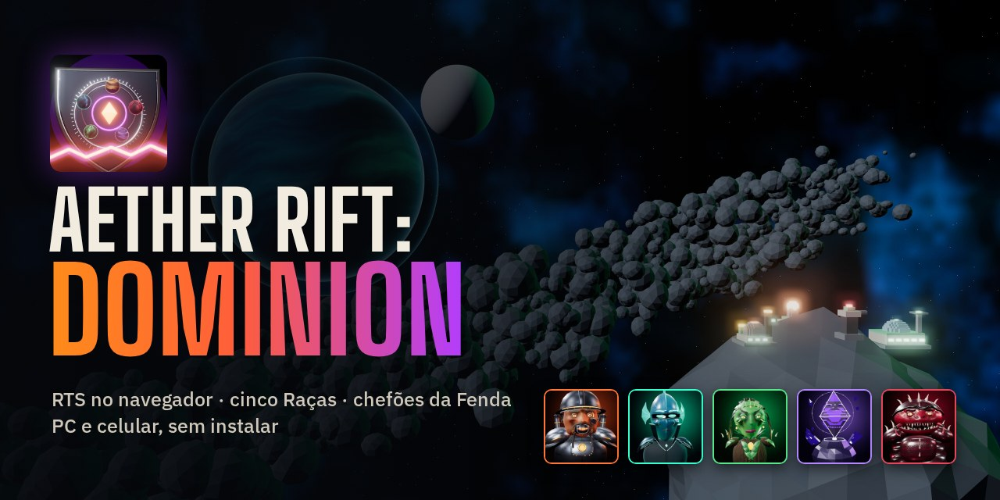
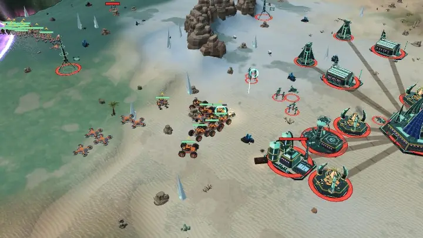
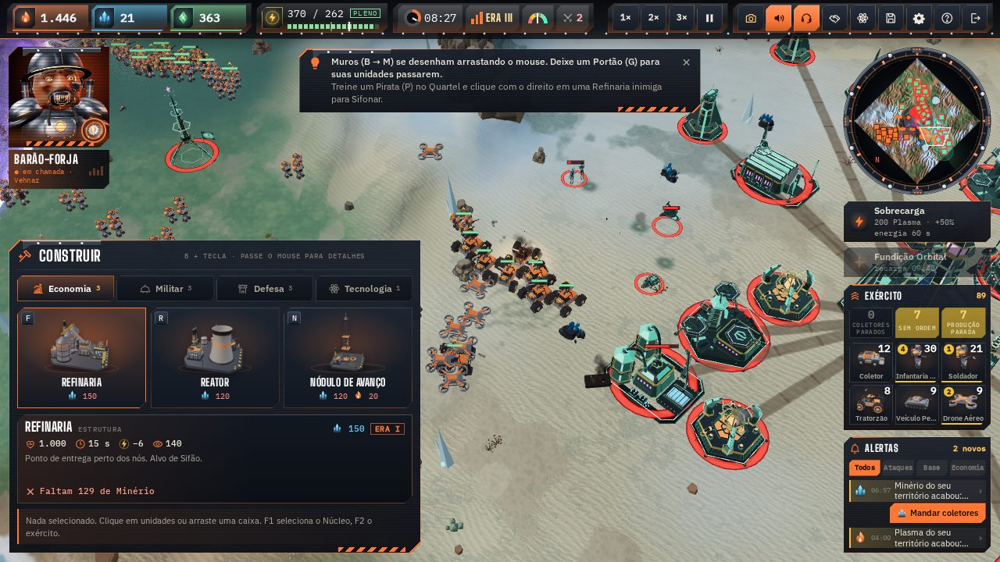
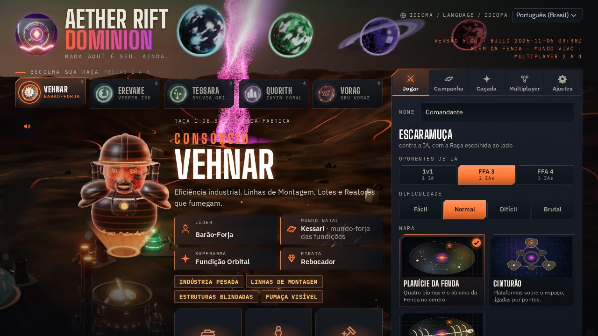
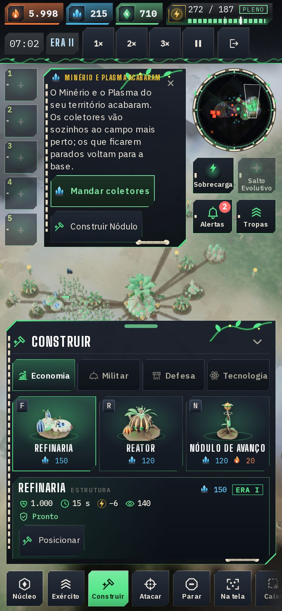
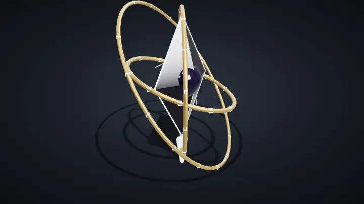

<p align="center">
  
</p>

<h1 align="center">Aether Rift: Dominion</h1>

<p align="center">
  <b>Real-time strategy in the browser.</b> Five Races fight over the Rift: build your base, harvest, steal, make pacts and take down bosses. On PC and phone, with nothing to install.
</p>

<p align="center">
  <a href="https://andreyrafael85.github.io/aether-rift-dominion/?lang=en"></a>
</p>

<p align="center">
  <a href="README.md">Português (Brasil)</a> · <b>English</b> · <a href="README.es.md">Español</a>
</p>

<p align="center">
  
</p>

> Playtest beta, version **5.0g.1**. The game opens in your browser's language and you can switch it in **Idioma / Language / Idioma** (start screen, Settings and the in-match window) or with `?lang=en`, `?lang=es` or `?lang=pt` in the link.

## Highlights

- **Five Races with their own style:** each has a leader, a homeworld, exclusive units, a Pirate, a superweapon and an Ascension. 29 unit types and 11 buildings per Race.
- **Skirmish** against 1 to 3 AIs (Easy, Normal, Hard and Brutal) on **Rift Plains**, **The Belt** and **Titan's Wreck**.
- **Campaign "The Great Alignment":** 20 missions, with stars, a Commander level, relics, achievements and the Hangar.
- **Rift bosses:** The Herald and The Mother Forge, with phases, attacks warned on the ground and rewards, in the **Hunt** mode (alone or with friends), plus the Rift Sentinel in the **Rift Events**.
- **Multiplayer for 2 to 4 friends** by room code, straight between browsers (no game server).
- **Theft and diplomacy:** Pirates siphon enemy Refineries and Reactors; Non-Aggression Pacts can be broken at the right moment.
- **Three languages with voice:** Portuguese, English and Spanish, with 766 recorded lines per language (leaders, announcer and units).
- **Works offline** after the first visit (campaign and solo matches) and can be installed as an app.

## How to play

Destroy the enemy Cores, or hold the most Dominion (territory, army and resources) when time runs out. Harvesters gather **Ore**, **Plasma** and **Data** inside your territory; **Reactors** give energy; the **Core** advances through the Eras (I Foundation, II Expansion, III Dominion) and unlocks heavy units, the superweapon and the Race Ascension.

<table>
<tr>
<td width="50%"></td>
<td width="50%"></td>
</tr>
</table>

### On PC

| Input | What it does |
|:--|:--|
| Click / drag | Select; drag for a selection box (Shift adds; double-click picks every unit of that type) |
| Right click | Move; on an enemy, attack; on a node, harvest; with a Pirate on an enemy Refinery or Reactor, siphon |
| A / S | Attack-move (click the destination) / Stop |
| B + letter | Build: R Reactor, F Refinery, Q Barracks, V Factory, H Hangar, T Tower, N Outpost, L Laboratory, M Wall, G Gate |
| Letters with a building selected | Produce (the key is shown on each button) |
| Ctrl+1–9 / 1–9 | Set / select a group |
| Middle button | Command wheel where the mouse is |
| WASD, arrows, wheel | Camera and zoom; hold the right button and drag to move the map |
| Q / E · PageUp / PageDown | Rotate / tilt the camera (Home goes back to the tactical view) |
| F1 / F2 / F / Space | Core / army / center the selection / last alert |
| J or 📷 | Photo Mode |
| P / H / Esc | Pause / help / cancel · Ctrl+S saves |

### On a phone



- Tap one of your units to select it (double tap: every unit of that type), then tap the ground to move or an enemy to attack.
- The bottom bar has Core, Army, Build, Attack, Stop, On screen, Box, Rotate and Tilt.
- A long press on the map opens the command wheel; dragging with two fingers moves, zooms and rotates the map.
- Groups 1–5 sit on the left: hold to save, tap to select.

The full help opens in the match with **H** or the **?** button.

<br clear="right">

## The five Races

| | Race | Play style |
|:-:|:--|:--|
|  | **[Vehnar Consortium](docs/racas/vehnar.en.md)**<br>Leader: Barão-Forja | Heavy industry: Assembly Lines speed up production, Batches cost half and the buildings are armored.<br>Superweapon: **Orbital Foundry**, a Bastion dropped from the sky. |
|  | **[Erevane](docs/racas/erevane.en.md)**<br>Leader: Vesper Ísk | Stealth and theft: cloaked infantry, Pirates and Outposts, clean theft and two Core Jumps.<br>Superweapon: **Blackout**, which shuts down enemy sensors and energy. |
|  | **[Tessara](docs/racas/tessara.en.md)**<br>Leader: Sylvia Oriel | Adaptation: units gain Traits against what they fight and the Core does Photosynthesis.<br>Superweapon: **Evolutionary Leap**, +35% damage for the whole army. |
|  | **[Quorith Choir](docs/racas/quorith.en.md)**<br>Leader: Zayin Coral | Sync: every nearby ally strengthens the Link; pacts cost half and enemy towers go silent.<br>Superweapon: **Unison**, the whole army in a full chord. |
|  | **[Vorag Brood](docs/racas/vorag.en.md)**<br>Leader: Oru Voraz | A cheap, fast swarm: Broodlings hatch in pairs and the Scavenger devours wrecks and Outposts.<br>Superweapon: **Hatching**, eggs that release Broodlings on the field. |

Each page shows the leader and the story, every unit and building with an image, cost and numbers, the abilities, the superweapon and the Ascension. The shared rules (Eras, research and counters) are in **[All Races](docs/racas/README.en.md)**.

## Bosses and modes

<p>
  
  
  
</p>

<p align="center">
  
</p>

- **The Herald** (three phases: Three Pillars, Echoes and Collapse) and **The Mother Forge** (March, Assembly Line and Exposed Core, which can also be captured).
- **Hunt:** pick the boss, the difficulty and the allies; gold, silver and bronze medals by time and losses.
- **Rift Events** in skirmish: Rift Sentinel, Corsair Caravan, Wandering Swarm and meteor showers.
- **Mutators:** Eternal Night, Frequent Storms and Scarce Resources.

Phases, attacks, health and rewards: **[Bosses and modes](docs/chefoes-e-modos.en.md)**.

## Engines and requirements

- **A current browser** (Chrome, Edge, Firefox or Safari) on PC or phone. The game is a single page; the libraries come from a CDN and are cached for offline play.
- **Classic engine** (Three.js on WebGL2): the default, with automatic quality based on FPS.
- **Engine 5** (WebGPU, falling back to WebGL2), in testing: physical sky, weather, war clouds, water and effects on the GPU. Turn it on in **Settings**.
- **2D mode**, light, for simpler devices.
- **Multiplayer:** PeerJS/WebRTC between browsers; the host relays the lockstep and the simulation is deterministic (the same result on Chrome, Firefox and Safari).

## Roadmap

The current version is **5.0g.1** (bosses, Hunt, Rift Events and mutators; 5.0g.1 adds new Vehnar and Vorag music and a wind-up before the boss). Next steps of v5.0 "Beyond the Rift":

- **5.0h — Intelligence and world:** AI with each leader's personality.
- **5.0i — Campaign 2:** 15 missions and the remaining bosses.
- **5.0j — New worlds:** one map per homeworld, with its own light and weather.
- **5.0k — Replays, clips and battle report.**

The full plan (in Portuguese), with what is done and why, is in [docs/plano-v5.md](docs/plano-v5.md); the v4 history and what is left for v6.0 (servers and scale), in [docs/plano-v4-v5.md](docs/plano-v4-v5.md).

## Run and build locally

The game has no npm dependencies: `index.html` is generated from `src/`.

```sh
node tools/build.mjs                     # builds index.html, sw.js, estilo.html and estilo3d.html
python3 -m http.server 8000              # serve the root over HTTP (the service worker and voices do not work on file://)
# open http://localhost:8000/
```

For the tests (they need Playwright: `npm install`):

```sh
node tools/vendor.mjs                    # copies Three.js to dist/vendor/ (offline tests)
node tools/qa.cjs                        # full quality gate: syntax, tests, determinism, smoke test of the 5 Races, build
node tools/docs-gerar.cjs                # rebuilds the Race and boss pages from the code
node tools/galeria.cjs                   # rebuilds the images in docs/imagens/ with the game's models
```

More tools (multiplayer with several browsers, cross-engine determinism, difficulty, campaign) are described at the top of each file in `tools/`.

## Project layout

```
aether-rift-dominion/
├─ index.html, sw.js, manifest.webmanifest   the published game (built; this is what GitHub Pages serves)
├─ assets/          approved art, icons, loading screens, posters, soundtrack, effects and recorded voices
├─ src/             game source: simulation, AI, 3D engines (classic and src/m5/ for Engine 5), interface and languages (src/i18n/)
├─ tools/           build, tests, QA and generators (docs, gallery, captures)
├─ docs/            documentation: Races, bosses and modes, plans, glossary and the images (docs/imagens/)
├─ lab/             active test benches (Engine 5, debris, sound on iPhone)
├─ prototipos/      old prototypes kept in one place: 2D and 3D style and screenshots of the first versions
├─ estilo.html, estilo3d.html                old visual proofs (built from prototipos/)
└─ ASSETS.md        origin and license of every art, sound and library
```

The documentation index is [docs/README.md](docs/README.md).

## Credits and licenses

- Game, code, models, art and voices: the Aether Rift: Dominion team (all rights reserved, see below).
- Soundtrack: tracks by Kevin MacLeod ([incompetech.com](https://incompetech.com)), CC BY 4.0.
- Libraries: Three.js (MIT), postprocessing (Zlib), N8AO (ISC), GSAP (Standard "No Charge" license), PeerJS (MIT); fonts Big Shoulders Display, IBM Plex Sans and IBM Plex Mono (SIL OFL 1.1).
- The full list, with the origin, author and license of every item, is in [ASSETS.md](ASSETS.md).

Playtest content. All rights reserved; redistribution outside this repository is not allowed without permission.

## Feedback

On the end screen, **Copy result (JSON)** copies a match summary to paste into an Issue, and **Send feedback** opens the [Issue template](https://github.com/andreyrafael85/aether-rift-dominion/issues/new?template=feedback.md) already filled in. What helps the most: where you got lost, whether the theft and the alerts were clear, whether the AI was fair and what was missing for the match to be fun. The automatic diagnostics sent with the feedback stay in Portuguese, for the developer.

Security issues: see [SECURITY.md](SECURITY.md).
