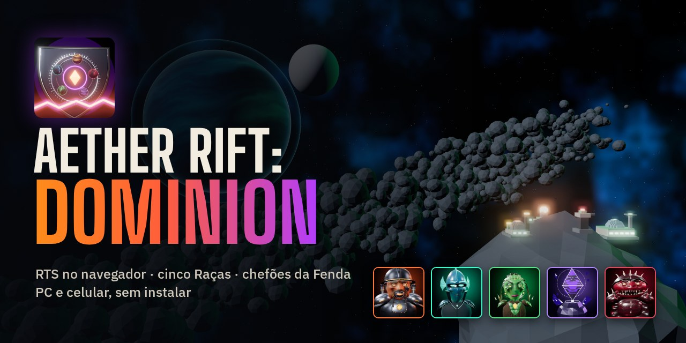
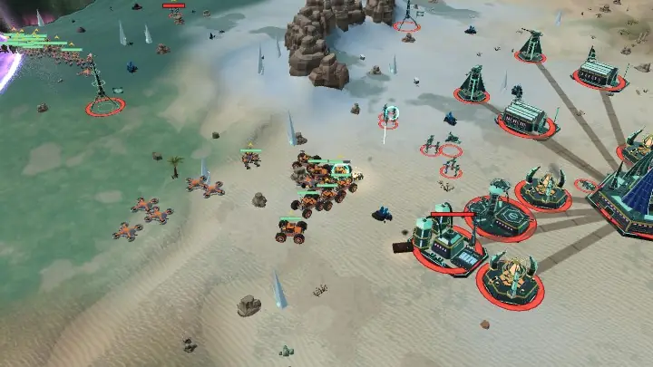
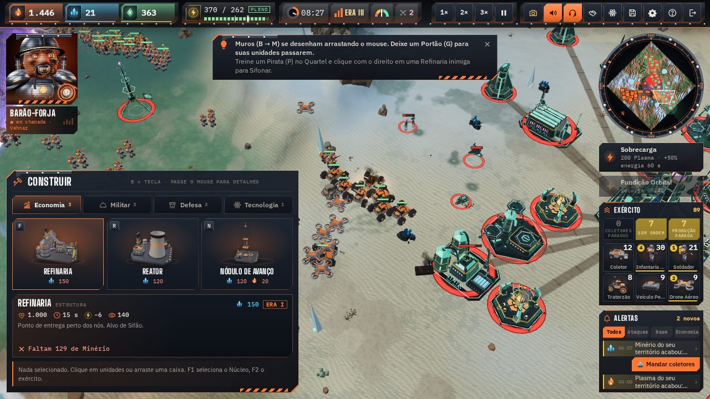
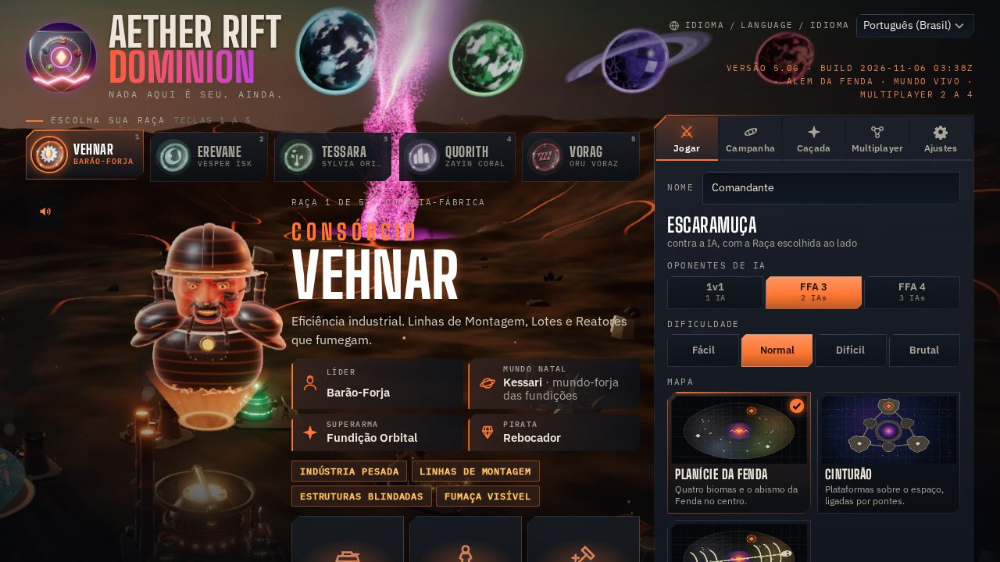
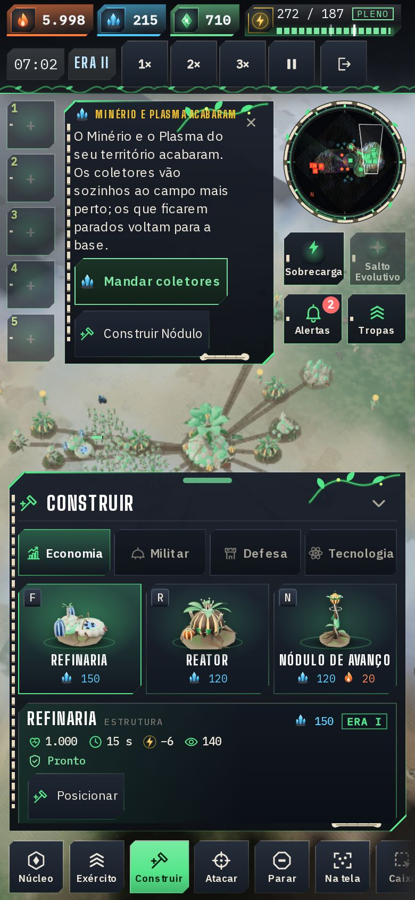
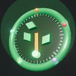
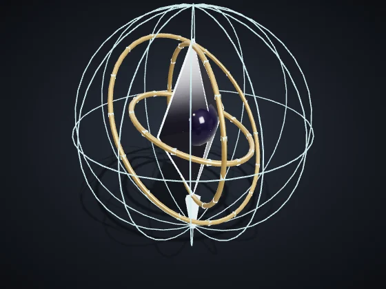
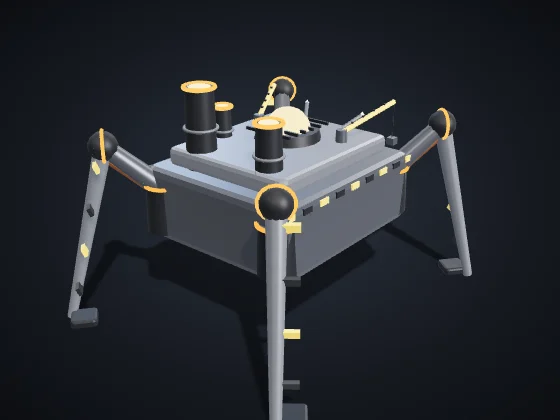
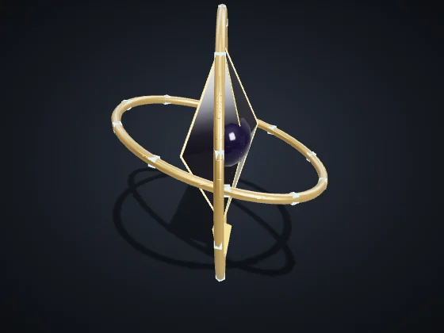
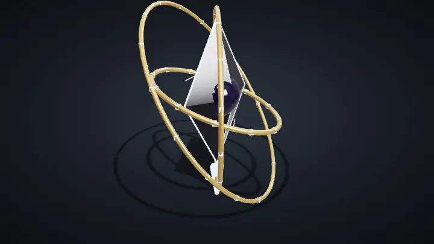

<p align="center">
  
</p>

<h1 align="center">Aether Rift: Dominion</h1>

<p align="center">
  <b>Estrategia en tiempo real en el navegador.</b> Cinco Razas se disputan la Grieta: construye tu base, recolecta, roba, haz pactos y derriba jefes. En la computadora y en el celular, sin instalar nada.
</p>

<p align="center">
  <a href="https://andreyrafael85.github.io/aether-rift-dominion/?lang=es"></a>
</p>

<p align="center">
  <a href="README.md">English</a> · <a href="README.pt-BR.md">Português (Brasil)</a> · <b>Español</b>
</p>

<p align="center">
  
</p>

> Beta de pruebas, versión **5.0h.1**. El juego abre en el idioma del navegador (español, inglés o portugués; cualquier otro idioma abre en inglés). Cámbialo en **Idioma / Language / Idioma** (pantalla de inicio, Ajustes y ventana de la partida) y el juego recuerda tu elección; `?lang=es`, `?lang=en` o `?lang=pt` en el enlace elige el idioma mientras no elijas uno.

## Lo más destacado

- **Cinco Razas con estilo propio:** cada una tiene líder, mundo natal, unidades exclusivas, Pirata, superarma y Ascensión. 29 tipos de unidad y 11 construcciones por Raza.
- **Escaramuza** contra 1 a 3 IA (Fácil, Normal, Difícil y Brutal) en los mapas **Llanura de la Grieta**, **El Cinturón** y **Restos del Titán**.
- **Campaña "La Gran Alineación":** 20 misiones, con estrellas, nivel de Comandante, reliquias, logros y el Hangar.
- **Jefes de la Grieta:** El Heraldo y La Forja Madre, con fases, golpes avisados en el suelo y recompensas, en el modo **Cacería** (solo o con amigos), y la Centinela de la Grieta en los **Eventos de la Grieta**.
- **Mundo vivo y Comandantes en el campo:** Ruinas de los Constructores para capturar, un campamento Corsario con mercenarios, la fauna de la Grieta y los surgimientos de éter; cada líder puede entrar al campo como un avatar con tres habilidades, y cada Raza tiene dos construcciones únicas y módulos a elegir.
- **Multijugador de 2 a 4 amigos** con código de sala, directo entre los navegadores (sin servidor de juego).
- **Robo y diplomacia:** los Piratas sifonan Refinerías y Reactores enemigos; los pactos de No Agresión se pueden romper en el momento justo.
- **Tres idiomas con voz:** portugués, inglés y español, con 766 líneas grabadas por idioma (líderes, locutor y unidades).
- **Funciona sin internet** después de la primera visita (campaña y partidas en solitario) y se puede instalar como app.

## Cómo jugar

El objetivo es destruir los Núcleos enemigos o tener más Dominio (territorio, ejército y recursos) cuando se acabe el tiempo. Los recolectores juntan **Mineral**, **Plasma** y **Datos** dentro de tu territorio; los **Reactores** dan energía; el **Núcleo** sube de Era (I Fundación, II Expansión, III Dominio) y desbloquea las unidades pesadas, la superarma y la Ascensión de la Raza.

<table>
<tr>
<td width="50%"></td>
<td width="50%"></td>
</tr>
</table>

### En la computadora

| Control | Qué hace |
|:--|:--|
| Clic / arrastrar | Selecciona; arrastrar dibuja el recuadro de selección (Shift suma; doble clic toma todas las del mismo tipo) |
| Botón derecho | Mueve; sobre un enemigo, ataca; sobre un nodo, recolecta; con un Pirata sobre una Refinería o un Reactor enemigo, sifona |
| A / S | Atacar-mover (clic en el destino) / Detener |
| B + letra | Construir: R Reactor, F Refinería, Q Cuartel, V Fábrica, H Hangar, T Torre, N Nódulo, L Laboratorio, M Muro, G Portón |
| Letras con una construcción seleccionada | Producir (la tecla aparece en cada botón) |
| Ctrl+1–9 / 1–9 | Guardar / seleccionar grupo |
| Botón central | Rueda de comandos donde está el mouse |
| WASD, flechas, rueda | Cámara y zoom; mantener el botón derecho y arrastrar mueve el mapa |
| Q / E · RePág / AvPág | Girar / inclinar la cámara (Inicio vuelve a la vista táctica) |
| F1 / F2 / F / Espacio | Núcleo / ejército / centrar la selección / última alerta |
| J o 📷 | Modo Foto |
| P / H / Esc | Pausar / ayuda / cancelar · Ctrl+S guarda |

### En el celular



- Toca una de tus unidades para seleccionarla (doble toque: todas las de ese tipo); después toca el suelo para mover o al enemigo para atacar.
- La barra inferior tiene Núcleo, Ejército, Construir, Atacar, Detener, En pantalla, Recuadro, Girar e Inclinar la cámara.
- Un toque largo en el mapa abre la rueda de comandos; arrastrar con dos dedos mueve, acerca y gira el mapa.
- Los grupos 1–5 están a la izquierda: mantén para guardar, toca para seleccionar.

La ayuda completa se abre en la partida con **H** o con el botón **?**.

<br clear="right">

## Las cinco Razas

| | Raza | Estilo de juego |
|:-:|:--|:--|
|  | **[Consorcio Vehnar](docs/racas/vehnar.es.md)**<br>Líder: Barão-Forja | Industria pesada: las Líneas de Montaje aceleran la producción, los Lotes cuestan la mitad y las construcciones están blindadas.<br>Superarma: **Fundición Orbital**, un Bastión que cae del cielo. |
|  | **[Erevane](docs/racas/erevane.es.md)**<br>Líder: Vesper Ísk | Sigilo y robo: infantería, Piratas y Nódulos camuflados, robo limpio y dos Saltos de Núcleo.<br>Superarma: **Apagón**, que apaga los sensores y la energía del enemigo. |
|  | **[Tessara](docs/racas/tessara.es.md)**<br>Líder: Sylvia Oriel | Adaptación: las unidades ganan Rasgos contra lo que combaten y el Núcleo hace Fotosíntesis.<br>Superarma: **Salto Evolutivo**, +35 % de daño para todo el ejército. |
|  | **[Coro Quorith](docs/racas/quorith.es.md)**<br>Líder: Zayin Coral | Sincronía: cada aliado cercano refuerza el Enlace; los pactos cuestan la mitad y las torres enemigas enmudecen.<br>Superarma: **Unísono**, todo el ejército en acorde pleno. |
|  | **[Prole Vorag](docs/racas/vorag.es.md)**<br>Líder: Oru Voraz | Enjambre barato y rápido: las Crías nacen en pares y el Carroñero devora restos y Nódulos.<br>Superarma: **Eclosión**, huevos que sueltan Crías en el campo. |

Cada página muestra el líder y la historia, cada unidad y construcción con imagen, costo y números, las habilidades, la superarma, la Ascensión, el Comandante en el campo y las dos construcciones únicas. Las reglas comunes (Eras, investigaciones, módulos y ventajas) están en **[Todas las Razas](docs/racas/README.es.md)**.

## Jefes y modos

<p>
  
  
  
</p>

<p align="center">
  
</p>

- **El Heraldo** (tres fases: Tres Pilares, Ecos y Colapso) y **La Forja Madre** (Marcha, Línea de montaje y Núcleo expuesto, que también se puede capturar).
- **Cacería:** elige el jefe, la dificultad y los aliados; medallas de oro, plata y bronce por tiempo y bajas.
- **Eventos de la Grieta** en la escaramuza: Centinela de la Grieta, Caravana Corsaria, Enjambre Errante y lluvia de meteoros.
- **Mutadores:** Noche Eterna, Tormentas Frecuentes y Recursos Escasos.

Fases, golpes, vida y recompensas, y el Mundo vivo: **[Jefes y modos](docs/bosses-and-modes.es.md)**.

## Motores y requisitos

- **Un navegador actual** (Chrome, Edge, Firefox o Safari) en la computadora o el celular. El juego es una sola página; las bibliotecas vienen de un CDN y quedan guardadas para jugar sin internet.
- **Motor clásico** (Three.js con WebGL2): el predeterminado, con calidad automática según los FPS.
- **Motor 5** (WebGPU, con respaldo en WebGL2), en pruebas: cielo físico, clima, nubes de guerra, agua y efectos en la GPU. Se activa en **Ajustes**.
- **Modo 2D** ligero, para equipos más sencillos.
- **Multijugador:** PeerJS/WebRTC entre los navegadores; el anfitrión hace de relé del lockstep y la simulación es determinista (el mismo resultado en Chrome, Firefox y Safari).

## Hoja de ruta

La versión actual es la **5.0h.1** (IA con la personalidad de cada líder, Mundo vivo, construcciones únicas, módulos y Comandantes en campo; la 5.0g trajo los jefes, la Cacería, los Eventos de la Grieta y los mutadores). Los próximos pasos de la v5.0 "Más allá de la Grieta":

- **5.0h — Inteligencia y mundo** ✔: IA con la personalidad de cada líder, Mundo vivo, construcciones únicas y Comandantes en campo.
- **5.0i — Campaña 2:** 15 misiones y los jefes que faltan.
- **5.0j — Mundos nuevos:** un mapa por mundo natal, con luz y clima propios.
- **5.0k — Repeticiones, clips e informe de batalla.**

El plan completo (en portugués), con lo hecho y el porqué de cada decisión, está en [docs/plano-v5.md](docs/plano-v5.md); la historia de la v4 y lo que queda para la v6.0 (servidores y escala), en [docs/plano-v4-v5.md](docs/plano-v4-v5.md).

## Ejecutar y compilar localmente

El juego no tiene dependencias de npm: `index.html` se genera a partir de `src/`.

```sh
node tools/build.mjs                     # genera index.html, sw.js, estilo.html y estilo3d.html
python3 -m http.server 8000              # sirve la raíz por HTTP (el service worker y las voces no funcionan en file://)
# abre http://localhost:8000/
```

Para las pruebas (necesitan Playwright: `npm install`):

```sh
node tools/vendor.mjs                    # copia Three.js a dist/vendor/ (pruebas sin red)
node tools/qa.cjs                        # control de calidad completo: sintaxis, pruebas, determinismo, prueba rápida de las 5 Razas, build
node tools/docs-gerar.cjs                # rehace las páginas de las Razas y de los jefes a partir del código
node tools/galeria.cjs                   # rehace las imágenes de docs/imagens/ con los modelos del juego
```

Más herramientas (multijugador con varios navegadores, determinismo entre motores, dificultad, campaña) se describen al inicio de cada archivo en `tools/`.

## Estructura del proyecto

```
aether-rift-dominion/
├─ index.html, sw.js, manifest.webmanifest   el juego publicado (generados por el build; es lo que sirve GitHub Pages)
├─ assets/          arte aprobado, íconos, pantallas de carga, pósteres, música, efectos y voces grabadas
├─ src/             código fuente: simulación, IA, motores 3D (clásico y src/m5/ del Motor 5), interfaz e idiomas (src/i18n/)
├─ tools/           build, pruebas, QA y generadores (documentación, galería, capturas)
├─ docs/            documentación: Razas, jefes y modos, planes, glosario y las imágenes (docs/imagens/)
├─ lab/             bancos de prueba activos (Motor 5, escombros, sonido en iPhone)
├─ prototipos/      prototipos antiguos guardados: las pruebas de estilo 2D y 3D
├─ estilo.html, estilo3d.html                pruebas visuales antiguas (generadas a partir de prototipos/)
└─ ASSETS.md        origen y licencia de cada arte, sonido y biblioteca
```

El índice de la documentación está en [docs/README.md](docs/README.md).

## Créditos y licencias

- Juego, código, modelos, arte y voces: el autor de Aether Rift: Dominion (todos los derechos reservados, ver [Licencia](#licencia)).
- Música: pistas de Kevin MacLeod ([incompetech.com](https://incompetech.com)), licencia CC BY 4.0.
- Bibliotecas: Three.js (MIT), postprocessing (Zlib), N8AO (ISC), GSAP (licencia Standard "No Charge"), PeerJS (MIT); fuentes Big Shoulders Display, IBM Plex Sans e IBM Plex Mono (SIL OFL 1.1).
- La lista completa, con el origen, el autor y la licencia de cada elemento, está en [ASSETS.md](ASSETS.md).

## Licencia

Aether Rift: Dominion **no es código abierto**. El código, el arte, las voces, la música propia, el nombre y las Razas y personajes son del autor, con todos los derechos reservados: no se permite copiar, redistribuir, publicar versiones modificadas ni vender el juego. **Puedes jugarlo, compartir el enlace, transmitirlo y hacer videos y capturas, incluso monetizados, y escribir sobre él.** Las piezas de terceros siguen sus propias licencias, listadas en [ASSETS.md](ASSETS.md). El texto que vale es el [LICENSE](LICENSE), en inglés; la traducción de cortesía está en [LICENSE.es.md](LICENSE.es.md).

## Comentarios

En la pantalla final, **Copiar resultado (JSON)** copia un resumen de la partida para pegarlo en un Issue, y **Enviar comentarios** abre la [plantilla de Issue](https://github.com/andreyrafael85/aether-rift-dominion/issues/new?template=feedback.md) ya completa. Lo que más ayuda: dónde te perdiste, si el robo y las alertas quedaron claros, si la IA fue justa y qué faltó para que la partida fuera divertida. El diagnóstico automático que acompaña los comentarios queda en portugués, para el desarrollador.

Problemas de seguridad: ver [SECURITY.es.md](SECURITY.es.md).
