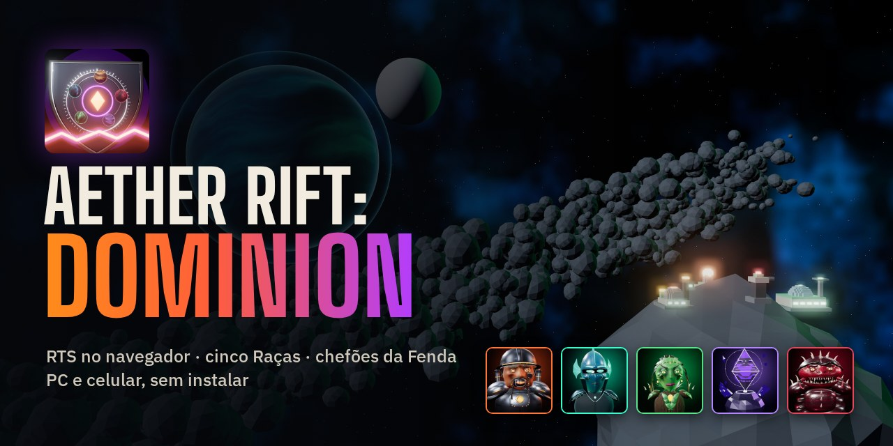
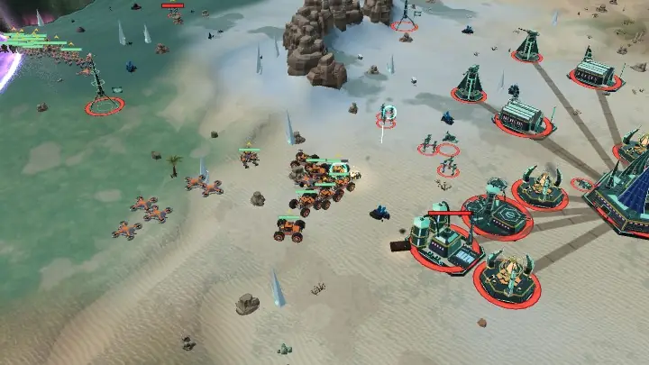
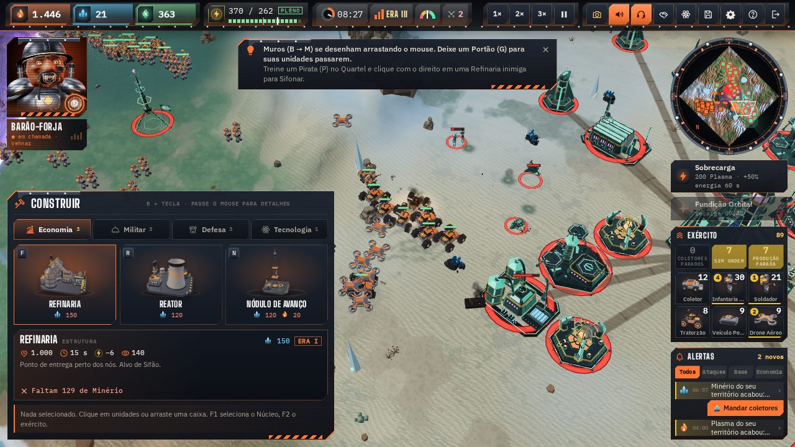
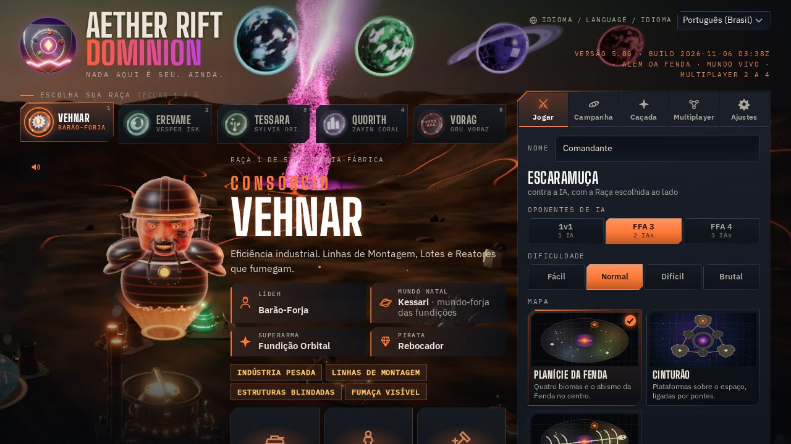
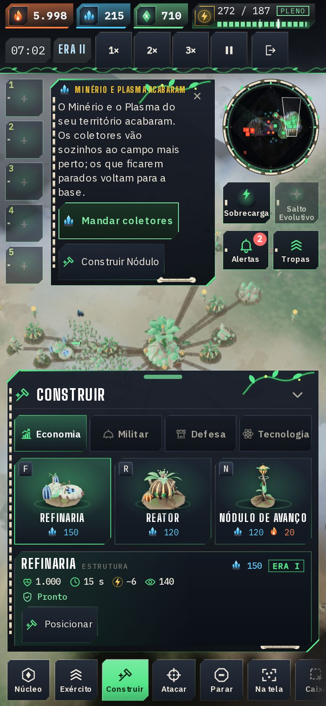
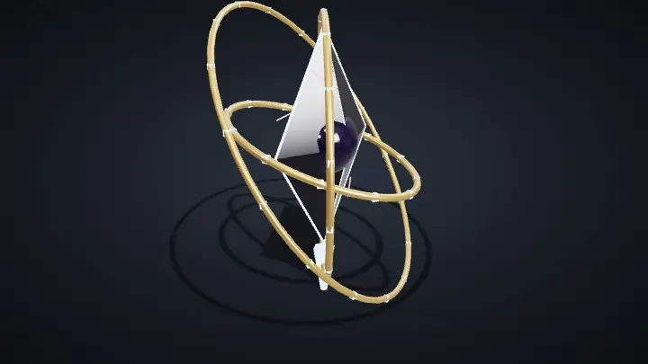

<p align="center">
  
</p>

<h1 align="center">Aether Rift: Dominion</h1>

<p align="center">
  <b>Estratégia em tempo real no navegador.</b> Cinco Raças disputam a Fenda: construa a base, colha, roube, faça pactos e derrube chefões. No computador e no celular, sem instalar nada.
</p>

<p align="center">
  <a href="https://andreyrafael85.github.io/aether-rift-dominion/?lang=pt"></a>
</p>

<p align="center">
  <a href="README.md">English</a> · <b>Português (Brasil)</b> · <a href="README.es.md">Español</a>
</p>

<p align="center">
  
</p>

> Beta de testes, versão **5.0h.1**. O jogo abre no idioma do navegador (português, inglês ou espanhol; qualquer outro idioma abre em inglês). Troque em **Idioma / Language / Idioma** (tela inicial, Ajustes e janela da partida) e o jogo guarda a escolha; `?lang=pt`, `?lang=en` ou `?lang=es` no link escolhe o idioma enquanto você não escolher um.

## Destaques

- **Cinco Raças com estilo próprio:** cada uma tem líder, mundo natal, unidades exclusivas, Pirata, superarma e Ascensão. São 29 tipos de unidade e 11 construções por Raça.
- **Escaramuça** contra 1 a 3 IAs (Fácil, Normal, Difícil e Brutal) nos mapas **Planície da Fenda**, **Cinturão** e **Destroço do Titã**.
- **Campanha "O Grande Alinhamento":** 20 missões, com estrelas, nível de Comandante, relíquias, conquistas e o Hangar.
- **Chefões da Fenda:** O Arauto e A Forja-Mãe, com fases, golpes avisados no chão e recompensas, no modo **Caçada** (sozinho ou com amigos), e a Sentinela da Fenda nos **Eventos da Fenda**.
- **Mundo vivo e Comandantes em campo:** Ruínas dos Construtores para capturar, um acampamento Corsário com mercenários, a fauna da Fenda e os surtos de éter; cada líder pode entrar em campo como um avatar com três habilidades, e cada Raça tem duas construções únicas e módulos com escolha.
- **Multiplayer de 2 a 4 amigos** por código de sala, direto entre os navegadores (sem servidor de jogo).
- **Roubo e diplomacia:** Piratas sifonam Refinarias e Reatores inimigos; pactos de Não-agressão podem ser quebrados na hora certa.
- **Três idiomas com voz:** português, inglês e espanhol, com 766 falas gravadas por idioma (líderes, locutor e unidades).
- **Funciona sem internet** depois da primeira visita (campanha e partidas solo) e pode ser instalado como app.

## Como jogar

O objetivo é destruir os Núcleos inimigos ou ter mais Domínio (território, exército e recursos) quando o tempo acabar. Os coletores colhem **Minério**, **Plasma** e **Dados** dentro do seu território; os **Reatores** dão energia; o **Núcleo** evolui de Era (I Fundação, II Expansão, III Domínio) e libera as unidades pesadas, a superarma e a Ascensão da Raça.

<table>
<tr>
<td width="50%"></td>
<td width="50%"></td>
</tr>
</table>

### No computador

| Comando | O que faz |
|:--|:--|
| Clique / arrastar | Seleciona; arrastar faz a caixa de seleção (Shift adiciona; duplo clique pega todas do mesmo tipo) |
| Botão direito | Move; em inimigo, ataca; em nó, colhe; com Pirata em Refinaria ou Reator inimigo, sifona |
| A / S | Atacar-mover (clique no destino) / Parar |
| B + letra | Construir: R Reator, F Refinaria, Q Quartel, V Fábrica, H Hangar, T Torre, N Nódulo, L Laboratório, M Muro, G Portão |
| Letras com a construção selecionada | Produzir (a tecla aparece em cada botão) |
| Ctrl+1–9 / 1–9 | Gravar / selecionar grupo |
| Botão do meio | Roda de comandos onde o mouse está |
| WASD, setas, roda | Câmera e zoom; segurar o botão direito e arrastar move o mapa |
| Q / E · PageUp / PageDown | Girar / inclinar a câmera (Home volta à visão tática) |
| F1 / F2 / F / Espaço | Núcleo / exército / centralizar a seleção / último alerta |
| J ou 📷 | Modo Foto |
| P / H / Esc | Pausar / ajuda / cancelar · Ctrl+S salva |

### No celular



- Toque numa unidade sua para selecionar (dois toques: todas do tipo); depois toque no chão para mover ou no inimigo para atacar.
- A barra de baixo tem Núcleo, Exército, Construir, Atacar, Parar, Na tela, Caixa, Girar e Inclinar a câmera.
- Toque longo no mapa abre a roda de comandos; arrastar com dois dedos move, aproxima e gira o mapa.
- Os grupos 1–5 ficam à esquerda: segure para gravar, toque para selecionar.

A ajuda completa abre na partida com **H** ou pelo botão **?**.

<br clear="right">

## As cinco Raças

| | Raça | Estilo de jogo |
|:-:|:--|:--|
|  | **[Consórcio Vehnar](docs/racas/vehnar.pt-BR.md)**<br>Líder: Barão-Forja | Indústria pesada: Linhas de Montagem aceleram a produção, Lotes saem pela metade do preço e as construções são blindadas.<br>Superarma: **Fundição Orbital**, um Bastião que cai do céu. |
|  | **[Erevane](docs/racas/erevane.pt-BR.md)**<br>Líder: Vesper Ísk | Furtividade e roubo: infantaria, Piratas e Nódulos camuflados, roubo limpo e dois Saltos de Núcleo.<br>Superarma: **Blecaute**, que apaga sensores e energia do inimigo. |
|  | **[Tessara](docs/racas/tessara.pt-BR.md)**<br>Líder: Sylvia Oriel | Adaptação: as unidades ganham Traços contra o que combatem e o Núcleo faz Fotossíntese.<br>Superarma: **Salto Evolutivo**, +35% de dano para todo o exército. |
|  | **[Coro Quorith](docs/racas/quorith.pt-BR.md)**<br>Líder: Zayin Coral | Sincronia: cada aliado perto reforça o Elo; pactos custam metade e torres inimigas emudecem.<br>Superarma: **Uníssono**, o exército inteiro em acorde cheio. |
|  | **[Prole Vorag](docs/racas/vorag.pt-BR.md)**<br>Líder: Oru Voraz | Enxame barato e rápido: Crias nascem em pares e o Carniceiro devora carcaças e Nódulos.<br>Superarma: **Eclosão**, ovos que soltam Crias no campo. |

Cada página mostra o líder e a história, cada unidade e construção com imagem, custo e números, as habilidades, a superarma, a Ascensão, o Comandante em campo e as duas construções únicas. As regras comuns (Eras, pesquisas, módulos e contras) estão em **[Todas as Raças](docs/racas/README.pt-BR.md)**.

## Chefões e modos

<p>
  
  
  
</p>

<p align="center">
  
</p>

- **O Arauto** (três fases: Três Pilares, Ecos e Colapso) e **A Forja-Mãe** (Marcha, Linha de montagem e Núcleo exposto, que também pode ser capturada).
- **Caçada:** escolha o chefão, a dificuldade e os aliados; medalhas de ouro, prata e bronze por tempo e perdas.
- **Eventos da Fenda** na escaramuça: Sentinela da Fenda, Caravana Corsária, Enxame Errante e chuva de meteoros.
- **Mutadores:** Noite Eterna, Tempestades Frequentes e Recursos Escassos.

Fases, golpes, vidas e recompensas, e o Mundo vivo: **[Chefões e modos](docs/bosses-and-modes.pt-BR.md)**.

## Motores e requisitos

- **Navegador atual** (Chrome, Edge, Firefox ou Safari) no computador ou no celular. O jogo é uma página só; as bibliotecas vêm de CDN e ficam guardadas para jogar sem internet.
- **Motor clássico** (Three.js com WebGL2): o padrão, com qualidade automática pelo FPS.
- **Motor 5** (WebGPU, com reserva em WebGL2), em teste: céu físico, clima, nuvens de guerra, água e efeitos na GPU. Liga em **Ajustes**.
- **Modo 2D** leve, para aparelhos mais simples.
- **Multiplayer:** PeerJS/WebRTC entre os navegadores; o anfitrião é o relé do lockstep e a simulação é determinística (o mesmo resultado no Chrome, no Firefox e no Safari).

## Roteiro

A versão atual é a **5.0h.1** (IA com a personalidade de cada líder, Mundo vivo, construções únicas, módulos e Comandantes em campo; antes, na 5.0g, os chefões, a Caçada, os Eventos da Fenda e os mutadores). Os próximos passos da v5.0 "Além da Fenda":

- **5.0h — Inteligência e mundo** ✔: IA com a personalidade de cada líder, Mundo vivo, construções únicas e Comandantes em campo.
- **5.0i — Campanha 2:** 15 missões e os chefões que faltam.
- **5.0j — Mundos novos:** um mapa por mundo natal, com luz e clima próprios.
- **5.0k — Replays, clipes e relatório de batalha.**

O plano completo, com o que já foi feito e o porquê de cada escolha, está em [docs/plano-v5.md](docs/plano-v5.md); a história das versões 4 e o que fica para a v6.0 (servidores e escala), em [docs/plano-v4-v5.md](docs/plano-v4-v5.md).

## Rodar e construir localmente

O jogo não tem dependências de npm: `index.html` é gerado a partir de `src/`.

```sh
node tools/build.mjs                     # gera index.html, sw.js, estilo.html e estilo3d.html
python3 -m http.server 8000              # sirva a raiz por HTTP (o service worker e as vozes não funcionam em file://)
# abra http://localhost:8000/
```

Para os testes (precisam do Playwright: `npm install`):

```sh
node tools/vendor.mjs                    # copia o Three.js para dist/vendor/ (testes sem rede)
node tools/qa.cjs                        # portão de qualidade completo: sintaxe, testes, determinismo, smoke das 5 Raças, build
node tools/docs-gerar.cjs                # refaz as páginas das Raças e dos chefões a partir do código
node tools/galeria.cjs                   # refaz as imagens de docs/imagens/ com os modelos do jogo
```

Mais ferramentas (multiplayer com vários navegadores, determinismo entre motores, dificuldade, campanha) estão descritas no topo de cada arquivo em `tools/`.

## Estrutura do projeto

```
aether-rift-dominion/
├─ index.html, sw.js, manifest.webmanifest   o jogo publicado (gerados pelo build; é o que o GitHub Pages serve)
├─ assets/          arte aprovada, ícones, telas de carregamento, pôsteres, trilha, efeitos e vozes gravadas
├─ src/             código-fonte do jogo: simulação, IA, motores 3D (clássico e src/m5/ do Motor 5), interface e idiomas (src/i18n/)
├─ tools/           build, testes, QA e geradores (documentação, galeria, capturas)
├─ docs/            documentação: Raças, chefões e modos, planos, glossário e as imagens (docs/imagens/)
├─ lab/             bancadas de teste ativas (Motor 5, destroços, som no iPhone)
├─ prototipos/      protótipos antigos guardados: as provas de estilo 2D e 3D
├─ estilo.html, estilo3d.html                provas visuais antigas (geradas a partir de prototipos/)
└─ ASSETS.md        origem e licença de cada arte, som e biblioteca
```

O índice da documentação está em [docs/README.md](docs/README.md).

## Créditos e licenças

- Jogo, código, modelos, arte e vozes: o autor do Aether Rift: Dominion (todos os direitos reservados, veja [Licença](#licença)).
- Trilha: faixas de Kevin MacLeod ([incompetech.com](https://incompetech.com)), licença CC BY 4.0.
- Bibliotecas: Three.js (MIT), postprocessing (Zlib), N8AO (ISC), GSAP (licença Standard "No Charge"), PeerJS (MIT); fontes Big Shoulders Display, IBM Plex Sans e IBM Plex Mono (SIL OFL 1.1).
- A lista completa, com a origem, o autor e a licença de cada item, está em [ASSETS.md](ASSETS.md).

## Licença

O Aether Rift: Dominion **não é código aberto**. O código, a arte, as vozes, a música própria, o nome e as Raças e personagens são do autor, com todos os direitos reservados: não é permitido copiar, redistribuir, publicar versões modificadas nem vender o jogo. **Você pode jogar, compartilhar o link, fazer stream, vídeos e capturas, inclusive monetizados, e escrever sobre o jogo.** As peças de terceiros seguem as próprias licenças, listadas em [ASSETS.md](ASSETS.md). O texto que vale é o [LICENSE](LICENSE), em inglês; a tradução de cortesia está em [LICENSE.pt-BR.md](LICENSE.pt-BR.md).

## Feedback

Na tela final da partida, **Copiar resultado (JSON)** copia um resumo para colar numa Issue, e **Enviar feedback** abre o [modelo de Issue](https://github.com/andreyrafael85/aether-rift-dominion/issues/new?template=feedback.md) já preenchido. O que mais ajuda: onde você se perdeu, se o roubo e os alertas ficaram claros, se a IA foi justa e o que faltou para a partida ser divertida.

Problemas de segurança: veja [SECURITY.pt-BR.md](SECURITY.pt-BR.md).
