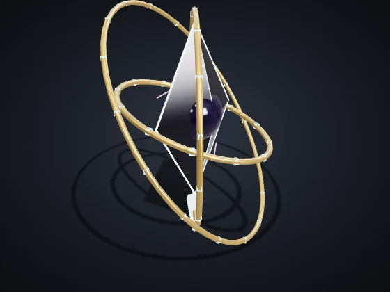
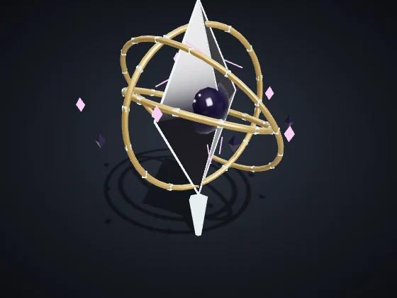
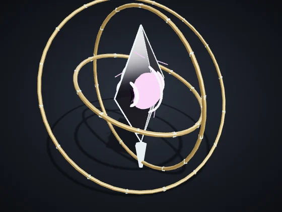
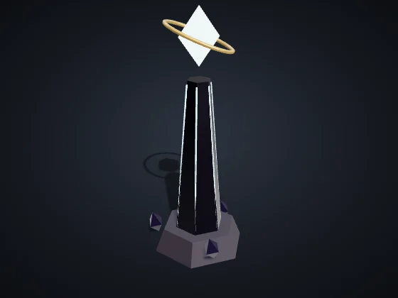
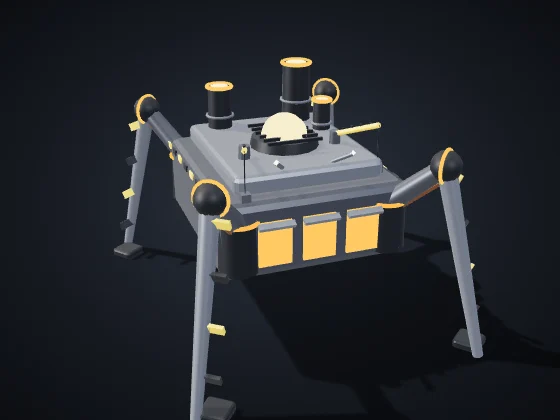
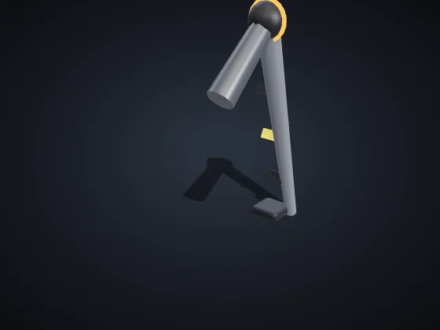
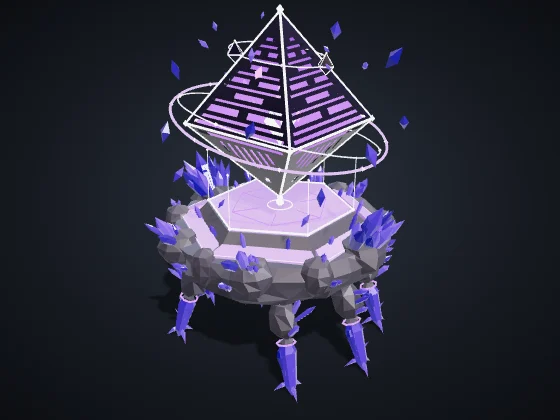
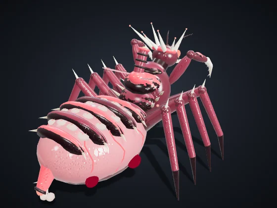

<!-- Generado por node tools/docs-gerar.cjs a partir del código del juego (números de la simulación y textos de los diccionarios). Imágenes: tools/galeria.cjs, con los modelos del propio juego. -->
# Jefes y modos

**Idiomas:** [English](bosses-and-modes.md) · [Português (Brasil)](bosses-and-modes.pt-BR.md) · **Español** · [Volver al README](../README.es.md)

Los jefes vienen de la Grieta: aparecen en la Cacería (el modo para derribar a un jefe, solo o con amigos), en los Eventos de la Grieta de la escaramuza y en la campaña.

## El Heraldo

*El primero en cruzar la Grieta*

    

**Vida:** 22,000 · **Fases:** 1. Tres Pilares (100%) → 2. Ecos (66%) → 3. Colapso (33%)

3 Pilares (2,600 de vida cada uno) alimentan el escudo del Heraldo; con los Pilares en el suelo, el escudo cae. Llama a 5 guardias cada 45 s y, en las fases siguientes, crea copias espectrales (Ecos) de tus unidades. En el Colapso abre un Pozo que lo atrae todo al centro; después del Pozo llega la ventana de daño, con el ojo abierto.

**Golpes (con aviso en el suelo antes de cada uno)**

| | aviso | radio | daño | cada |
|:--|:-:|:-:|:-:|:-:|
| Anillo | 1.6 s | 85 | 170 | 9 s |
| Franja | 1.8 s | 64 × 720 | 210 | 8 s |
| Ecos | 1.6 s | 46 | — | — |
| Pozo de gravedad | 5 s | 520 | 360 | 20 s |

**Recompensa:** La reliquia Lente del Heraldo (+10 % de visión en una partida) y el título del Heraldo.

## La Forja Madre

*La fábrica antigua que camina*

  

**Vida:** 40,000 · **Fases:** 1. Marcha (100%) → 2. Línea de montaje (66%) → 3. Núcleo expuesto (34%)

Camina sobre 4 patas (2,200 de vida cada una): cada pata destruida la vuelve un 25 % más lenta. En la Línea de montaje levanta una torre cada 30 s (hasta 8) y suelta 4 drones cada 20 s. En el Núcleo expuesto, el cuerpo queda abierto al ataque.

Captura: con el Núcleo expuesto, 5 o más de tu infantería hasta 110 del casco durante 30 s capturan a la Forja Madre.

**Golpes (con aviso en el suelo antes de cada uno)**

| | aviso | radio | daño | cada |
|:--|:-:|:-:|:-:|:-:|
| Pisotón | 1.7 s | 110 | 260 | 6 s |
| Soldadura | 1.8 s | 56 × 640 | 200 | 9 s |
| Ola de calor | 2 s | +150 | 140 | 9 s |

**Recompensa:** Destruir: la reliquia Corazón de la Forja. Capturar: el proyecto del Dron constructor (la unidad llega en una próxima versión).

## Centinela de la Grieta

*Vigía de la Grieta*

**Vida:** 12,000 · Un Heraldo menor que vigila la Grieta. Aparece en el centro del mapa en los Eventos de la Grieta; quien dé el golpe final se lleva la recompensa.

**Golpes (con aviso en el suelo antes de cada uno)**

| | aviso | radio | daño | cada |
|:--|:-:|:-:|:-:|:-:|
| Anillo | 1.6 s | 80 | 140 | 9 s |
| Franja | 1.8 s | 56 × 620 | 170 | 9 s |

Recompensa de quien derriba a la Centinela: 700 Mineral + 450 Plasma + 180 Datos.

### Dificultad

| Dificultad | Vida | Daño | Intervalo de los golpes |
|:--|:-:|:-:|:-:|
| Fácil | 0.7× | 0.75× | 1.25× |
| Normal | 1× | 1× | 1× |
| Difícil | 1.35× | 1.2× | 0.9× |
| Brutal | 1.75× | 1.4× | 0.8× |

## Cacería

Elige el jefe, la dificultad y los aliados (solo, 1 o 2 IA aliadas, o amigos en una sala cooperativa). Victoria: derribar al jefe. Derrota: perder el Núcleo (en cooperativo, todos los Núcleos). Tiempo límite: 40 min.

| Jefe | Arena |
|:--|:--|
| El Heraldo | Llanura de la Grieta |
| La Forja Madre | Restos del Titán |

| Dificultad | Recursos iniciales | IA aliada |
|:--|:--|:--|
| Fácil | 1,200 Mineral + 600 Plasma + 200 Datos | Normal |
| Normal | 900 Mineral + 450 Plasma + 150 Datos | Normal |
| Difícil | 700 Mineral + 350 Plasma + 120 Datos | Difícil |
| Brutal | 500 Mineral + 250 Plasma + 100 Datos | Difícil |

**Medallas:** Oro — hasta 12 min y 15 bajas · Plata — hasta 20 min y 40 bajas · Bronce — cualquier victoria.

## Eventos de la Grieta

Opción de la escaramuza. El primer evento llega entre los 6 y los 8 min; la Centinela de la Grieta, entre los 12 y los 15 min; después, un evento cada 3 min, siempre con 20 s de aviso.

- **Centinela de la Grieta:** Recompensa de quien derriba a la Centinela: 700 Mineral + 450 Plasma + 180 Datos.
- **Caravana Corsaria:** 3 naves corsarias (520 de vida cada una) cruzan el mapa durante 170 s. Quien destruya una se queda con la carga: 260 Mineral + 120 Plasma.
- **Enjambre Errante:** 10 Crías errantes (150 de vida cada una) atacan lo que tengan más cerca durante 150 s.
- **Lluvia de meteoros:** 8 meteoros, uno cada 3 s, con un anillo de aviso en el suelo (radio 80, 160 de daño). Donde caen, nacen cristales con 240 de recurso.

## Mutadores

- **Noche Eterna:** la noche no termina y la visión baja un 25%
- **Tormentas Frecuentes:** Tormentas de Éter el doble de veces; dentro de ellas, las unidades van un 10% más lentas
- **Recursos Escasos:** nodos y restos rinden la mitad

## Mundo vivo

Opción de la escaramuza en cuatro partes que se activan por separado: neutrales en el mapa, para todos los jugadores.

### Ruinas de los Constructores

Infantería quieta hasta 70 de una ruina la captura en 20 s (más rápido con más infantería, hasta 5). La bonificación dura mientras la mantengas; la infantería enemiga a su lado recupera la ruina.

- **Observatorio:** Visión amplia a su alrededor. Ruina de los Constructores. Capturada con infantería quieta a su lado, da visión amplia a su alrededor.
- **Forja Antigua:** Vehículos un 20% más baratos. Ruina de los Constructores. Capturada, los vehículos de su dueño cuestan un 20% menos.
- **Portal:** Teletransporte al otro extremo del par. Ruina de los Constructores, en pareja. Capturada, lleva las unidades de su dueño al otro extremo.
- **Torre de Éter:** +40 de energía. Ruina de los Constructores. Capturada, da +40 de energía a su dueño.

### Hermandad Corsaria

El Campamento está en el centro del mapa. Con una unidad tuya hasta 600 de él, contrata mercenarios pagados en Datos: hasta 3 a la vez, cada uno sirve 5 min, y una contratación cada 60 s.

| | Costo | Vida | Velocidad | |
|:--|:-:|:-:|:-:|:--|
| **Saqueador Corsario** | 80 Datos | 320 | 125 | Ataque 27 cada 0.6 s, alcance 80. Mercenario rápido de ataque cuerpo a cuerpo. Sirve por 5 min. |
| **Artillero Corsario** | 140 Datos | 420 | 68 | Ataque 60 cada 0.9 s, alcance 260, área 30. Mercenario de asedio: disparo largo con área. Sirve por 5 min. |
| **Tirador Corsario** | 100 Datos | 150 | 92 | Ataque 55 cada 2.6 s, alcance 260. Mercenario de tiro largo; como infantería, también captura ruinas. Sirve por 5 min. |

### Fauna de la Grieta

- **Pastador de la Grieta** (Vida 200, hasta 9 por mapa): Herbívoro manso de las llanuras de la Grieta. Huye de quien se acerca; al caer, deja una caja pequeña.
- **Guardián de la Veta** (Vida 1,200 · Ataque 20 cada 1 s, alcance 36, hasta 4 por mapa): Bestia blindada de cristal que defiende un nodo rico. Ataca a quien se acerca al nodo; al caer, suelta un bono.
- **Enjambre Nocturno** (Vida 70 · Ataque 5 cada 0.6 s, alcance 80, hasta 9 por mapa): Polillas de éter que salen de los nidos cerca de la Grieta por la noche y atacan a quien pasa.

### Oleada de éter

El primer surgimiento llega a los 5 min; después, surgimiento y lluvia de meteoros se alternan cada 150 s. Un círculo en el suelo (radio 230) avisa 30 s antes; dentro de él, la recolección rinde el doble durante 90 s.

## Mapas

- **Llanura de la Grieta:** Cuatro biomas y el abismo de la Grieta en el centro.
- **El Cinturón:** Plataformas sobre el espacio, unidas por puentes.
- **Restos del Titán:** El cadáver de un titán caído sobre la Grieta: costillas, placas y el cráneo.

## Épicos de la campaña

En la campaña La Gran Alineación, dos épicos aparecen como jefes de las misiones.

| | |
|:-:|:--|
|  | **Catedral Errante** — Coro Quorith *El relicario del Coro camina cantando* Vida 9,000 · Velocidad 26 · Ataque 90 cada 2.2 s, alcance 240, área 40 *Épico del Coro: una catedral de cristal que camina cantando. Onda de resonancia en área.* |
|  | **Matriarca** — Prole Vorag *Reina de la Prole, madre de todas las Crías* Vida 8,000 · Velocidad 34 · Ataque 70 cada 1.6 s, alcance 160, área 34 *Épica de la Prole: la reina que incuba Crías sin parar.* |

Valores en dificultad Normal, sin investigaciones ni veteranía. Vida y daño: puntos del juego; distancia y velocidad: unidades del mapa (el mapa mide 3200 de lado). Generado por `node tools/docs-gerar.cjs` a partir del código del juego (números de la simulación y textos de los diccionarios). Imágenes: `tools/galeria.cjs`, con los modelos del propio juego.
