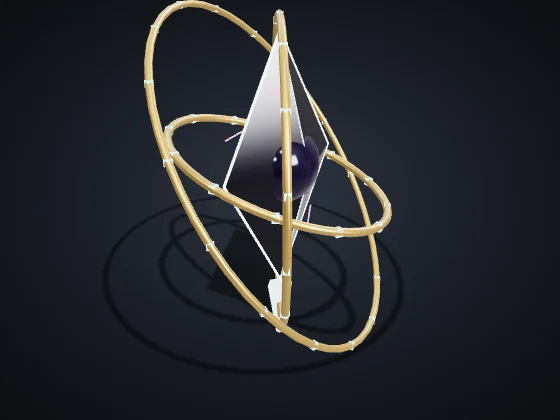
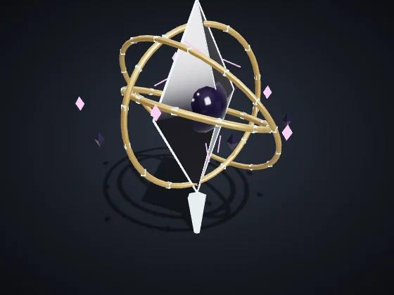
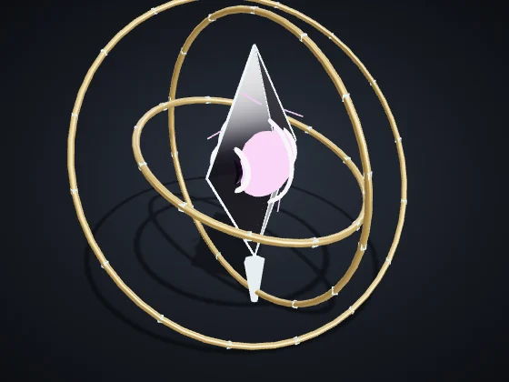
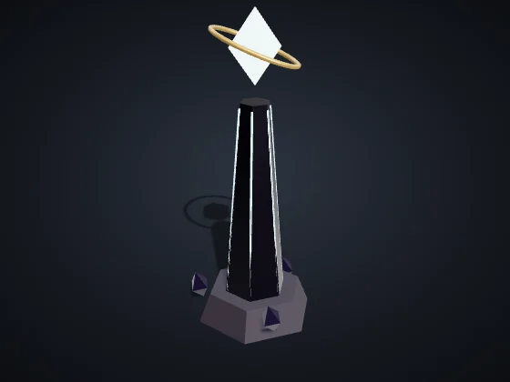
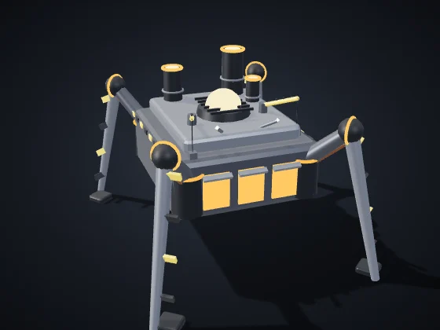
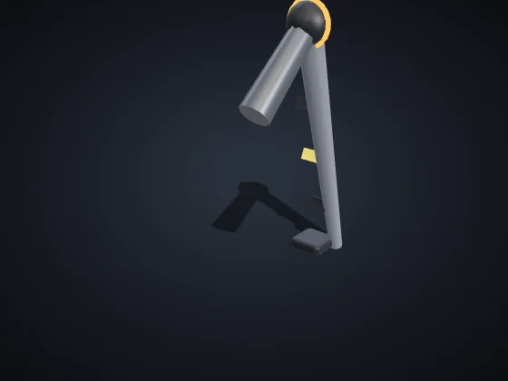
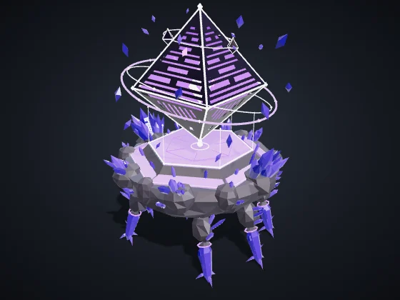
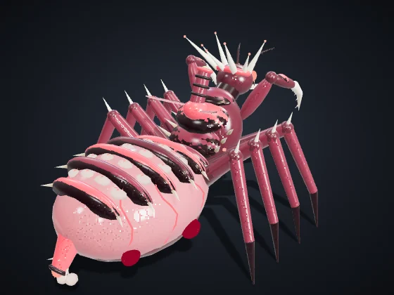

<!-- Generated by node tools/docs-gerar.cjs from the game code (numbers from the simulation, texts from the dictionaries). Images: tools/galeria.cjs, with the game's own models. -->
# Bosses and modes

**Languages:** [Português (Brasil)](chefoes-e-modos.md) · **English** · [Español](chefoes-e-modos.es.md) · [Back to the README](../README.en.md)

The bosses come from the Rift: they show up in the Hunt (the mode for taking down a boss, alone or with friends), in the Rift Events of skirmish and in the campaign.

## The Herald

*The first to cross the Rift*

    

**Health:** 22,000 · **Phases:** 1. Three Pillars (100%) → 2. Echoes (66%) → 3. Collapse (33%)

3 Pillars (2,600 health each) power the Herald's shield; with the Pillars down, the shield drops. It calls 5 guards every 45 s and, in later phases, makes spectral copies (Echoes) of your units. In Collapse it opens a Well that pulls everything to the center; after the Well comes the damage window, with the eye open.

**Attacks (with a warning on the ground before each one)**

| | warning | radius | damage | every |
|:--|:-:|:-:|:-:|:-:|
| Ring | 1.6 s | 85 | 170 | 9 s |
| Beam | 1.8 s | 64 × 720 | 210 | 8 s |
| Echoes | 1.6 s | 46 | — | — |
| Gravity Well | 5 s | 520 | 360 | 20 s |

**Reward:** The Herald's Lens relic (+10% sight for one match) and the Herald title.

## The Mother Forge

*The ancient factory that walks*

  

**Health:** 40,000 · **Phases:** 1. March (100%) → 2. Assembly Line (66%) → 3. Exposed Core (34%)

It walks on 4 legs (2,200 health each): every leg destroyed makes it 25% slower. In Assembly Line it raises a turret every 30 s (up to 8) and releases 4 drones every 20 s. In Exposed Core, the body is open to attack.

Capture: with the Core exposed, 5 or more of your infantry within 110 of the hull for 30 s capture the Mother Forge.

**Attacks (with a warning on the ground before each one)**

| | warning | radius | damage | every |
|:--|:-:|:-:|:-:|:-:|
| Stomp | 1.7 s | 110 | 260 | 6 s |
| Weld | 1.8 s | 56 × 640 | 200 | 9 s |
| Heat Wave | 2 s | +150 | 140 | 9 s |

**Reward:** Destroy: the Forge Heart relic. Capture: the Builder Drone blueprint (the unit arrives in a future version).

## Rift Sentinel

*Warden of the Rift*

**Health:** 12,000 · A smaller Herald that watches over the Rift. It appears at the center of the map in the Rift Events; whoever lands the final blow takes the reward.

**Attacks (with a warning on the ground before each one)**

| | warning | radius | damage | every |
|:--|:-:|:-:|:-:|:-:|
| Ring | 1.6 s | 80 | 140 | 9 s |
| Beam | 1.8 s | 56 × 620 | 170 | 9 s |

Reward for whoever takes down the Sentinel: 700 Ore + 450 Plasma + 180 Data.

### Difficulty

| Difficulty | Health | Damage | Attack interval |
|:--|:-:|:-:|:-:|
| Easy | 0.7× | 0.75× | 1.25× |
| Normal | 1× | 1× | 1× |
| Hard | 1.35× | 1.2× | 0.9× |
| Brutal | 1.75× | 1.4× | 0.8× |

## Hunt

Pick the boss, the difficulty and the allies (alone, 1 or 2 allied AIs, or friends in a co-op lobby). Victory: take down the boss. Defeat: lose your Core (in co-op, every Core). Time limit: 40 min.

| Boss | Arena |
|:--|:--|
| The Herald | Rift Plains |
| The Mother Forge | Titan's Wreck |

| Difficulty | Starting resources | Allied AI |
|:--|:--|:--|
| Easy | 1,200 Ore + 600 Plasma + 200 Data | Normal |
| Normal | 900 Ore + 450 Plasma + 150 Data | Normal |
| Hard | 700 Ore + 350 Plasma + 120 Data | Hard |
| Brutal | 500 Ore + 250 Plasma + 100 Data | Hard |

**Medals:** Gold — within 12 min and 15 losses · Silver — within 20 min and 40 losses · Bronze — any victory.

## Rift Events

A skirmish option. The first event comes between 6 and 8 min; the Rift Sentinel, between 12 and 15 min; after that, one event every 3 min, always with a 20 s warning.

- **Rift Sentinel:** Reward for whoever takes down the Sentinel: 700 Ore + 450 Plasma + 180 Data.
- **Corsair Caravan:** 3 corsair ships (520 health each) cross the map for 170 s. Whoever destroys one keeps its cargo: 260 Ore + 120 Plasma.
- **Wandering Swarm:** 10 wandering Broodlings (150 health each) attack whatever is closest for 150 s.
- **Meteor shower:** 8 meteors, one every 3 s, with a warning ring on the ground (radius 80, 160 damage). Where they land, crystals with 240 resources appear.

## Mutators

- **Eternal Night:** night never ends and vision drops 25%
- **Frequent Storms:** Aether Storms twice as often; inside them, units are 10% slower
- **Scarce Resources:** nodes and wrecks yield half

## Maps

- **Rift Plains:** Four biomes and the chasm of the Rift at the center.
- **The Belt:** Platforms over open space, linked by bridges.
- **Titan's Wreck:** The carcass of a titan fallen across the Rift: ribs, plates and the skull.

## Campaign epics

In the campaign The Great Alignment, two epics appear as mission bosses.

| | |
|:-:|:--|
|  | **Wandering Cathedral** — Quorith Choir *The Choir's reliquary walks as it sings* Health 9,000 · Speed 26 · Attack 90 every 2.2 s, range 240, splash 40 *The Choir's epic: a crystal cathedral that walks as it sings. Area resonance wave.* |
|  | **Matriarch** — Vorag Brood *Queen of the Brood, mother of every Broodling* Health 8,000 · Speed 34 · Attack 70 every 1.6 s, range 160, splash 34 *The Brood's epic: the queen who hatches Broodlings nonstop.* |

Values on Normal, with no research or veterancy. Health and damage are game points; distance and speed are map units (the map is 3200 across). Generated by `node tools/docs-gerar.cjs` from the game code (numbers from the simulation, texts from the dictionaries). Images: `tools/galeria.cjs`, with the game's own models.
