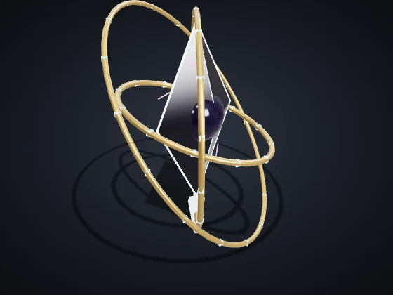
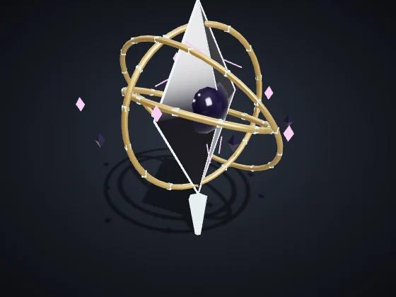
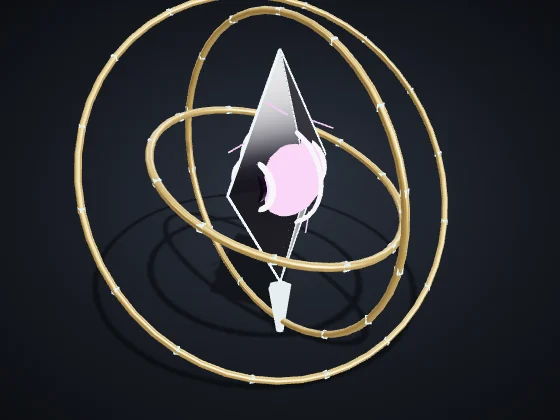
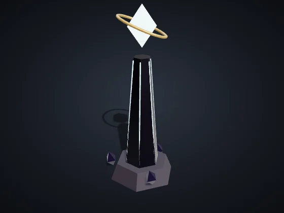
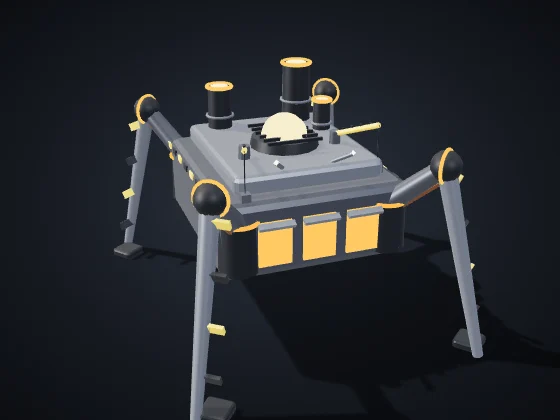
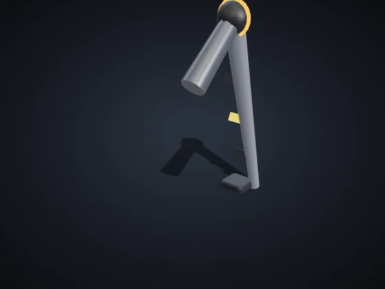
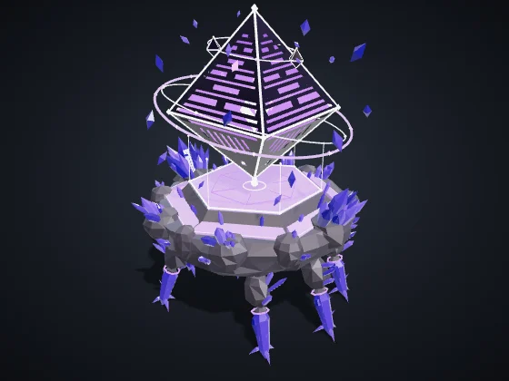
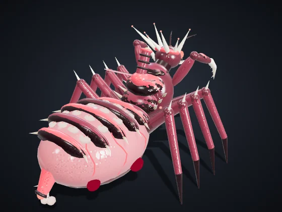

<!-- Gerado por node tools/docs-gerar.cjs a partir do código do jogo (números da simulação e textos dos dicionários). Imagens: tools/galeria.cjs, com os modelos do próprio jogo. -->
# Chefões e modos

**Idiomas:** **Português (Brasil)** · [English](chefoes-e-modos.en.md) · [Español](chefoes-e-modos.es.md) · [Voltar ao README](../README.md)

Os chefões vêm da Fenda: aparecem na Caçada (o modo de derrubar um chefão, sozinho ou com amigos), nos Eventos da Fenda da escaramuça e na campanha.

## O Arauto

*O primeiro a atravessar a Fenda*

    

**Vida:** 22.000 · **Fases:** 1. Três Pilares (100%) → 2. Ecos (66%) → 3. Colapso (33%)

3 Pilares (2.600 de vida cada) alimentam o escudo do Arauto; com os Pilares no chão, o escudo cai. Ele chama 5 guardas a cada 45 s e, nas fases seguintes, cria cópias espectrais (Ecos) das suas unidades. No Colapso, abre um Poço que puxa tudo para o centro; depois do Poço vem a janela de dano, com o olho aberto.

**Golpes (com aviso no chão antes de cada um)**

| | aviso | raio | dano | a cada |
|:--|:-:|:-:|:-:|:-:|
| Anel | 1,6 s | 85 | 170 | 9 s |
| Faixa | 1,8 s | 64 × 720 | 210 | 8 s |
| Ecos | 1,6 s | 46 | — | — |
| Poço de gravidade | 5 s | 520 | 360 | 20 s |

**Recompensa:** Relíquia Lente do Arauto (+10% de visão numa partida) e o título do Arauto.

## A Forja-Mãe

*A fábrica antiga que anda*

  

**Vida:** 40.000 · **Fases:** 1. Marcha (100%) → 2. Linha de montagem (66%) → 3. Núcleo exposto (34%)

Anda sobre 4 pernas (2.200 de vida cada): cada perna destruída a deixa 25% mais lenta. Na Linha de montagem ergue uma torre a cada 30 s (até 8) e solta 4 drones a cada 20 s. No Núcleo exposto, o corpo fica aberto ao ataque.

Captura: com o Núcleo exposto, 5 ou mais da sua infantaria a até 110 do casco por 30 s capturam a Forja-Mãe.

**Golpes (com aviso no chão antes de cada um)**

| | aviso | raio | dano | a cada |
|:--|:-:|:-:|:-:|:-:|
| Pisão | 1,7 s | 110 | 260 | 6 s |
| Solda | 1,8 s | 56 × 640 | 200 | 9 s |
| Onda de calor | 2 s | +150 | 140 | 9 s |

**Recompensa:** Destruir: a relíquia Coração da Forja. Capturar: o projeto do Drone-construtor (a unidade chega numa próxima versão).

## Sentinela da Fenda

*Vigia da Fenda*

**Vida:** 12.000 · Um Arauto menor que vigia a Fenda. Aparece no centro do mapa nos Eventos da Fenda; quem der o golpe final leva a recompensa.

**Golpes (com aviso no chão antes de cada um)**

| | aviso | raio | dano | a cada |
|:--|:-:|:-:|:-:|:-:|
| Anel | 1,6 s | 80 | 140 | 9 s |
| Faixa | 1,8 s | 56 × 620 | 170 | 9 s |

Recompensa de quem derruba a Sentinela: 700 Minério + 450 Plasma + 180 Dados.

### Dificuldade

| Dificuldade | Vida | Dano | Intervalo dos golpes |
|:--|:-:|:-:|:-:|
| Fácil | 0,7× | 0,75× | 1,25× |
| Normal | 1× | 1× | 1× |
| Difícil | 1,35× | 1,2× | 0,9× |
| Brutal | 1,75× | 1,4× | 0,8× |

## Caçada

Escolha o chefão, a dificuldade e os aliados (sozinho, 1 ou 2 IAs aliadas, ou amigos pela sala cooperativa). Vitória: derrubar o chefão. Derrota: perder o Núcleo (no cooperativo, todos os Núcleos). Tempo-limite: 40 min.

| Chefão | Arena |
|:--|:--|
| O Arauto | Planície da Fenda |
| A Forja-Mãe | Destroço do Titã |

| Dificuldade | Recursos iniciais | IA aliada |
|:--|:--|:--|
| Fácil | 1.200 Minério + 600 Plasma + 200 Dados | Normal |
| Normal | 900 Minério + 450 Plasma + 150 Dados | Normal |
| Difícil | 700 Minério + 350 Plasma + 120 Dados | Difícil |
| Brutal | 500 Minério + 250 Plasma + 100 Dados | Difícil |

**Medalhas:** Ouro — até 12 min e 15 perdas · Prata — até 20 min e 40 perdas · Bronze — qualquer vitória.

## Eventos da Fenda

Opção da escaramuça. O primeiro evento chega entre 6 e 8 min; a Sentinela da Fenda, entre 12 e 15 min; depois, um evento a cada 3 min, sempre com 20 s de aviso.

- **Sentinela da Fenda:** Recompensa de quem derruba a Sentinela: 700 Minério + 450 Plasma + 180 Dados.
- **Caravana Corsária:** 3 naves corsárias (520 de vida cada) cruzam o mapa por 170 s. Quem destruir uma fica com a carga: 260 Minério + 120 Plasma.
- **Enxame Errante:** 10 Crias errantes (150 de vida cada) atacam o que estiver mais perto por 150 s.
- **Chuva de meteoros:** 8 meteoros, um a cada 3 s, com anel de aviso no chão (raio 80, 160 de dano). Onde caem, nascem cristais com 240 de recurso.

## Mutadores

- **Noite Eterna:** a noite não acaba e a visão cai 25%
- **Tempestades Frequentes:** Tempestades de Éter o dobro de vezes; dentro delas, unidades 10% mais lentas
- **Recursos Escassos:** nós e destroços rendem a metade

## Mapas

- **Planície da Fenda:** Quatro biomas e o abismo da Fenda no centro.
- **Cinturão:** Plataformas sobre o espaço, ligadas por pontes.
- **Destroço do Titã:** A carcaça de um titã caído sobre a Fenda: costelas, placas e o crânio.

## Épicos da campanha

Na campanha O Grande Alinhamento, dois épicos aparecem como chefões das missões.

| | |
|:-:|:--|
|  | **Catedral Errante** — Coro Quorith *O relicário do Coro caminha cantando* Vida 9.000 · Velocidade 26 · Ataque 90 a cada 2,2 s, alcance 240, área 40 *Épico do Coro: uma catedral de cristal que caminha cantando. Onda de ressonância em área.* |
|  | **Matriarca** — Prole Vorag *Rainha da Prole, mãe de todas as Crias* Vida 8.000 · Velocidade 34 · Ataque 70 a cada 1,6 s, alcance 160, área 34 *Épica da Prole: a rainha que choca Crias sem parar.* |

Valores na dificuldade Normal, sem pesquisas nem veterania. Vida e dano das unidades: pontos do jogo; distância e velocidade: unidades do mapa (o mapa tem 3200 de lado). Gerado por `node tools/docs-gerar.cjs` a partir do código do jogo (números da simulação e textos dos dicionários). Imagens: `tools/galeria.cjs`, com os modelos do próprio jogo.
