<!-- Generado por node tools/docs-gerar.cjs a partir del código del juego (números de la simulación y textos de los diccionarios). Imágenes: tools/galeria.cjs, con los modelos del propio juego. -->
# Coro Quorith

**Idiomas:** [Português (Brasil)](quorith.md) · [English](quorith.en.md) · **Español** · [Todas las Razas](README.es.md) · [Volver al README](../../README.es.md)

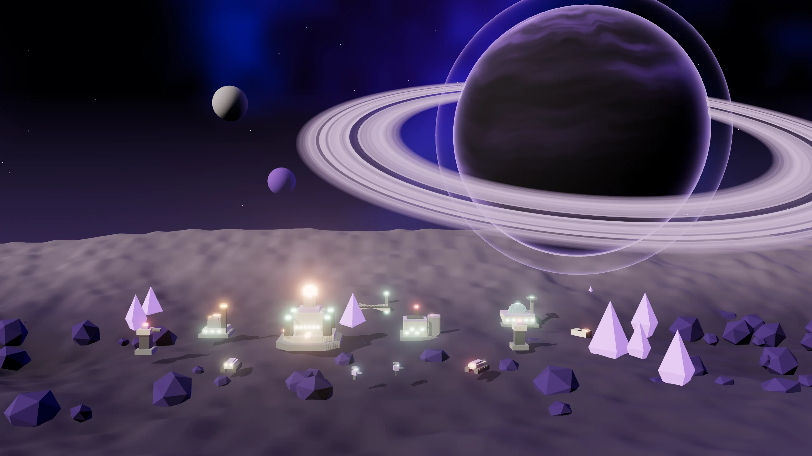

> Mente colmena de cristal resonante. Voces en sincronía: cada aliado cercano afina el acorde (Enlace), y los pactos cuestan la mitad y rinden el doble.

## El líder y la historia

**Líder:** Zayin Coral  
**Mundo natal:** Quor (cavernas de cristal resonante) · Mente colmena de cristal  
**Estilo de juego:** Sincronía (Enlace) · Pactos al 50% · Torres silenciadas · Cristal

*“Zayin Coral. El Coro canta con una sola voz. Afínate, comandante.”*

 

## Habilidades de la Raza

- **Enlace de Sincronía:** cada aliado hasta 90 suma +3.5 % de daño y −2.5 % de daño recibido, hasta 3 aliados.
- **Diplomacia afinada:** los pactos cuestan la mitad de la Fianza (75) y dan el doble de reputación.
- **Torres silenciadas:** las torres enemigas hasta 110 de tus unidades dejan de disparar.
- **Saltos de Núcleo:** 1 por partida.

## Superarma: Unísono

Durante 20 s, todo el ejército cuenta como acorde completo (Enlace máximo) y recibe 25% menos daño. Cuesta 300 Datos + 200 Plasma.

## Ascensión de la Raza: Coro Pleno

El Enlace de Sincronía sube hasta 5 aliados (antes 3) y la energía rinde 15% más. Costo: 300 Mineral + 200 Plasma + 150 Datos.

## Unidades

| | |
|:-:|:--|
| 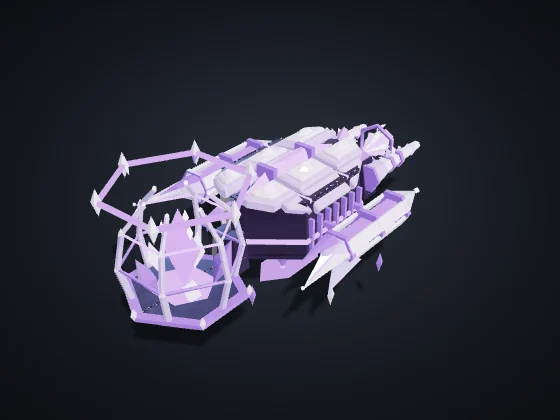 | **Afinador** (tecla C) — Civil · Era I · Se produce en: Núcleo de Dominio Costo: 60 Mineral · Vida 90 · Velocidad 85 · Visión 110 · Carga 50 *Recolecta automáticamente los nodos de tu territorio y entrega en la Refinería o el Núcleo más cercano.* |
| 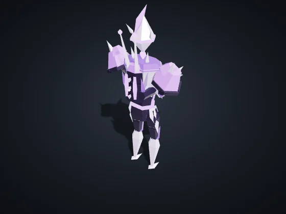 | **Infantería Orbital** (tecla I) — Infantería · Era I · Se produce en: Cuartel Orbital Costo: 50 Mineral · Vida 120 · Velocidad 90 · Visión 160 Ataque 12 cada 0.8 s, alcance 110 *Fuerte contra Drones y Soporte. Débil contra Vehículos y Estructuras.* |
| 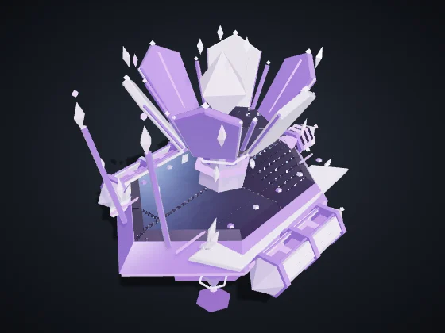 | **Soporte / Hack** (tecla S) — Soporte/Hack · Era II · Se produce en: Cuartel Orbital Costo: 90 Mineral + 20 Datos · Vida 100 · Velocidad 80 · Visión 200 Ataque 10 cada 1.5 s, alcance 170 *Fuerte contra Vehículos y Estructuras, y los ralentiza. Débil contra Infantería y Drones.* |
| 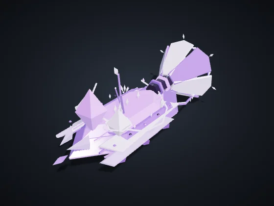 | **Resonador** (tecla P) — Soporte/Hack · Era I · Se produce en: Cuartel Orbital Costo: 120 Mineral + 30 Plasma · Vida 140 · Velocidad 100 · Visión 180 · Carga 300 *Sifona Refinerías y Reactores enemigos hasta 40 s. Erevane: camuflado y +20% de robo. Vehnar: Remolcador, lento y resistente, carga el doble.* |
| 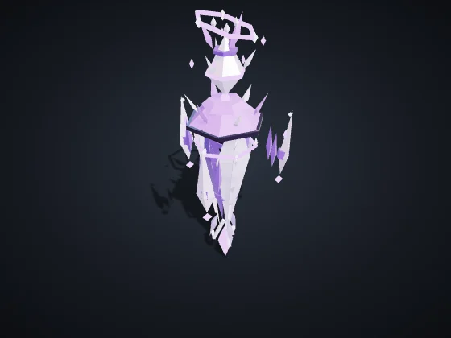 | **Voz** (tecla Z) — Infantería · Era I · Se produce en: Cuartel Orbital Costo: 55 Mineral + 5 Datos · Vida 95 · Velocidad 92 · Visión 170 Ataque 11 cada 0.8 s, alcance 115 *El pulso básico del Coro. Débil sola; en acorde (Enlace: +3.5% de daño y +2.5% de armadura por aliado Quorith a 90 o menos, máx. 3) se vuelve letal.* |
| 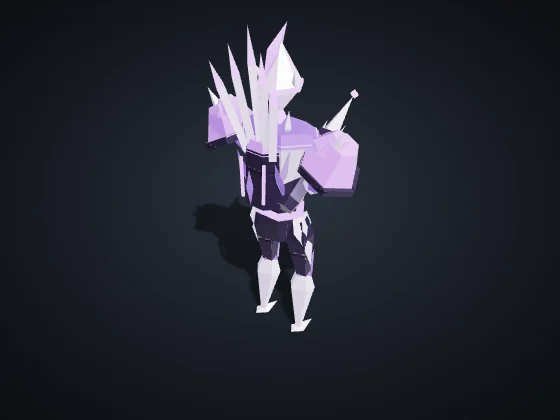 | **Aguja** (tecla G) — Infantería · Era II · Se produce en: Cuartel Orbital Costo: 100 Mineral + 25 Plasma · Vida 110 · Velocidad 85 · Visión 220 Ataque 16 cada 0.7 s, alcance 170 *Antiaérea: agujas resonantes que hacen añicos los drones. Débil contra vehículos y estructuras.* |
| 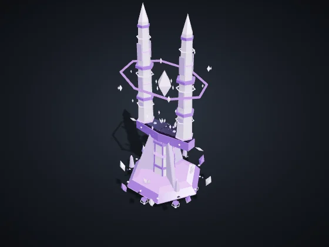 | **Diapasón** (tecla D) — Soporte/Hack · Era II · Se produce en: Cuartel Orbital Costo: 140 Mineral + 20 Plasma + 30 Datos · Vida 170 · Velocidad 72 · Visión 210 Amplía el Enlace hasta 100 *Sin armas. Amplía el Enlace: los aliados a 100 o menos de él aceptan un cuarto vecino en el acorde.* |
| 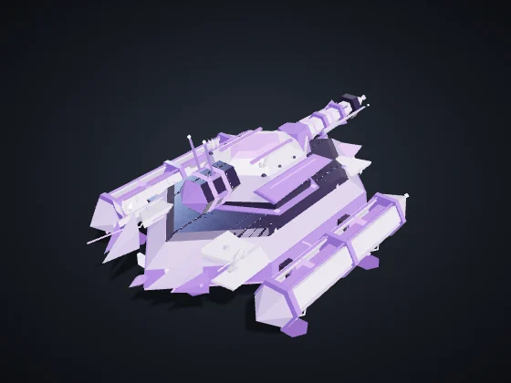 | **Vehículo Pesado** (tecla V) — Vehículos · Era II · Se produce en: Fábrica de Vehículos Costo: 160 Mineral + 40 Plasma · Vida 420 · Velocidad 65 · Visión 170 Ataque 40 cada 1.4 s, alcance 150, área 24 *Fuerte contra Infantería y Estructuras. Débil contra Drones y Soporte.* |
| 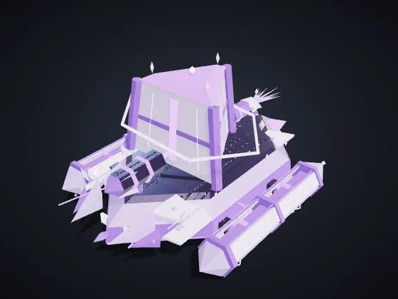 | **Prisma** (tecla P) — Vehículos · Era II · Se produce en: Fábrica de Vehículos Costo: 190 Mineral + 50 Plasma + 10 Datos · Vida 520 · Velocidad 60 · Visión 170 Ataque 44 cada 1.5 s, alcance 150, área 20 *Tanque refractor: concentra la onda del Coro en un haz de área.* |
| 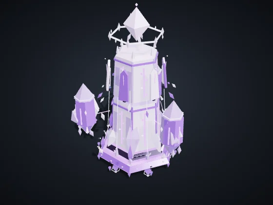 | **Monolito** (tecla O) — Vehículos · Era III · Se produce en: Fábrica de Vehículos Costo: 330 Mineral + 80 Plasma + 40 Datos · Vida 780 · Velocidad 45 · Visión 190 Ataque 75 cada 2.6 s, alcance 210, área 30 *Asedio resonante: onda lenta y larga que agrieta estructuras. Casi inútil contra drones.* |
| 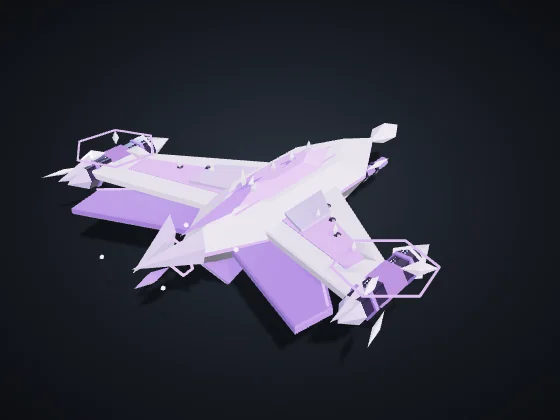 | **Dron Aéreo** (tecla D) — Drones · Era II · Se produce en: Hangar de Drones Costo: 120 Mineral + 50 Plasma · Vida 160 · Velocidad 150 · Visión 220 Ataque 18 cada 0.9 s, alcance 120 *Fuerte contra Vehículos y Soporte. Débil contra Infantería y Estructuras. Vuela sobre la Grieta.* |
| 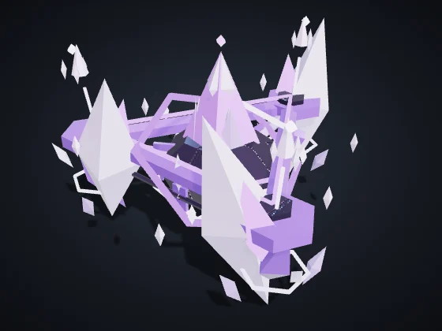 | **Armónico** (tecla H) — Drones · Era II · Se produce en: Hangar de Drones Costo: 110 Mineral + 45 Plasma + 10 Datos · Vida 120 · Velocidad 150 · Visión 230 Ataque 14 cada 0.9 s, alcance 120 *Volador del Coro: un acorde aéreo que persigue vehículos y soporte.* |

## Construcciones

| | |
|:-:|:--|
| 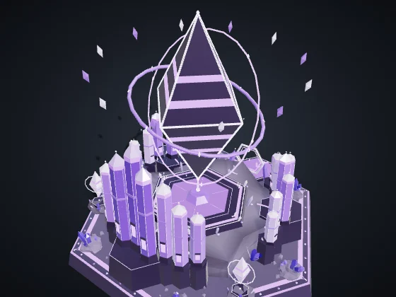 | **Núcleo de Dominio** — Era I Costo: — · Vida 8,000 · Energía +60 · Visión 420 Produce: Afinador *Centro de la colonia. Produce recolectores. Si cae, quedas eliminado.* |
| 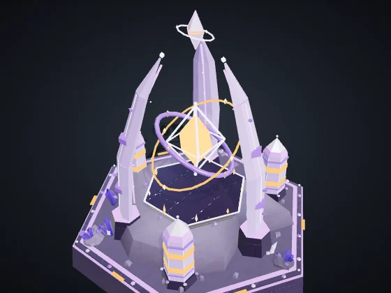 | **Reactor** (B + R) — Era I Costo: 120 Mineral · Vida 700 · Energía +35 · Visión 120 *+35 de energía quemando 0.3 de Plasma/s. Vehnar: echa Humo visible para todos.* Módulo **Cámara de Fusión** (Era II, 120 Mineral + 40 Plasma): +60% de energía en este Reactor, sin quemar más Plasma. |
| 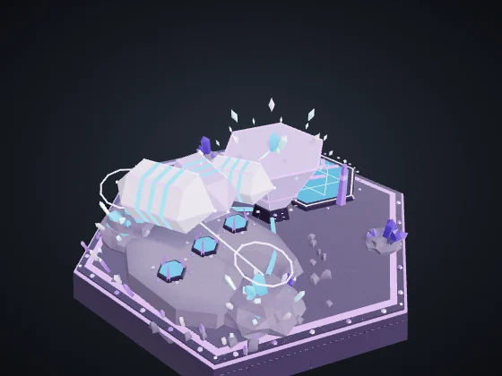 | **Refinería** (B + F) — Era I Costo: 150 Mineral · Vida 1,000 · Energía −6 · Visión 140 *Punto de entrega cerca de los nodos. Blanco de Sifón.* |
| 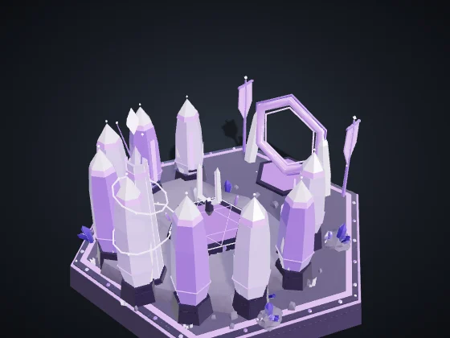 | **Cuartel Orbital** (B + Q) — Era I Costo: 200 Mineral · Vida 1,150 · Energía −8 · Visión 140 Produce: Infantería Orbital, Soporte / Hack, Resonador, Voz, Aguja, Diapasón *Produce Infantería, Soporte/Hack y Piratas.* Módulo **Academia** (Era II, 160 Mineral + 60 Plasma + 30 Datos): La infantería de este Cuartel ya sale Veterana (★): +10% de daño y −7% de daño recibido. |
| 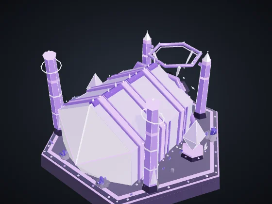 | **Fábrica de Vehículos** (B + V) — Era II Costo: 300 Mineral + 60 Plasma · Vida 1,300 · Energía −12 · Visión 140 Produce: Vehículo Pesado, Prisma, Monolito *Produce Vehículos Pesados.* |
| 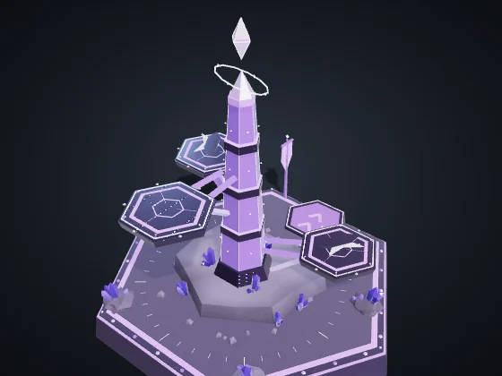 | **Hangar de Drones** (B + H) — Era II Costo: 280 Mineral + 60 Plasma · Vida 1,150 · Energía −12 · Visión 160 Produce: Dron Aéreo, Armónico *Produce Drones Aéreos.* |
| 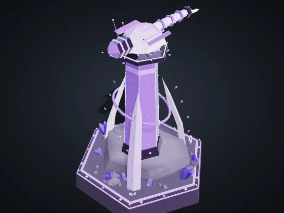 | **Torre de Defensa** (B + T) — Era I Costo: 180 Mineral + 40 Plasma · Vida 1,100 · Energía −10 · Visión 260 Ataque 30 cada 1 s, alcance 230, área 16 *Fuerte contra Infantería y Drones. Detecta camuflaje a 140.* Módulo **Batería Pesada** (Era III, 150 Mineral + 60 Plasma): +40% de vida y +30% de daño en esta Torre. |
| 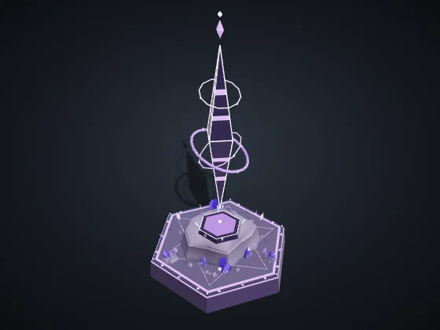 | **Nódulo de Avance** (B + N) — Era I Costo: 120 Mineral + 20 Plasma · Vida 650 · Energía −4 · Visión 260 *Reclama territorio en 320 y libera nodos para la recolección automática. Se puede colocar hasta a 650 de cualquier estructura tuya.* |
| 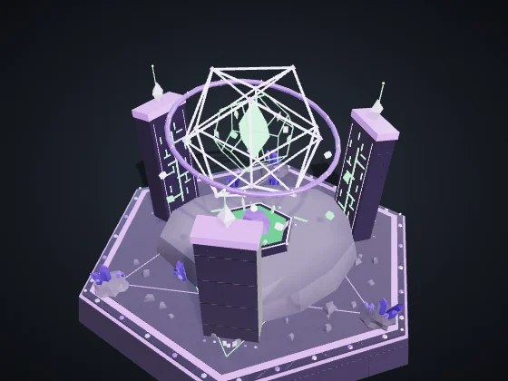 | **Laboratorio** (B + L) — Era II Costo: 220 Mineral + 60 Plasma + 40 Datos · Vida 900 · Energía −10 · Visión 140 *Investigaciones y superarma, pagadas con Fragmentos de Datos.* |
| 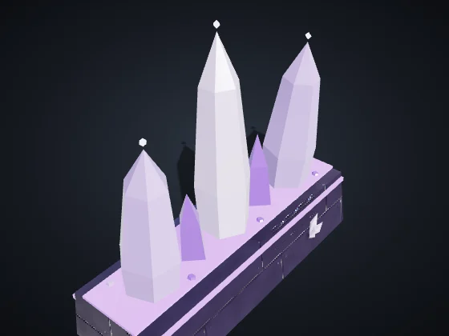 | **Muro** (B + M) — Era I Costo: 20 Mineral · Vida 450 · Visión 50 *Barrera barata. Arrastra para trazar una línea. Bloquea unidades y absorbe disparos.* |
| 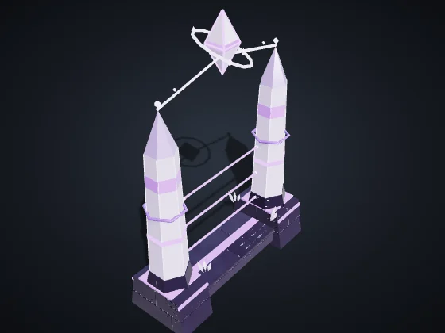 | **Portón** (B + G) — Era I Costo: 40 Mineral · Vida 600 · Visión 60 *Tramo de muro que tus unidades atraviesan. Los enemigos tienen que derribarlo.* |

---

Valores en dificultad Normal, sin investigaciones ni veteranía. Vida y daño: puntos del juego; distancia y velocidad: unidades del mapa (el mapa mide 3200 de lado). Generado por `node tools/docs-gerar.cjs` a partir del código del juego (números de la simulación y textos de los diccionarios). Imágenes: `tools/galeria.cjs`, con los modelos del propio juego.
