<!-- Generated by node tools/docs-gerar.cjs from the game code (numbers from the simulation, texts from the dictionaries). Images: tools/galeria.cjs, with the game's own models. -->
# Quorith Choir

**Languages:** **English** · [Português (Brasil)](quorith.pt-BR.md) · [Español](quorith.es.md) · [All Races](README.md) · [Back to the README](../../README.md)

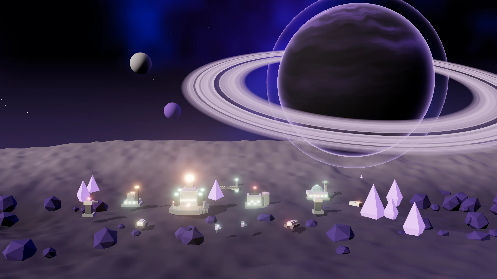

> A hive mind of resonant crystal. Voices in sync: every nearby ally tunes the chord (Link), and pacts cost half and pay double.

## The leader and the story

**Leader:** Zayin Coral  
**Homeworld:** Quor (caverns of resonant crystal) · Crystal hive mind  
**Play style:** Sync (Link) · Half-cost Pacts · Muted Towers · Crystal

*“Zayin Coral. The Choir sings with a single voice. Get in tune, commander.”*

 

## Race abilities

- **Sync Link:** each ally within 90 adds +3.5% damage and −2.5% damage taken, up to 3 allies.
- **Tuned diplomacy:** pacts cost half the Bond (75) and give double reputation.
- **Silenced towers:** enemy towers within 110 of your units stop firing.
- **Core Jumps:** 1 per match.

## Superweapon: Unison

For 20 s, the whole army counts as a full chord (maximum Link) and takes 25% less damage. Costs 300 Data + 200 Plasma.

## Race Ascension: Full Choir

The Sync Link grows to 5 allies (was 3) and energy yields 15% more. Cost: 300 Ore + 200 Plasma + 150 Data.

## Commander in the field: Living Prism

A match option (Commanders in the field): the leader enters the map as an avatar with three abilities.

| | |
|:-:|:--|
| 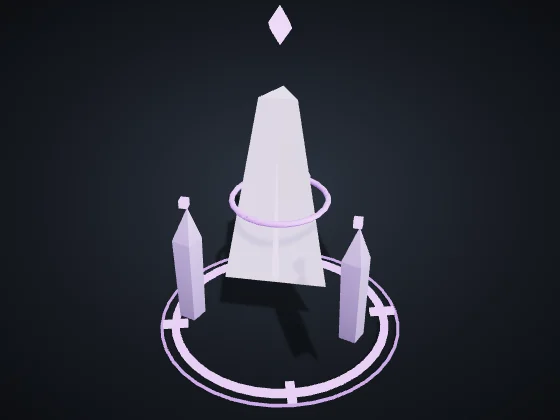 | **Living Prism** — Vehicles · Leader: Zayin Coral Health 850 · Speed 82 · Sight 250 Attack 30 every 1.3 s, range 160, splash 14 *Avatar of Zayin Coral: a prism that sings the Choir's chord.* |

| Ability | Target | Cooldown | Effect |
|:--|:--|:-:|:--|
| **Chord** | around the avatar | 26 s | Your units around deal +20% damage for 8 s. |
| **Shatter** | point on the ground (range 220) | 14 s | Crystal burst: 140 area damage (r 70). |
| **Silence** | point on the ground (range 240) | 30 s | Enemies in an area cannot fire for 4 s. |

The level rises with the avatar's veterancy: each level adds +15% damage and healing, −5% cooldown and +10% health. When it falls, it returns at the Core after 40 s + 10 s per level, keeping its level.

## Units

| | |
|:-:|:--|
| 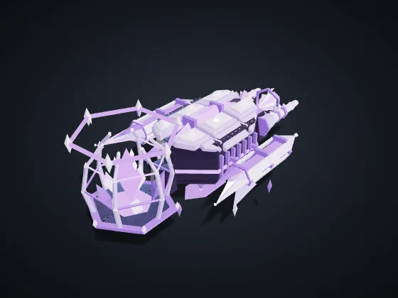 | **Tuner** (key C) — Civilian · Era I · Built at: Dominion Core Cost: 60 Ore · Health 90 · Speed 85 · Sight 110 · Cargo 50 *Automatically harvests nodes in your territory and delivers to the nearest Refinery or Core.* |
| 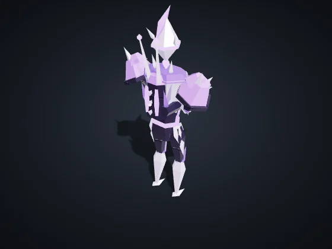 | **Orbital Infantry** (key I) — Infantry · Era I · Built at: Orbital Barracks Cost: 50 Ore · Health 120 · Speed 90 · Sight 160 Attack 12 every 0.8 s, range 110 *Strong vs Drones and Support. Weak vs Vehicles and Structures.* |
| 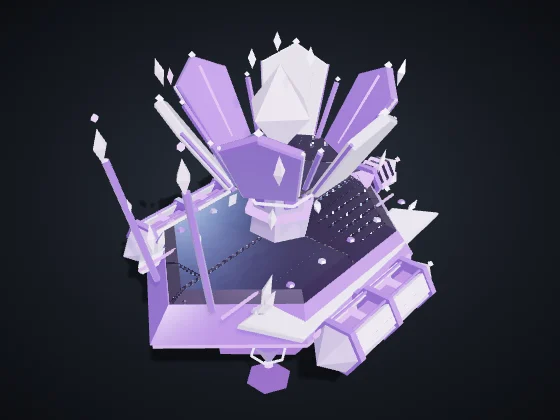 | **Support / Hack** (key S) — Support/Hack · Era II · Built at: Orbital Barracks Cost: 90 Ore + 20 Data · Health 100 · Speed 80 · Sight 200 Attack 10 every 1.5 s, range 170 *Strong vs Vehicles and Structures, and slows them. Weak vs Infantry and Drones.* |
| 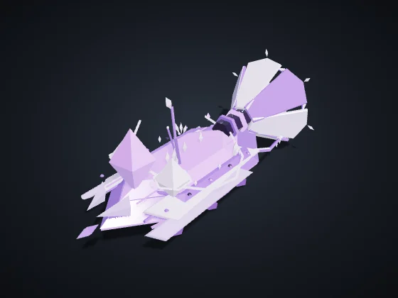 | **Resonator** (key P) — Support/Hack · Era I · Built at: Orbital Barracks Cost: 120 Ore + 30 Plasma · Health 140 · Speed 100 · Sight 180 · Cargo 300 *Siphons enemy Refineries and Reactors for up to 40 s. Erevane: cloaked, +20% stolen. Vehnar: Hauler, slow and tough, carries 2x.* |
| 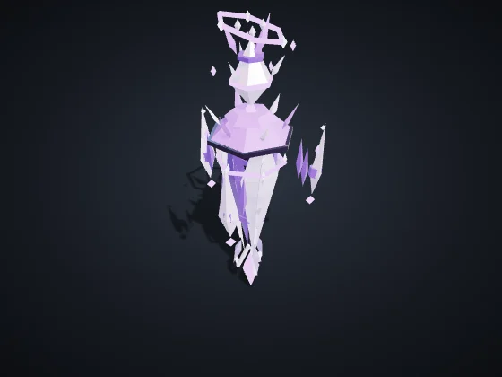 | **Voice** (key Z) — Infantry · Era I · Built at: Orbital Barracks Cost: 55 Ore + 5 Data · Health 95 · Speed 92 · Sight 170 Attack 11 every 0.8 s, range 115 *The Choir's basic pulse. Weak alone; in a chord (Link: +3.5% damage and +2.5% armor per Quorith ally within 90, max. 3) it turns lethal.* |
| 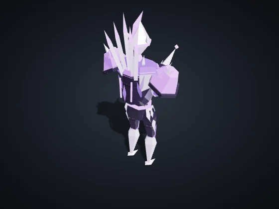 | **Needle** (key G) — Infantry · Era II · Built at: Orbital Barracks Cost: 100 Ore + 25 Plasma · Health 110 · Speed 85 · Sight 220 Attack 16 every 0.7 s, range 170 *Anti-air: resonant needles that shatter drones. Weak against vehicles and structures.* |
| 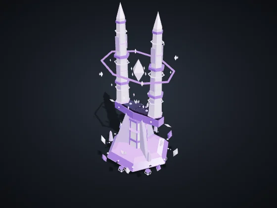 | **Tuning Fork** (key D) — Support/Hack · Era II · Built at: Orbital Barracks Cost: 140 Ore + 20 Plasma + 30 Data · Health 170 · Speed 72 · Sight 210 Extends the Link within 100 *Unarmed. Extends the Link: allies within 100 of it accept a fourth neighbor in the chord.* |
| 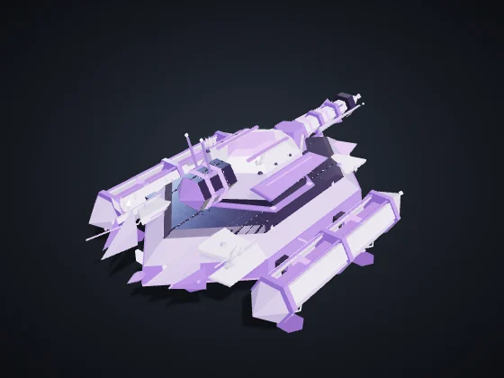 | **Heavy Vehicle** (key V) — Vehicles · Era II · Built at: Vehicle Factory Cost: 160 Ore + 40 Plasma · Health 420 · Speed 65 · Sight 170 Attack 40 every 1.4 s, range 150, splash 24 *Strong vs Infantry and Structures. Weak vs Drones and Support.* |
| 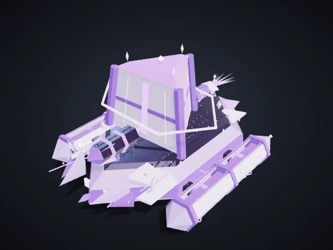 | **Prism** (key P) — Vehicles · Era II · Built at: Vehicle Factory Cost: 190 Ore + 50 Plasma + 10 Data · Health 520 · Speed 60 · Sight 170 Attack 44 every 1.5 s, range 150, splash 20 *Refractor tank: focuses the Choir's wave into an area beam.* |
| 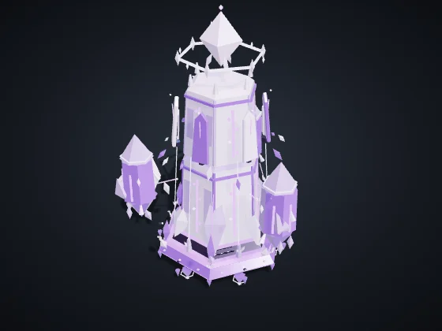 | **Monolith** (key O) — Vehicles · Era III · Built at: Vehicle Factory Cost: 330 Ore + 80 Plasma + 40 Data · Health 780 · Speed 45 · Sight 190 Attack 75 every 2.6 s, range 210, splash 30 *Resonant siege: a slow, long wave that cracks structures. Nearly useless against drones.* |
| 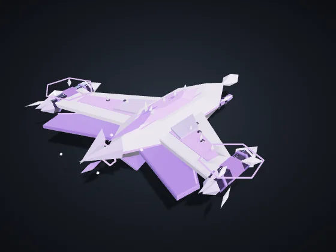 | **Aerial Drone** (key D) — Drones · Era II · Built at: Drone Hangar Cost: 120 Ore + 50 Plasma · Health 160 · Speed 150 · Sight 220 Attack 18 every 0.9 s, range 120 *Strong vs Vehicles and Support. Weak vs Infantry and Structures. Flies over the Rift.* |
| 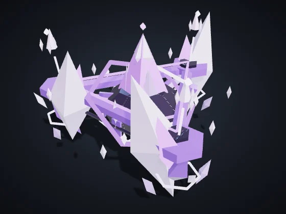 | **Harmonic** (key H) — Drones · Era II · Built at: Drone Hangar Cost: 110 Ore + 45 Plasma + 10 Data · Health 120 · Speed 150 · Sight 230 Attack 14 every 0.9 s, range 120 *The Choir's flyer: an aerial chord that hunts vehicles and support.* |

## Buildings

| | |
|:-:|:--|
| 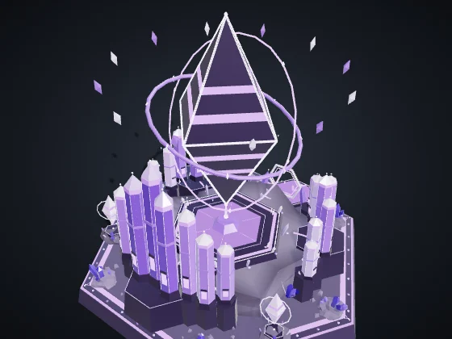 | **Dominion Core** — Era I Cost: — · Health 8,000 · Energy +60 · Sight 420 Produces: Tuner *The heart of the colony. Produces harvesters. If it falls, you are eliminated.* |
| 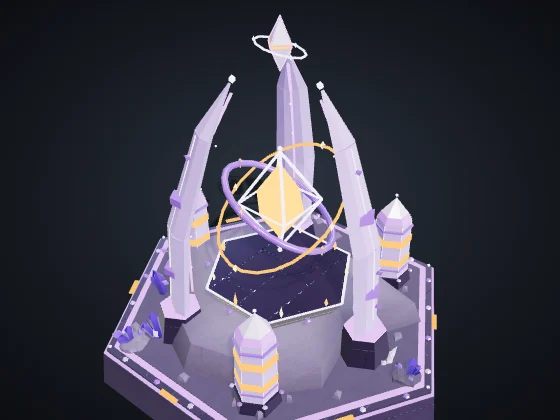 | **Reactor** (B + R) — Era I Cost: 120 Ore · Health 700 · Energy +35 · Sight 120 *+35 energy by burning 0.3 Plasma/s. Vehnar: gives off Smoke visible to everyone.* Module **Fusion Chamber** (Era II, 120 Ore + 40 Plasma): +60% energy from this Reactor, without burning more Plasma. |
| 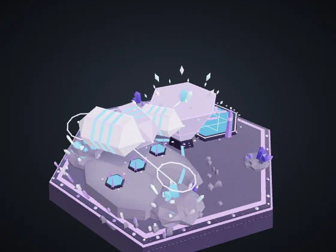 | **Refinery** (B + F) — Era I Cost: 150 Ore · Health 1,000 · Energy −6 · Sight 140 *Drop-off point near the nodes. A Siphon target.* Modules with a choice (Era II, 150 Ore + 50 Plasma): **Ore Press** — +0.5 Ore per second. · **Armored Vault** — +60% health and regenerates 4 health/s. |
| 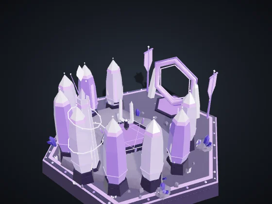 | **Orbital Barracks** (B + Q) — Era I Cost: 200 Ore · Health 1,150 · Energy −8 · Sight 140 Produces: Orbital Infantry, Support / Hack, Resonator, Voice, Needle, Tuning Fork *Produces Infantry, Support/Hack and Pirates.* Module **Academy** (Era II, 160 Ore + 60 Plasma + 30 Data): Infantry from this Barracks comes out Veteran (★): +10% damage and −7% damage taken. |
| 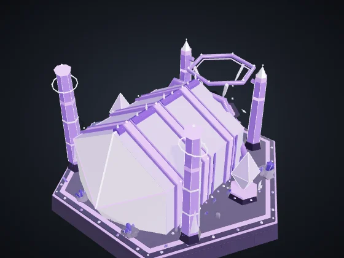 | **Vehicle Factory** (B + V) — Era II Cost: 300 Ore + 60 Plasma · Health 1,300 · Energy −12 · Sight 140 Produces: Heavy Vehicle, Prism, Monolith *Produces Heavy Vehicles.* Modules with a choice (Era II, 150 Ore + 50 Plasma): **Fast Line** — 20% faster production in this Factory. · **Reinforced Chassis** — Vehicles from here come out with +15% health. |
| 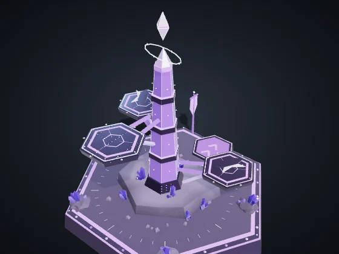 | **Drone Hangar** (B + H) — Era II Cost: 280 Ore + 60 Plasma · Health 1,150 · Energy −12 · Sight 160 Produces: Aerial Drone, Harmonic *Produces Aerial Drones.* Modules with a choice (Era II, 150 Ore + 50 Plasma): **Afterburner** — Drones from here come out 12% faster. · **Repair Dock** — Repairs your flying units within 160 (5 health/s). |
| 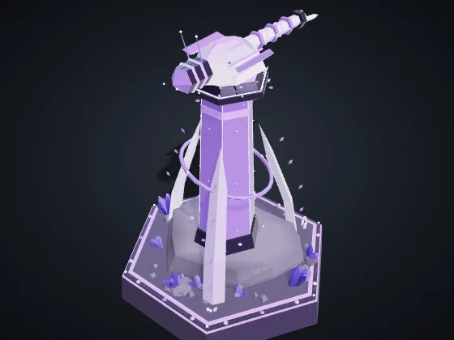 | **Defense Tower** (B + T) — Era I Cost: 180 Ore + 40 Plasma · Health 1,100 · Energy −10 · Sight 260 Attack 30 every 1 s, range 230, splash 16 *Strong vs Infantry and Drones. Detects cloaked units within 140.* Module **Heavy Battery** (Era III, 150 Ore + 60 Plasma): +40% health and +30% damage for this Tower. |
| 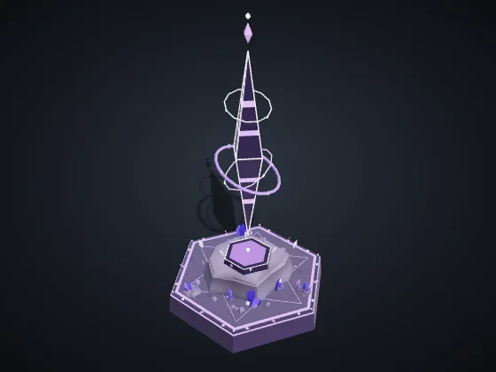 | **Forward Outpost** (B + N) — Era I Cost: 120 Ore + 20 Plasma · Health 650 · Energy −4 · Sight 260 *Claims territory within 320 and frees nodes for automatic harvesting. Can be placed up to 650 from any of your structures.* Modules with a choice (Era II, 150 Ore + 50 Plasma): **Forward Post** — +50% health and regenerates 3 health/s. · **Pulse Mine** — A 45-damage area pulse on enemies within 90, every 6 s. |
| 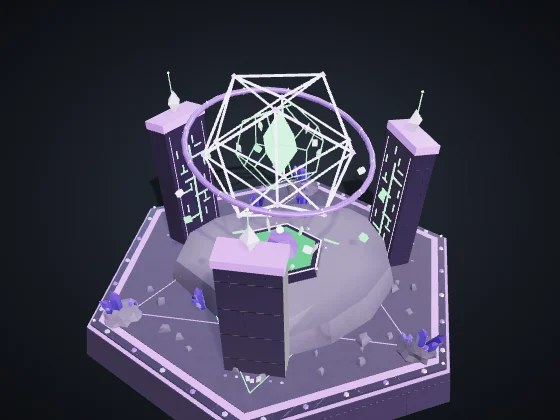 | **Laboratory** (B + L) — Era II Cost: 220 Ore + 60 Plasma + 40 Data · Health 900 · Energy −10 · Sight 140 *Research and the superweapon, paid with Data Shards.* Modules with a choice (Era II, 150 Ore + 50 Plasma): **Data Antenna** — +0.3 Data per second. · **Counterintelligence** — Detects cloaked enemy units within 260, like a Tower. |
| 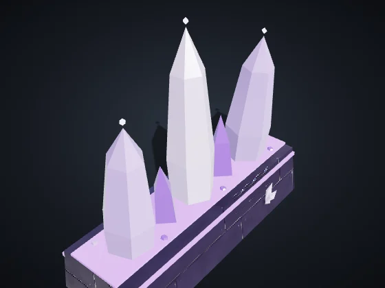 | **Wall** (B + M) — Era I Cost: 20 Ore · Health 450 · Sight 50 *Cheap barrier. Drag to draw a line. Blocks units and absorbs fire.* |
| 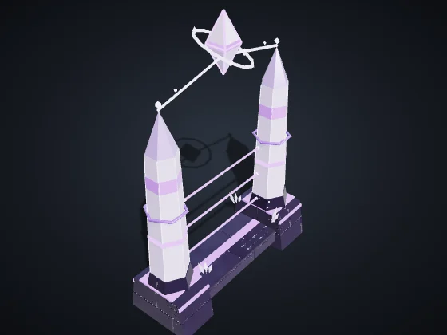 | **Gate** (B + G) — Era I Cost: 40 Ore · Health 600 · Sight 60 *A stretch of wall your units can pass through. Enemies have to knock it down.* |

## Unique buildings

Each Race has two, and each player can raise at most one of each (shortcuts B + J and B + K).

| | |
|:-:|:--|
| 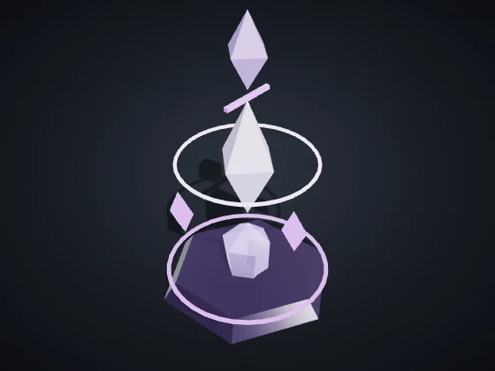 | **Resonance Pillar** (B + J) — Era II Cost: 180 Ore + 60 Plasma + 20 Data · Health 900 · Energy −8 · Sight 200 *Extends the Link: your units within 200 count one more neighbor in the chord (up to one above the cap).* |
| 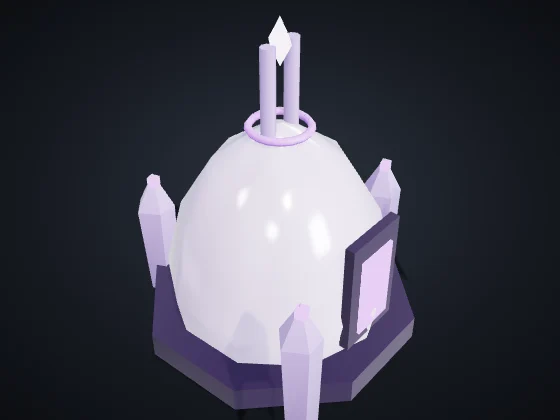 | **Echo Chamber** (B + K) — Era II Cost: 220 Ore + 60 Plasma · Health 1,000 · Energy −10 · Sight 240 Attack 22 every 1.6 s, range 200, splash 40 *Resonance tower: a 200-range wave that deals area damage and slows vehicles and structures.* |

---

Values on Normal, with no research or veterancy. Health and damage are game points; distance and speed are map units (the map is 3200 across). Generated by `node tools/docs-gerar.cjs` from the game code (numbers from the simulation, texts from the dictionaries). Images: `tools/galeria.cjs`, with the game's own models.
