<!-- Generado por node tools/docs-gerar.cjs a partir del código del juego (números de la simulación y textos de los diccionarios). Imágenes: tools/galeria.cjs, con los modelos del propio juego. -->
# Tessara

**Idiomas:** [English](tessara.md) · [Português (Brasil)](tessara.pt-BR.md) · **Español** · [Todas las Razas](README.es.md) · [Volver al README](../../README.es.md)

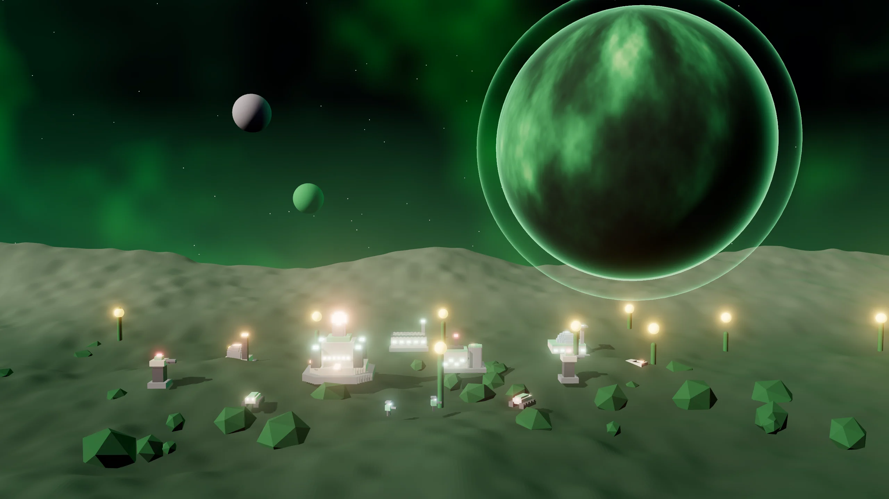

> Tecnología adaptable. Las unidades ganan Rasgos contra lo que combaten, el Núcleo hace Fotosíntesis y el Salto Evolutivo cambia la batalla.

## El líder y la historia

**Líder:** Sylvia Oriel  
**Mundo natal:** Oriel (invernaderos y jardines vivos) · Linaje vivo  
**Estilo de juego:** Adaptación · Rasgos de combate · Fotosíntesis · Hambrienta de Datos

*“Sylvia Oriel. Oriel crece. Y quien se resiste se vuelve abono.”*

 

## Habilidades de la Raza

- **Rasgos:** cada tipo de unidad que causa 280 de daño a una clase gana un Rasgo contra ella (+25 % de daño), hasta dos por tipo.
- **Fotosíntesis:** el Núcleo genera de 45 (noche) a 95 (día) de energía, en un ciclo de 750 s.
- **Saltos de Núcleo:** 1 por partida.

## Superarma: Salto Evolutivo

Durante 45 s, todas tus unidades causan +35% de daño. Cuesta 300 Datos + 200 Plasma.

## Ascensión de la Raza: Florecer

Las unidades se regeneran fuera de combate (4 de vida/s) y la recolección rinde 20% más. Costo: 300 Mineral + 200 Plasma + 150 Datos.

## Comandante en el campo: Guardiana

Opción de la partida (Comandantes en el campo): el líder entra al mapa con un avatar y tres habilidades.

| | |
|:-:|:--|
| 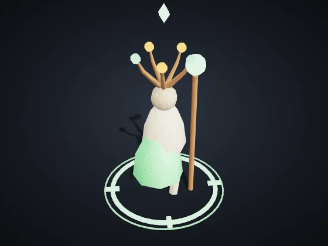 | **Guardiana** — Soporte/Hack · Líder: Sylvia Oriel Vida 820 · Velocidad 86 · Visión 260 Ataque 18 cada 1 s, alcance 150 *Avatar de Sylvia Oriel: raíces, flores que curan y esporas.* |

| Habilidad | Objetivo | Recarga | Efecto |
|:--|:--|:-:|:--|
| **Raíces** | punto en el suelo (alcance 240) | 22 s | Inmoviliza a los enemigos en un área durante 3 s. |
| **Florecer** | alrededor del avatar | 28 s | Cura tus unidades (160) y edificios (200) alrededor. |
| **Esporas** | punto en el suelo (alcance 260) | 30 s | Nube que daña a los enemigos durante 8 s (14 de daño/s). |

El nivel sube con la veteranía del avatar: cada nivel suma +15 % de daño y curación, −5 % de recarga y +10 % de vida. Cuando cae, vuelve al Núcleo después de 40 s + 10 s por nivel, con el nivel que tenía.

## Unidades

| | |
|:-:|:--|
| 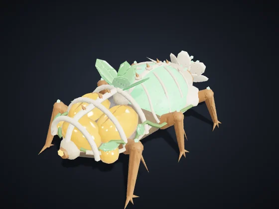 | **Recolector** (tecla C) — Civil · Era I · Se produce en: Núcleo de Dominio Costo: 60 Mineral · Vida 90 · Velocidad 85 · Visión 110 · Carga 50 *Recolecta automáticamente los nodos de tu territorio y entrega en la Refinería o el Núcleo más cercano.* |
| 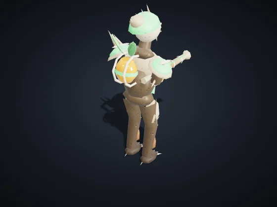 | **Infantería Orbital** (tecla I) — Infantería · Era I · Se produce en: Cuartel Orbital Costo: 50 Mineral · Vida 120 · Velocidad 90 · Visión 160 Ataque 12 cada 0.8 s, alcance 110 *Fuerte contra Drones y Soporte. Débil contra Vehículos y Estructuras.* |
| 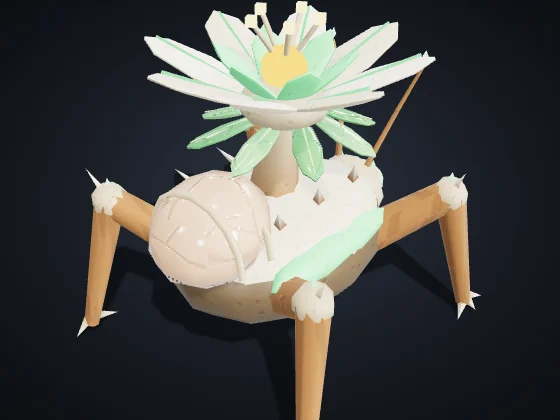 | **Soporte / Hack** (tecla S) — Soporte/Hack · Era II · Se produce en: Cuartel Orbital Costo: 90 Mineral + 20 Datos · Vida 100 · Velocidad 80 · Visión 200 Ataque 10 cada 1.5 s, alcance 170 *Fuerte contra Vehículos y Estructuras, y los ralentiza. Débil contra Infantería y Drones.* |
| 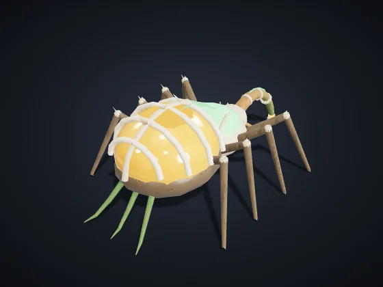 | **Injerto** (tecla P) — Soporte/Hack · Era I · Se produce en: Cuartel Orbital Costo: 120 Mineral + 30 Plasma · Vida 140 · Velocidad 100 · Visión 180 · Carga 300 *Sifona Refinerías y Reactores enemigos hasta 40 s. Erevane: camuflado y +20% de robo. Vehnar: Remolcador, lento y resistente, carga el doble.* |
| 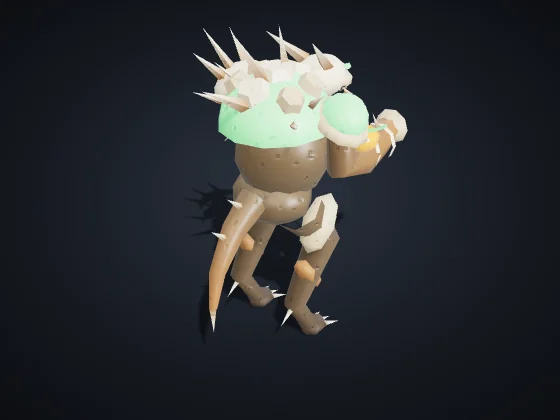 | **Quimera** (tecla I) — Infantería · Era I · Se produce en: Cuartel Orbital Costo: 55 Mineral · Vida 140 · Velocidad 88 · Visión 170 Ataque 12 cada 0.8 s, alcance 110 *Infantería adaptable. Gana Rasgos contra las clases que más combate.* |
| 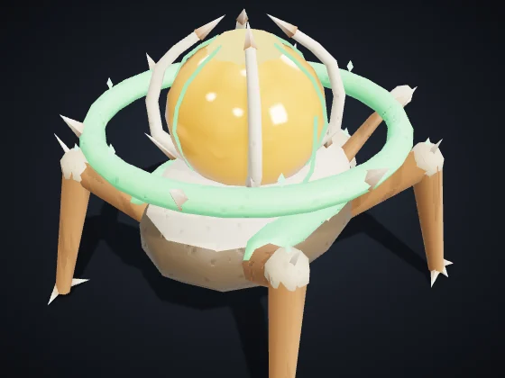 | **Molde** (tecla O) — Soporte/Hack · Era II · Se produce en: Cuartel Orbital Costo: 130 Mineral + 20 Plasma + 20 Datos · Vida 150 · Velocidad 75 · Visión 200 Aura de daño hasta 100 *Sin armas. Tus unidades a 100 o menos de él causan +15% de daño.* |
| 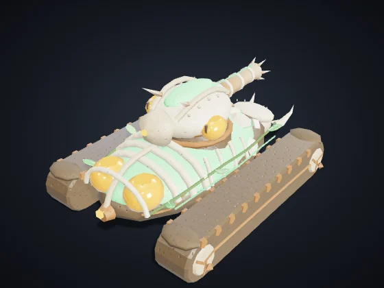 | **Vehículo Pesado** (tecla V) — Vehículos · Era II · Se produce en: Fábrica de Vehículos Costo: 160 Mineral + 40 Plasma · Vida 420 · Velocidad 65 · Visión 170 Ataque 40 cada 1.4 s, alcance 150, área 24 *Fuerte contra Infantería y Estructuras. Débil contra Drones y Soporte.* |
| 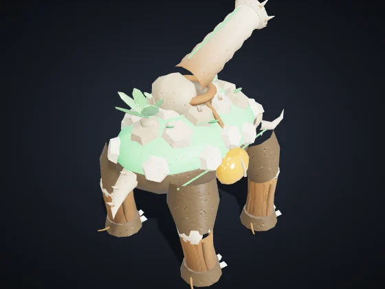 | **Coloso Cambiante** (tecla C) — Vehículos · Era III · Se produce en: Fábrica de Vehículos Costo: 320 Mineral + 80 Plasma + 25 Datos · Vida 1,150 · Velocidad 50 · Visión 180 Ataque 60 cada 1.8 s, alcance 150, área 28 *Pesado de asedio con cañón de área. Gana Rasgos como las demás unidades Tessara.* |
| 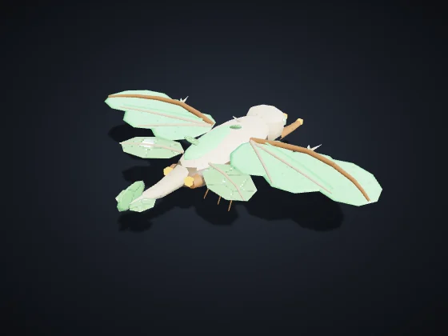 | **Dron Aéreo** (tecla D) — Drones · Era II · Se produce en: Hangar de Drones Costo: 120 Mineral + 50 Plasma · Vida 160 · Velocidad 150 · Visión 220 Ataque 18 cada 0.9 s, alcance 120 *Fuerte contra Vehículos y Soporte. Débil contra Infantería y Estructuras. Vuela sobre la Grieta.* |
| 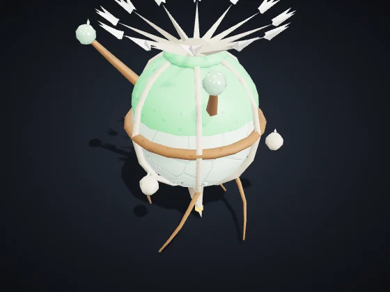 | **Espora Centinela** (tecla E) — Drones · Era II · Se produce en: Hangar de Drones Costo: 70 Mineral + 20 Plasma · Vida 90 · Velocidad 160 · Visión 330 Ataque 7 cada 0.45 s, alcance 85 *Dron de reconocimiento con sensores de muy largo alcance.* |

## Construcciones

| | |
|:-:|:--|
| 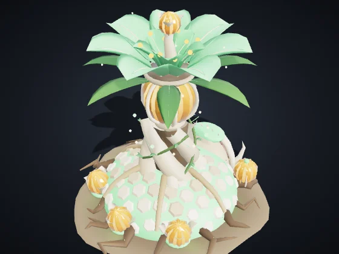 | **Núcleo de Dominio** — Era I Costo: — · Vida 8,000 · Energía +60 · Visión 420 Produce: Recolector *Centro de la colonia. Produce recolectores. Si cae, quedas eliminado.* |
| 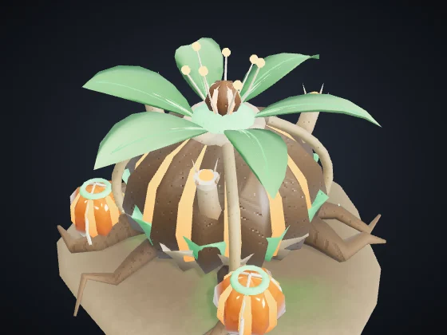 | **Reactor** (B + R) — Era I Costo: 120 Mineral · Vida 700 · Energía +35 · Visión 120 *+35 de energía quemando 0.3 de Plasma/s. Vehnar: echa Humo visible para todos.* Módulo **Cámara de Fusión** (Era II, 120 Mineral + 40 Plasma): +60% de energía en este Reactor, sin quemar más Plasma. |
| 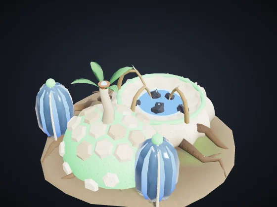 | **Refinería** (B + F) — Era I Costo: 150 Mineral · Vida 1,000 · Energía −6 · Visión 140 *Punto de entrega cerca de los nodos. Blanco de Sifón.* Módulos a elegir (Era II, 150 Mineral + 50 Plasma): **Prensa de Mineral** — +0,5 de Mineral por segundo. · **Cofre Blindado** — +60% de vida y regenera 4 de vida/s. |
| 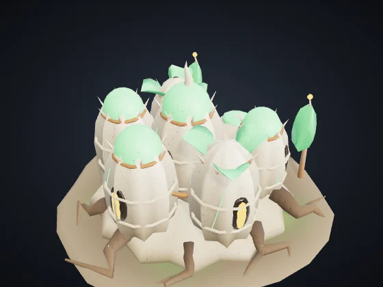 | **Cuartel Orbital** (B + Q) — Era I Costo: 200 Mineral · Vida 1,150 · Energía −8 · Visión 140 Produce: Infantería Orbital, Soporte / Hack, Injerto, Quimera, Molde *Produce Infantería, Soporte/Hack y Piratas.* Módulo **Academia** (Era II, 160 Mineral + 60 Plasma + 30 Datos): La infantería de este Cuartel ya sale Veterana (★): +10% de daño y −7% de daño recibido. |
| 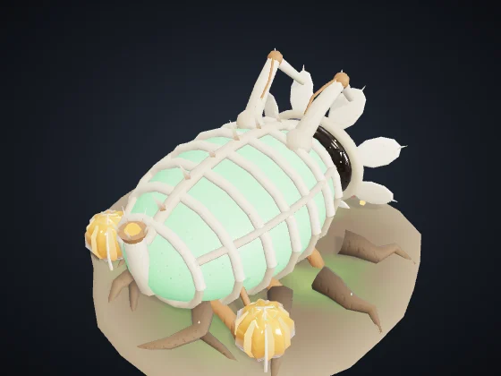 | **Fábrica de Vehículos** (B + V) — Era II Costo: 300 Mineral + 60 Plasma · Vida 1,300 · Energía −12 · Visión 140 Produce: Vehículo Pesado, Coloso Cambiante *Produce Vehículos Pesados.* Módulos a elegir (Era II, 150 Mineral + 50 Plasma): **Línea Rápida** — Producción un 20% más rápida en esta Fábrica. · **Chasis Reforzado** — Los vehículos de aquí salen con +15% de vida. |
| 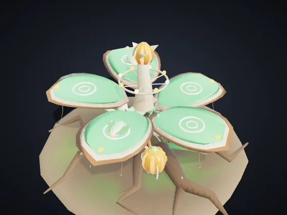 | **Hangar de Drones** (B + H) — Era II Costo: 280 Mineral + 60 Plasma · Vida 1,150 · Energía −12 · Visión 160 Produce: Dron Aéreo, Espora Centinela *Produce Drones Aéreos.* Módulos a elegir (Era II, 150 Mineral + 50 Plasma): **Postcombustión** — Los drones de aquí salen un 12% más rápidos. · **Dique de Reparación** — Repara tus unidades voladoras a menos de 160 (5 de vida/s). |
| 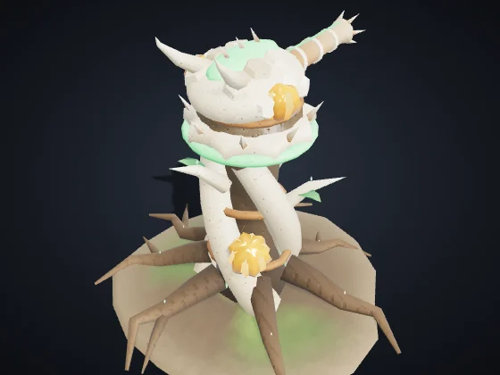 | **Torre de Defensa** (B + T) — Era I Costo: 180 Mineral + 40 Plasma · Vida 1,100 · Energía −10 · Visión 260 Ataque 30 cada 1 s, alcance 230, área 16 *Fuerte contra Infantería y Drones. Detecta camuflaje a 140.* Módulo **Batería Pesada** (Era III, 150 Mineral + 60 Plasma): +40% de vida y +30% de daño en esta Torre. |
| 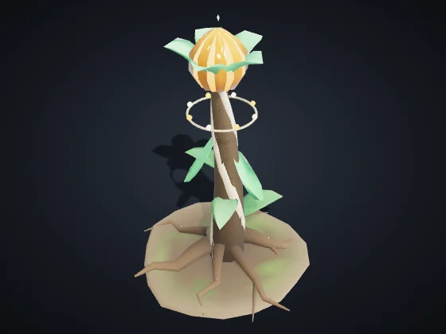 | **Nódulo de Avance** (B + N) — Era I Costo: 120 Mineral + 20 Plasma · Vida 650 · Energía −4 · Visión 260 *Reclama territorio en 320 y libera nodos para la recolección automática. Se puede colocar hasta a 650 de cualquier estructura tuya.* Módulos a elegir (Era II, 150 Mineral + 50 Plasma): **Puesto Avanzado** — +50% de vida y regenera 3 de vida/s. · **Mina de Pulso** — Pulso de 45 de daño en área a los enemigos a menos de 90, cada 6 s. |
| 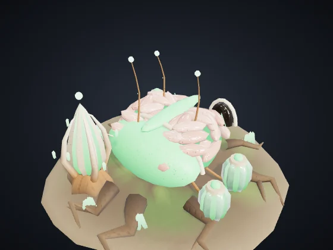 | **Laboratorio** (B + L) — Era II Costo: 220 Mineral + 60 Plasma + 40 Datos · Vida 900 · Energía −10 · Visión 140 *Investigaciones y superarma, pagadas con Fragmentos de Datos.* Módulos a elegir (Era II, 150 Mineral + 50 Plasma): **Antena de Datos** — +0,3 de Datos por segundo. · **Contraespionaje** — Detecta las unidades camufladas enemigas a menos de 260, como una Torre. |
| 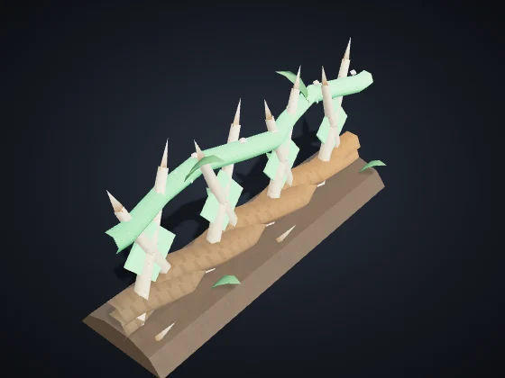 | **Muro** (B + M) — Era I Costo: 20 Mineral · Vida 450 · Visión 50 *Barrera barata. Arrastra para trazar una línea. Bloquea unidades y absorbe disparos.* |
| 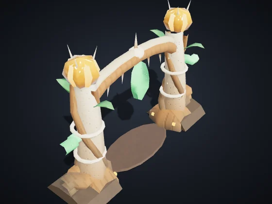 | **Portón** (B + G) — Era I Costo: 40 Mineral · Vida 600 · Visión 60 *Tramo de muro que tus unidades atraviesan. Los enemigos tienen que derribarlo.* |

## Construcciones únicas

Cada Raza tiene dos, y cada jugador levanta como máximo una de cada (atajos B + J y B + K).

| | |
|:-:|:--|
| 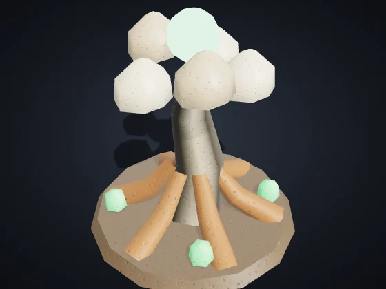 | **Árbol Madre** (B + J) — Era I Costo: 220 Mineral + 40 Plasma · Vida 1,200 · Energía −6 · Visión 200 *Cura tus unidades y edificios a menos de 150 (+40 por Era): 3 de vida/s (+2 por Era). Crece y gana vida en cada Era.* |
| 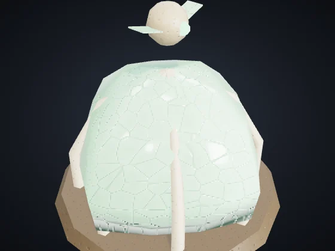 | **Vivero** (B + K) — Era II Costo: 200 Mineral + 50 Plasma · Vida 800 · Energía −6 · Visión 180 *Cultiva Esporas centinela gratis: una cada 45 s, hasta 3 vivas a la vez.* |

---

Valores en dificultad Normal, sin investigaciones ni veteranía. Vida y daño: puntos del juego; distancia y velocidad: unidades del mapa (el mapa mide 3200 de lado). Generado por `node tools/docs-gerar.cjs` a partir del código del juego (números de la simulación y textos de los diccionarios). Imágenes: `tools/galeria.cjs`, con los modelos del propio juego.
