<!-- Generated by node tools/docs-gerar.cjs from the game code (numbers from the simulation, texts from the dictionaries). Images: tools/galeria.cjs, with the game's own models. -->
# Tessara

**Languages:** **English** · [Português (Brasil)](tessara.pt-BR.md) · [Español](tessara.es.md) · [All Races](README.md) · [Back to the README](../../README.md)

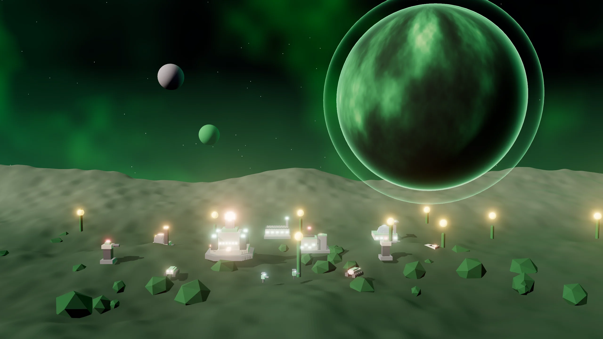

> Adaptive technology. Units gain Traits against what they fight, the Core performs Photosynthesis and the Evolutionary Leap turns the battle.

## The leader and the story

**Leader:** Sylvia Oriel  
**Homeworld:** Oriel (greenhouses and living gardens) · Living lineage  
**Play style:** Adaptation · Combat Traits · Photosynthesis · Hungry for Data

*“Sylvia Oriel. Oriel grows. And those who resist become compost.”*

 

## Race abilities

- **Traits:** each unit type that deals 280 damage to a class gains a Trait against it (+25% damage), up to two per type.
- **Photosynthesis:** the Core makes 45 (night) to 95 (day) energy, on a 750 s cycle.
- **Core Jumps:** 1 per match.

## Superweapon: Evolutionary Leap

For 45 s, all your units deal +35% damage. Costs 300 Data + 200 Plasma.

## Race Ascension: Bloom

Units regenerate out of combat (4 health/s) and harvesting yields 20% more. Cost: 300 Ore + 200 Plasma + 150 Data.

## Commander in the field: Warden

A match option (Commanders in the field): the leader enters the map as an avatar with three abilities.

| | |
|:-:|:--|
| 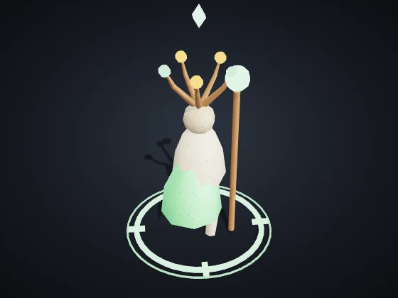 | **Warden** — Support/Hack · Leader: Sylvia Oriel Health 820 · Speed 86 · Sight 260 Attack 18 every 1 s, range 150 *Avatar of Sylvia Oriel: roots, healing blossoms and spores.* |

| Ability | Target | Cooldown | Effect |
|:--|:--|:-:|:--|
| **Roots** | point on the ground (range 240) | 22 s | Roots enemies in an area for 3 s. |
| **Bloom** | around the avatar | 28 s | Heals your units (160) and buildings (200) around. |
| **Spores** | point on the ground (range 260) | 30 s | A cloud that hurts enemies for 8 s (14 damage/s). |

The level rises with the avatar's veterancy: each level adds +15% damage and healing, −5% cooldown and +10% health. When it falls, it returns at the Core after 40 s + 10 s per level, keeping its level.

## Units

| | |
|:-:|:--|
| 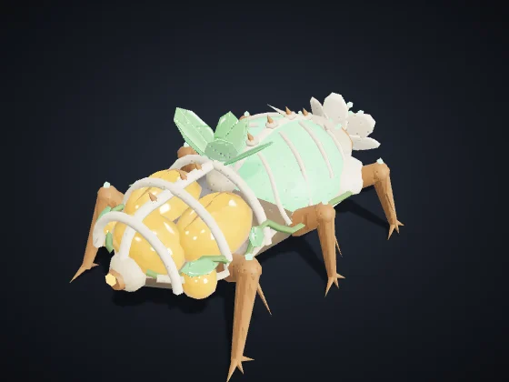 | **Harvester** (key C) — Civilian · Era I · Built at: Dominion Core Cost: 60 Ore · Health 90 · Speed 85 · Sight 110 · Cargo 50 *Automatically harvests nodes in your territory and delivers to the nearest Refinery or Core.* |
| 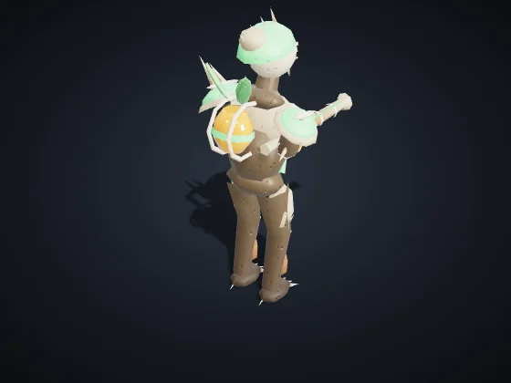 | **Orbital Infantry** (key I) — Infantry · Era I · Built at: Orbital Barracks Cost: 50 Ore · Health 120 · Speed 90 · Sight 160 Attack 12 every 0.8 s, range 110 *Strong vs Drones and Support. Weak vs Vehicles and Structures.* |
| 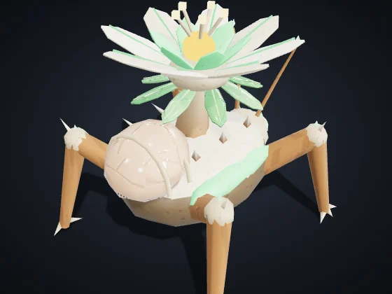 | **Support / Hack** (key S) — Support/Hack · Era II · Built at: Orbital Barracks Cost: 90 Ore + 20 Data · Health 100 · Speed 80 · Sight 200 Attack 10 every 1.5 s, range 170 *Strong vs Vehicles and Structures, and slows them. Weak vs Infantry and Drones.* |
| 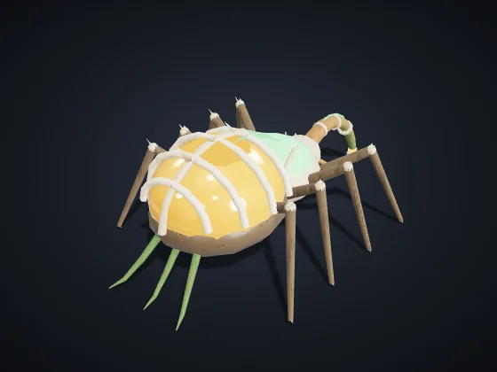 | **Graft** (key P) — Support/Hack · Era I · Built at: Orbital Barracks Cost: 120 Ore + 30 Plasma · Health 140 · Speed 100 · Sight 180 · Cargo 300 *Siphons enemy Refineries and Reactors for up to 40 s. Erevane: cloaked, +20% stolen. Vehnar: Hauler, slow and tough, carries 2x.* |
| 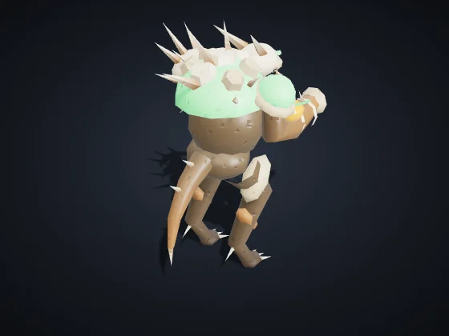 | **Chimera** (key I) — Infantry · Era I · Built at: Orbital Barracks Cost: 55 Ore · Health 140 · Speed 88 · Sight 170 Attack 12 every 0.8 s, range 110 *Adaptive infantry. Gains Traits against the classes it fights most.* |
| 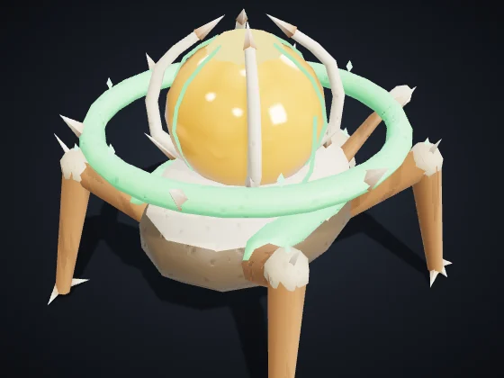 | **Mold** (key O) — Support/Hack · Era II · Built at: Orbital Barracks Cost: 130 Ore + 20 Plasma + 20 Data · Health 150 · Speed 75 · Sight 200 Damage aura within 100 *Unarmed. Your units within 100 of it deal +15% damage.* |
| 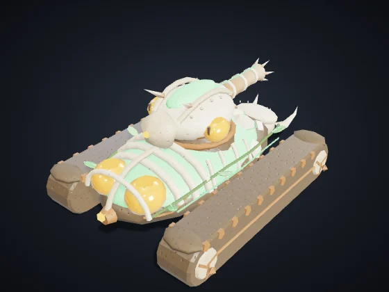 | **Heavy Vehicle** (key V) — Vehicles · Era II · Built at: Vehicle Factory Cost: 160 Ore + 40 Plasma · Health 420 · Speed 65 · Sight 170 Attack 40 every 1.4 s, range 150, splash 24 *Strong vs Infantry and Structures. Weak vs Drones and Support.* |
| 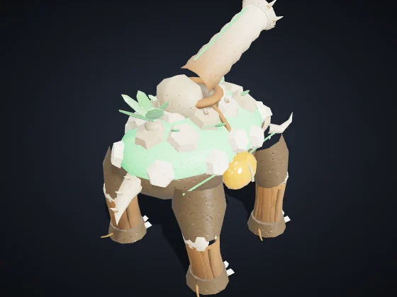 | **Shifting Colossus** (key C) — Vehicles · Era III · Built at: Vehicle Factory Cost: 320 Ore + 80 Plasma + 25 Data · Health 1,150 · Speed 50 · Sight 180 Attack 60 every 1.8 s, range 150, splash 28 *Heavy siege unit with an area cannon. Gains Traits like the other Tessara units.* |
| 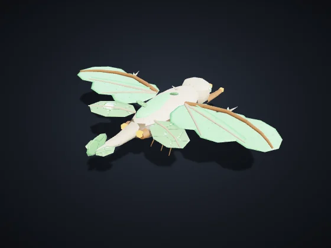 | **Aerial Drone** (key D) — Drones · Era II · Built at: Drone Hangar Cost: 120 Ore + 50 Plasma · Health 160 · Speed 150 · Sight 220 Attack 18 every 0.9 s, range 120 *Strong vs Vehicles and Support. Weak vs Infantry and Structures. Flies over the Rift.* |
| 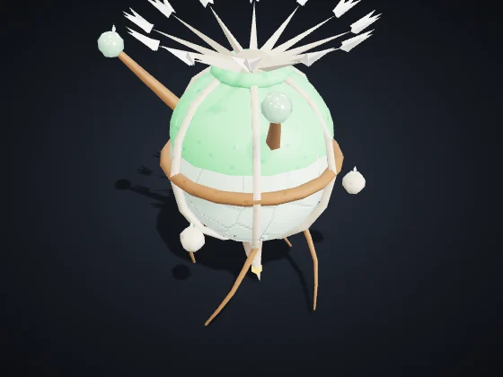 | **Spore Sentinel** (key E) — Drones · Era II · Built at: Drone Hangar Cost: 70 Ore + 20 Plasma · Health 90 · Speed 160 · Sight 330 Attack 7 every 0.45 s, range 85 *Recon drone with very long-range sensors.* |

## Buildings

| | |
|:-:|:--|
| 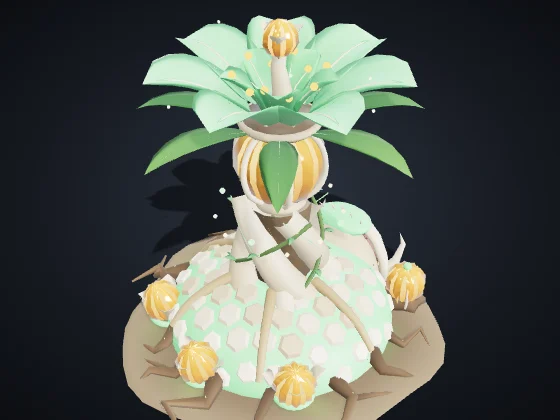 | **Dominion Core** — Era I Cost: — · Health 8,000 · Energy +60 · Sight 420 Produces: Harvester *The heart of the colony. Produces harvesters. If it falls, you are eliminated.* |
| 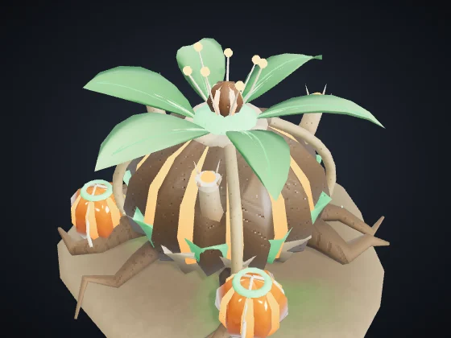 | **Reactor** (B + R) — Era I Cost: 120 Ore · Health 700 · Energy +35 · Sight 120 *+35 energy by burning 0.3 Plasma/s. Vehnar: gives off Smoke visible to everyone.* Module **Fusion Chamber** (Era II, 120 Ore + 40 Plasma): +60% energy from this Reactor, without burning more Plasma. |
| 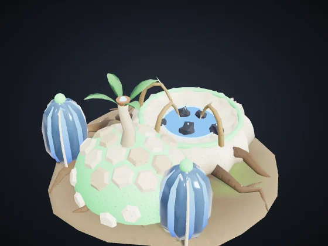 | **Refinery** (B + F) — Era I Cost: 150 Ore · Health 1,000 · Energy −6 · Sight 140 *Drop-off point near the nodes. A Siphon target.* Modules with a choice (Era II, 150 Ore + 50 Plasma): **Ore Press** — +0.5 Ore per second. · **Armored Vault** — +60% health and regenerates 4 health/s. |
| 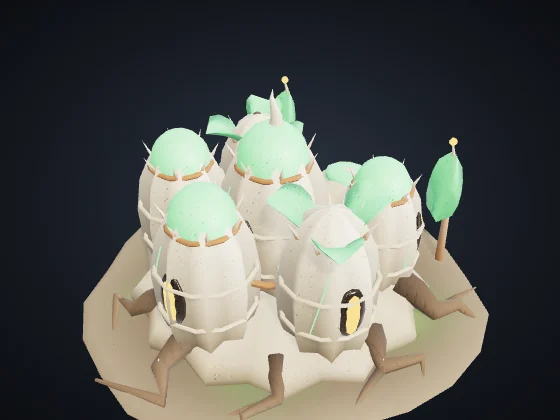 | **Orbital Barracks** (B + Q) — Era I Cost: 200 Ore · Health 1,150 · Energy −8 · Sight 140 Produces: Orbital Infantry, Support / Hack, Graft, Chimera, Mold *Produces Infantry, Support/Hack and Pirates.* Module **Academy** (Era II, 160 Ore + 60 Plasma + 30 Data): Infantry from this Barracks comes out Veteran (★): +10% damage and −7% damage taken. |
| 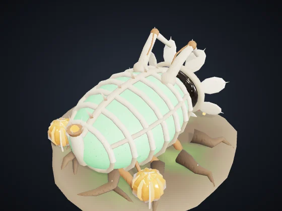 | **Vehicle Factory** (B + V) — Era II Cost: 300 Ore + 60 Plasma · Health 1,300 · Energy −12 · Sight 140 Produces: Heavy Vehicle, Shifting Colossus *Produces Heavy Vehicles.* Modules with a choice (Era II, 150 Ore + 50 Plasma): **Fast Line** — 20% faster production in this Factory. · **Reinforced Chassis** — Vehicles from here come out with +15% health. |
| 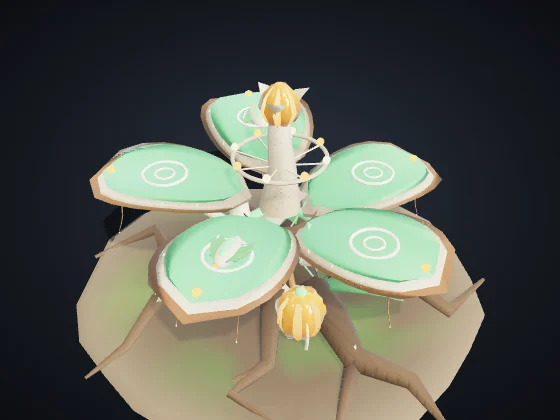 | **Drone Hangar** (B + H) — Era II Cost: 280 Ore + 60 Plasma · Health 1,150 · Energy −12 · Sight 160 Produces: Aerial Drone, Spore Sentinel *Produces Aerial Drones.* Modules with a choice (Era II, 150 Ore + 50 Plasma): **Afterburner** — Drones from here come out 12% faster. · **Repair Dock** — Repairs your flying units within 160 (5 health/s). |
| 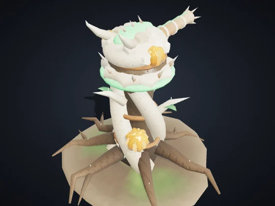 | **Defense Tower** (B + T) — Era I Cost: 180 Ore + 40 Plasma · Health 1,100 · Energy −10 · Sight 260 Attack 30 every 1 s, range 230, splash 16 *Strong vs Infantry and Drones. Detects cloaked units within 140.* Module **Heavy Battery** (Era III, 150 Ore + 60 Plasma): +40% health and +30% damage for this Tower. |
| 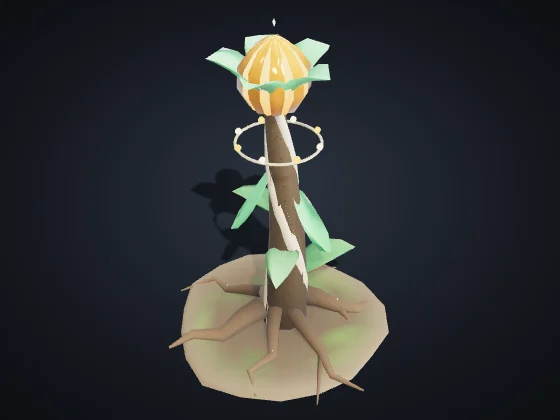 | **Forward Outpost** (B + N) — Era I Cost: 120 Ore + 20 Plasma · Health 650 · Energy −4 · Sight 260 *Claims territory within 320 and frees nodes for automatic harvesting. Can be placed up to 650 from any of your structures.* Modules with a choice (Era II, 150 Ore + 50 Plasma): **Forward Post** — +50% health and regenerates 3 health/s. · **Pulse Mine** — A 45-damage area pulse on enemies within 90, every 6 s. |
| 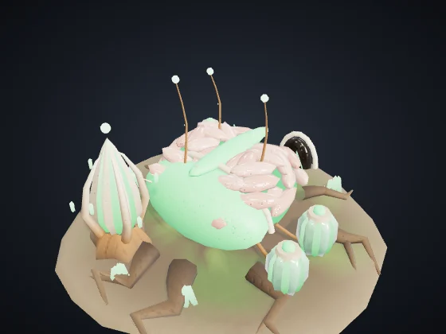 | **Laboratory** (B + L) — Era II Cost: 220 Ore + 60 Plasma + 40 Data · Health 900 · Energy −10 · Sight 140 *Research and the superweapon, paid with Data Shards.* Modules with a choice (Era II, 150 Ore + 50 Plasma): **Data Antenna** — +0.3 Data per second. · **Counterintelligence** — Detects cloaked enemy units within 260, like a Tower. |
| 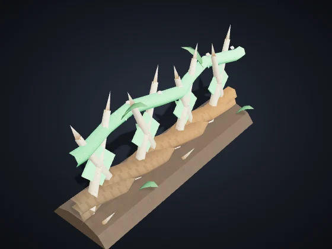 | **Wall** (B + M) — Era I Cost: 20 Ore · Health 450 · Sight 50 *Cheap barrier. Drag to draw a line. Blocks units and absorbs fire.* |
| 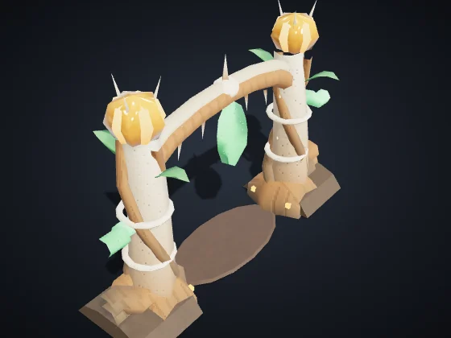 | **Gate** (B + G) — Era I Cost: 40 Ore · Health 600 · Sight 60 *A stretch of wall your units can pass through. Enemies have to knock it down.* |

## Unique buildings

Each Race has two, and each player can raise at most one of each (shortcuts B + J and B + K).

| | |
|:-:|:--|
| 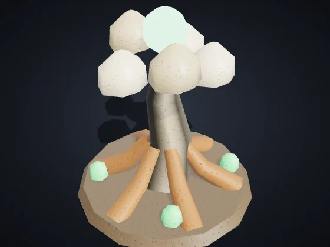 | **Mother Tree** (B + J) — Era I Cost: 220 Ore + 40 Plasma · Health 1,200 · Energy −6 · Sight 200 *Heals your units and buildings within 150 (+40 per Era): 3 health/s (+2 per Era). Grows and gains health every Era.* |
| 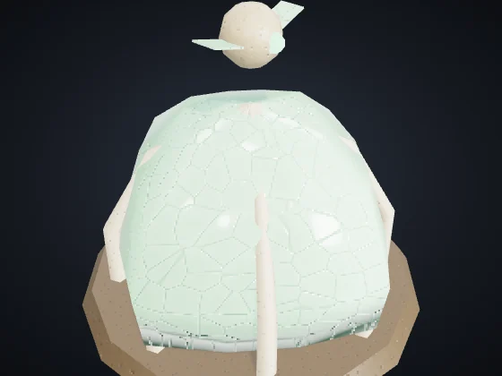 | **Nursery** (B + K) — Era II Cost: 200 Ore + 50 Plasma · Health 800 · Energy −6 · Sight 180 *Grows Sentinel Spores for free: one every 45 s, up to 3 alive at once.* |

---

Values on Normal, with no research or veterancy. Health and damage are game points; distance and speed are map units (the map is 3200 across). Generated by `node tools/docs-gerar.cjs` from the game code (numbers from the simulation, texts from the dictionaries). Images: `tools/galeria.cjs`, with the game's own models.
