<!-- Generado por node tools/docs-gerar.cjs a partir del código del juego (números de la simulación y textos de los diccionarios). Imágenes: tools/galeria.cjs, con los modelos del propio juego. -->
# Consorcio Vehnar

**Idiomas:** [English](vehnar.md) · [Português (Brasil)](vehnar.pt-BR.md) · **Español** · [Todas las Razas](README.es.md) · [Volver al README](../../README.es.md)

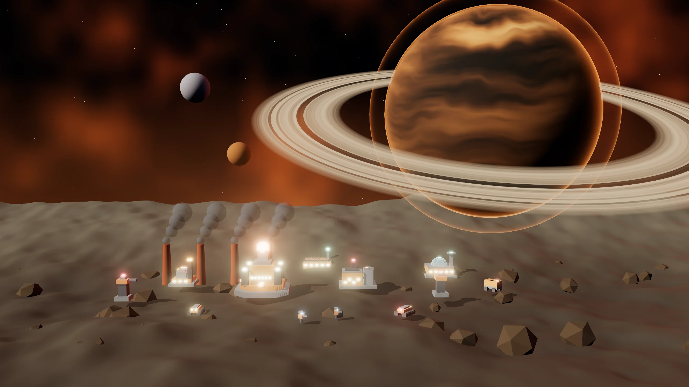

> Eficiencia industrial. Líneas de Montaje, Lotes y Reactores humeantes.

## El líder y la historia

**Líder:** Barão-Forja  
**Mundo natal:** Kessari (mundo forja de las fundiciones) · Colonia fábrica  
**Estilo de juego:** Industria pesada · Líneas de Montaje · Estructuras blindadas · Humo visible

*“Barão-Forja en línea. Los hornos de Kessari están encendidos, comandante.”*

 

## Habilidades de la Raza

- **Líneas de Montaje:** cada otra construcción de producción hasta 150 acelera la cola un 12 % (hasta 4).
- **Lotes:** con 4 o más unidades iguales en la cola, cada una cuesta el 50 % del precio.
- **Reactores humeantes:** los Reactores Vehnar son visibles para todos los jugadores.
- **Estructuras blindadas:** las construcciones Vehnar no sufren el daño extra de los vehículos.
- **Saltos de Núcleo:** 1 por partida.

## Superarma: Fundición Orbital

Lanza un Bastión prefabricado en tu propio territorio (3 s). Cuesta 300 Datos + 200 Plasma.

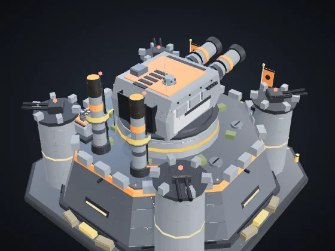  
**Bastión** — Vida 2,200 · Fortaleza de la Fundición Orbital.

## Ascensión de la Raza: Revolución Industrial

Producción 25% más rápida y los Reactores queman 30% menos Plasma. Costo: 300 Mineral + 200 Plasma + 150 Datos.

## Comandante en el campo: Exo-Forja

Opción de la partida (Comandantes en el campo): el líder entra al mapa con un avatar y tres habilidades.

| | |
|:-:|:--|
| 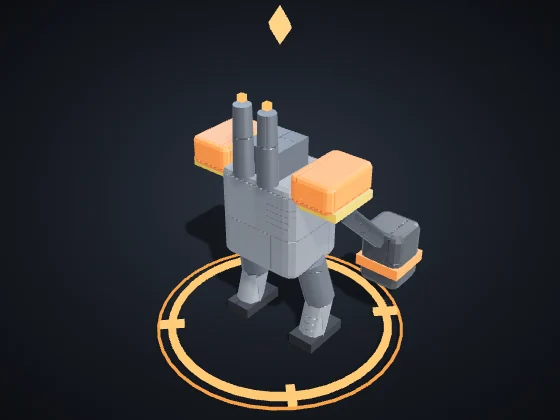 | **Exo-Forja** — Vehículos · Líder: Barão-Forja Vida 950 · Velocidad 78 · Visión 240 Ataque 34 cada 1.2 s, alcance 120, área 18 *Avatar del Barón-Forja: exoesqueleto de fundición con martillo sísmico.* |

| Habilidad | Objetivo | Recarga | Efecto |
|:--|:--|:-:|:--|
| **Martillo Sísmico** | punto en el suelo (alcance 220) | 18 s | Golpe al suelo: 110 de daño en área (r 90) e inmoviliza a los enemigos 1,2 s. |
| **Reparación de Campo** | alrededor del avatar | 25 s | Repara tus unidades (140) y edificios (240) alrededor. |
| **Llamada de la Fundición** | punto en el suelo (alcance 260) | 60 s | Dos Soldadores bajan a luchar durante 30 s. |

El nivel sube con la veteranía del avatar: cada nivel suma +15 % de daño y curación, −5 % de recarga y +10 % de vida. Cuando cae, vuelve al Núcleo después de 40 s + 10 s por nivel, con el nivel que tenía.

## Unidades

| | |
|:-:|:--|
| 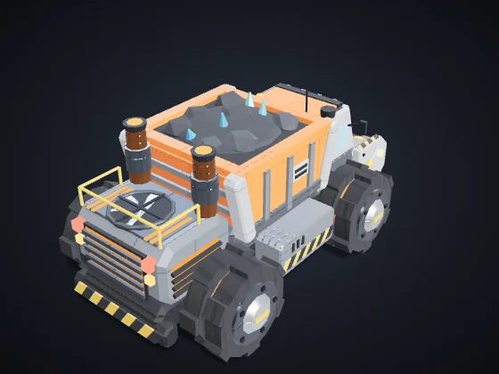 | **Recolector** (tecla C) — Civil · Era I · Se produce en: Núcleo de Dominio Costo: 60 Mineral · Vida 90 · Velocidad 85 · Visión 110 · Carga 50 *Recolecta automáticamente los nodos de tu territorio y entrega en la Refinería o el Núcleo más cercano.* |
| 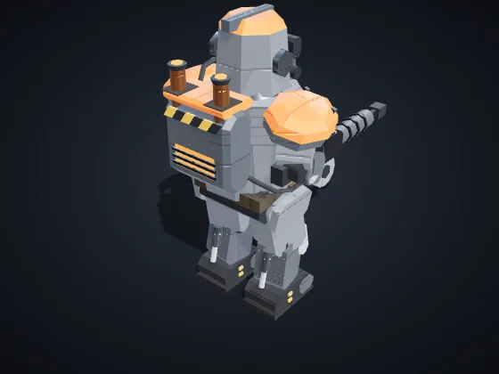 | **Infantería Orbital** (tecla I) — Infantería · Era I · Se produce en: Cuartel Orbital Costo: 50 Mineral · Vida 120 · Velocidad 90 · Visión 160 Ataque 12 cada 0.8 s, alcance 110 *Fuerte contra Drones y Soporte. Débil contra Vehículos y Estructuras.* |
| 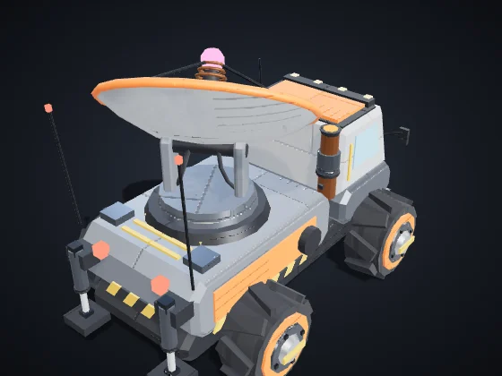 | **Soporte / Hack** (tecla S) — Soporte/Hack · Era II · Se produce en: Cuartel Orbital Costo: 90 Mineral + 20 Datos · Vida 100 · Velocidad 80 · Visión 200 Ataque 10 cada 1.5 s, alcance 170 *Fuerte contra Vehículos y Estructuras, y los ralentiza. Débil contra Infantería y Drones.* |
| 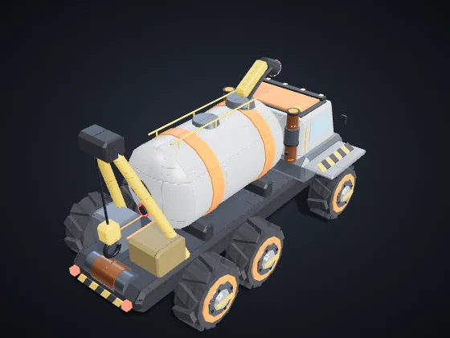 | **Remolcador** (tecla P) — Soporte/Hack · Era I · Se produce en: Cuartel Orbital Costo: 120 Mineral + 30 Plasma · Vida 260 · Velocidad 72 · Visión 180 · Carga 600 *Sifona Refinerías y Reactores enemigos hasta 40 s. Erevane: camuflado y +20% de robo. Vehnar: Remolcador, lento y resistente, carga el doble.* |
| 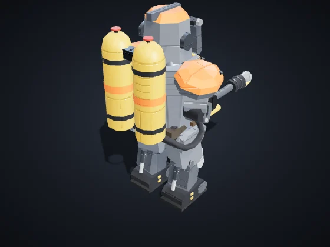 | **Soldador** (tecla O) — Infantería · Era I · Se produce en: Cuartel Orbital Costo: 90 Mineral + 15 Plasma · Vida 170 · Velocidad 75 · Visión 150 Ataque 20 cada 0.5 s, alcance 75, área 22 *Lanzallamas de corto alcance con daño en área. Devastador contra infantería; débil contra vehículos.* |
| 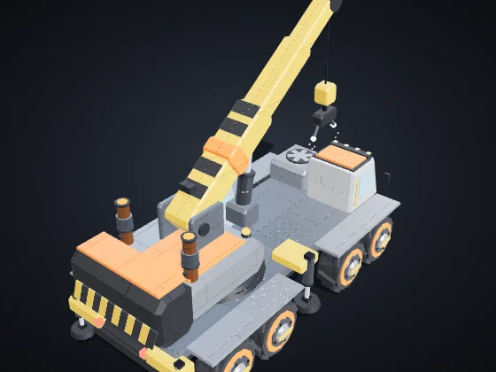 | **Grúa Armada** (tecla U) — Soporte/Hack · Era II · Se produce en: Cuartel Orbital Costo: 180 Mineral + 40 Plasma · Vida 320 · Velocidad 60 · Visión 170 Repara 4 de vida/s en unidades y 9/s en estructuras hasta 90 *Sin armas. Repara sin parar tus unidades y estructuras cercanas.* |
| 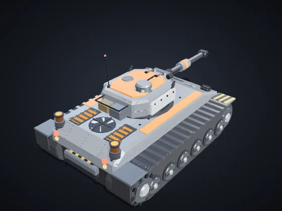 | **Vehículo Pesado** (tecla V) — Vehículos · Era II · Se produce en: Fábrica de Vehículos Costo: 160 Mineral + 40 Plasma · Vida 420 · Velocidad 65 · Visión 170 Ataque 40 cada 1.4 s, alcance 150, área 24 *Fuerte contra Infantería y Estructuras. Débil contra Drones y Soporte.* |
| 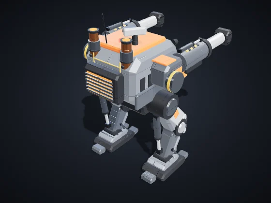 | **Prensa** (tecla R) — Vehículos · Era III · Se produce en: Fábrica de Vehículos Costo: 320 Mineral + 80 Plasma · Vida 900 · Velocidad 50 · Visión 170 Ataque 70 cada 2.2 s, alcance 140, área 34 *Mech bípedo de asedio: cañones dobles con gran área. Lento y caro.* |
| 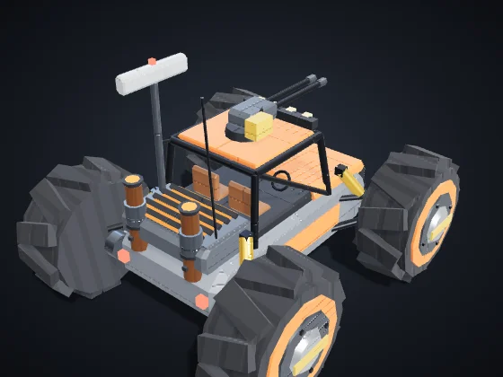 | **Tractorón** (tecla T) — Vehículos · Era II · Se produce en: Fábrica de Vehículos Costo: 110 Mineral + 20 Plasma · Vida 220 · Velocidad 135 · Visión 320 Ataque 18 cada 0.9 s, alcance 120 *Vehículo ligero y rápido de reconocimiento, con sensores de largo alcance y ametralladora.* |
| 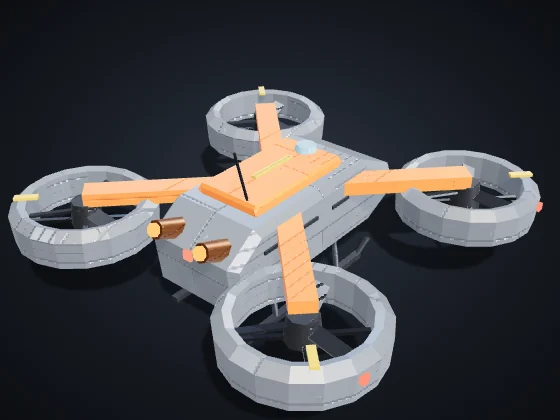 | **Dron Aéreo** (tecla D) — Drones · Era II · Se produce en: Hangar de Drones Costo: 120 Mineral + 50 Plasma · Vida 160 · Velocidad 150 · Visión 220 Ataque 18 cada 0.9 s, alcance 120 *Fuerte contra Vehículos y Soporte. Débil contra Infantería y Estructuras. Vuela sobre la Grieta.* |

## Construcciones

| | |
|:-:|:--|
| 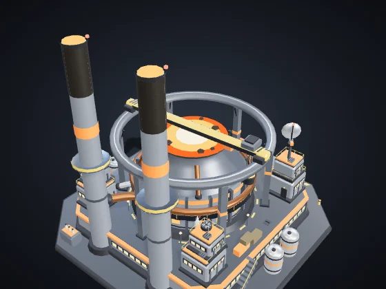 | **Núcleo de Dominio** — Era I Costo: — · Vida 8,000 · Energía +60 · Visión 420 Produce: Recolector *Centro de la colonia. Produce recolectores. Si cae, quedas eliminado.* |
| 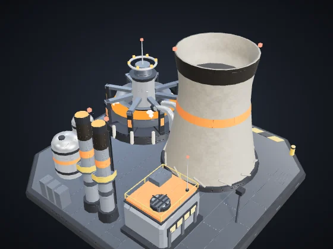 | **Reactor** (B + R) — Era I Costo: 120 Mineral · Vida 700 · Energía +35 · Visión 120 *+35 de energía quemando 0.3 de Plasma/s. Vehnar: echa Humo visible para todos.* Módulo **Cámara de Fusión** (Era II, 120 Mineral + 40 Plasma): +60% de energía en este Reactor, sin quemar más Plasma. |
| 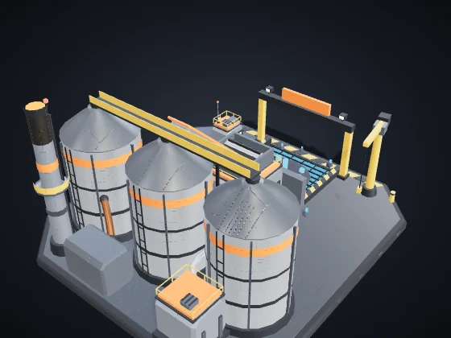 | **Refinería** (B + F) — Era I Costo: 150 Mineral · Vida 1,000 · Energía −6 · Visión 140 *Punto de entrega cerca de los nodos. Blanco de Sifón.* Módulos a elegir (Era II, 150 Mineral + 50 Plasma): **Prensa de Mineral** — +0,5 de Mineral por segundo. · **Cofre Blindado** — +60% de vida y regenera 4 de vida/s. |
| 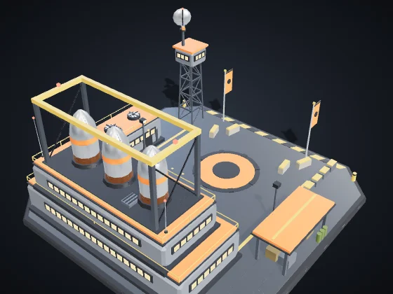 | **Cuartel Orbital** (B + Q) — Era I Costo: 200 Mineral · Vida 1,150 · Energía −8 · Visión 140 Produce: Infantería Orbital, Soporte / Hack, Remolcador, Soldador, Grúa Armada *Produce Infantería, Soporte/Hack y Piratas.* Módulo **Academia** (Era II, 160 Mineral + 60 Plasma + 30 Datos): La infantería de este Cuartel ya sale Veterana (★): +10% de daño y −7% de daño recibido. |
| 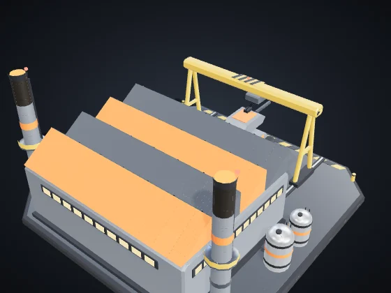 | **Fábrica de Vehículos** (B + V) — Era II Costo: 300 Mineral + 60 Plasma · Vida 1,300 · Energía −12 · Visión 140 Produce: Vehículo Pesado, Prensa, Tractorón *Produce Vehículos Pesados.* Módulos a elegir (Era II, 150 Mineral + 50 Plasma): **Línea Rápida** — Producción un 20% más rápida en esta Fábrica. · **Chasis Reforzado** — Los vehículos de aquí salen con +15% de vida. |
| 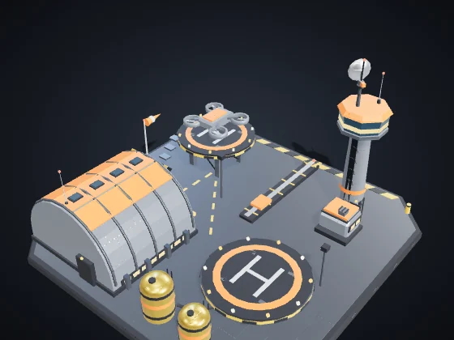 | **Hangar de Drones** (B + H) — Era II Costo: 280 Mineral + 60 Plasma · Vida 1,150 · Energía −12 · Visión 160 Produce: Dron Aéreo *Produce Drones Aéreos.* Módulos a elegir (Era II, 150 Mineral + 50 Plasma): **Postcombustión** — Los drones de aquí salen un 12% más rápidos. · **Dique de Reparación** — Repara tus unidades voladoras a menos de 160 (5 de vida/s). |
| 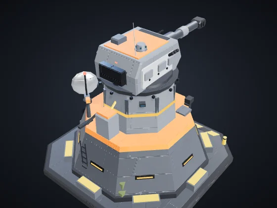 | **Torre de Defensa** (B + T) — Era I Costo: 180 Mineral + 40 Plasma · Vida 1,100 · Energía −10 · Visión 260 Ataque 30 cada 1 s, alcance 230, área 16 *Fuerte contra Infantería y Drones. Detecta camuflaje a 140.* Módulo **Batería Pesada** (Era III, 150 Mineral + 60 Plasma): +40% de vida y +30% de daño en esta Torre. |
| 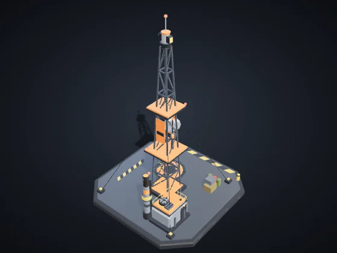 | **Nódulo de Avance** (B + N) — Era I Costo: 120 Mineral + 20 Plasma · Vida 650 · Energía −4 · Visión 260 *Reclama territorio en 320 y libera nodos para la recolección automática. Se puede colocar hasta a 650 de cualquier estructura tuya.* Módulos a elegir (Era II, 150 Mineral + 50 Plasma): **Puesto Avanzado** — +50% de vida y regenera 3 de vida/s. · **Mina de Pulso** — Pulso de 45 de daño en área a los enemigos a menos de 90, cada 6 s. |
| 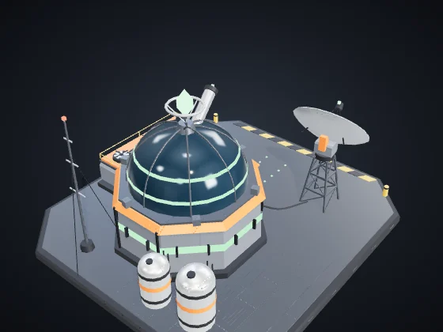 | **Laboratorio** (B + L) — Era II Costo: 220 Mineral + 60 Plasma + 40 Datos · Vida 900 · Energía −10 · Visión 140 *Investigaciones y superarma, pagadas con Fragmentos de Datos.* Módulos a elegir (Era II, 150 Mineral + 50 Plasma): **Antena de Datos** — +0,3 de Datos por segundo. · **Contraespionaje** — Detecta las unidades camufladas enemigas a menos de 260, como una Torre. |
| 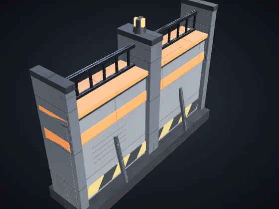 | **Muro** (B + M) — Era I Costo: 20 Mineral · Vida 450 · Visión 50 *Barrera barata. Arrastra para trazar una línea. Bloquea unidades y absorbe disparos.* |
| 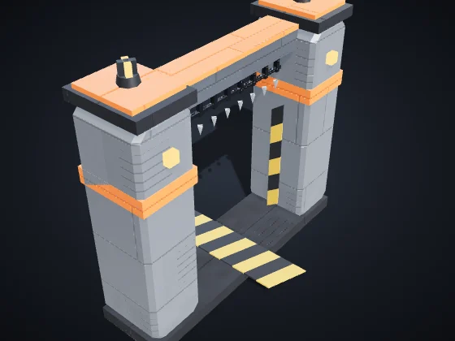 | **Portón** (B + G) — Era I Costo: 40 Mineral · Vida 600 · Visión 60 *Tramo de muro que tus unidades atraviesan. Los enemigos tienen que derribarlo.* |

## Construcciones únicas

Cada Raza tiene dos, y cada jugador levanta como máximo una de cada (atajos B + J y B + K).

| | |
|:-:|:--|
| 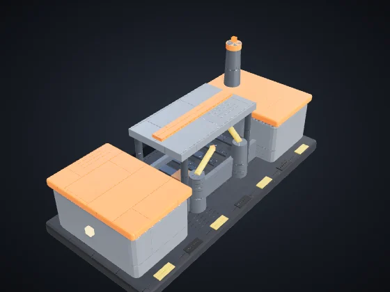 | **Cinta de Montaje** (B + J) — Era II Costo: 250 Mineral + 80 Plasma · Vida 900 · Energía −8 · Visión 140 *Une los dos edificios de producción más cercanos (hasta 260): +20% de velocidad de producción en ellos.* |
| 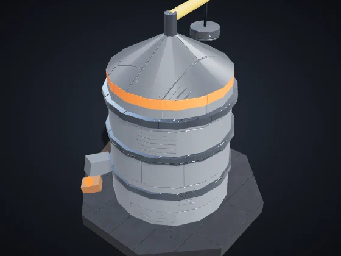 | **Silo de Chatarra** (B + K) — Era I Costo: 180 Mineral · Vida 800 · Energía −4 · Visión 160 *Los restos a menos de 240 se convierten solos en Mineral: 3 por segundo de cada uno, hasta 3 restos a la vez.* |

---

Valores en dificultad Normal, sin investigaciones ni veteranía. Vida y daño: puntos del juego; distancia y velocidad: unidades del mapa (el mapa mide 3200 de lado). Generado por `node tools/docs-gerar.cjs` a partir del código del juego (números de la simulación y textos de los diccionarios). Imágenes: `tools/galeria.cjs`, con los modelos del propio juego.
