<!-- Gerado por node tools/docs-gerar.cjs a partir do código do jogo (números da simulação e textos dos dicionários). Imagens: tools/galeria.cjs, com os modelos do próprio jogo. -->
# Consórcio Vehnar

**Idiomas:** **Português (Brasil)** · [English](vehnar.en.md) · [Español](vehnar.es.md) · [Todas as Raças](README.md) · [Voltar ao README](../../README.md)

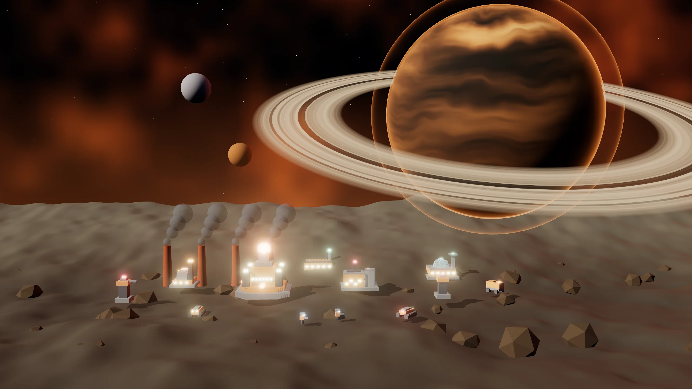

> Eficiência industrial. Linhas de Montagem, Lotes e Reatores que fumegam.

## O líder e a história

**Líder:** Barão-Forja  
**Mundo natal:** Kessari (mundo-forja das fundições) · Colônia-fábrica  
**Estilo de jogo:** Indústria pesada · Linhas de Montagem · Estruturas blindadas · Fumaça visível

*“Barão-Forja na linha. As fornalhas de Kessari estão acesas, comandante.”*

 

## Habilidades da Raça

- **Linhas de Montagem:** cada outra construção de produção a até 150 acelera a fila em 12% (até 4 delas).
- **Lotes:** com 4 ou mais unidades iguais na fila, cada uma custa 50% do preço.
- **Reatores que fumegam:** os Reatores Vehnar ficam visíveis para todos os jogadores.
- **Estruturas blindadas:** as construções Vehnar não sofrem o dano extra dos veículos.
- **Saltos de Núcleo:** 1 por partida.

## Superarma: Fundição Orbital

Derruba um Bastião pré-construído em território próprio (3 s). Custa 300 Dados + 200 Plasma.

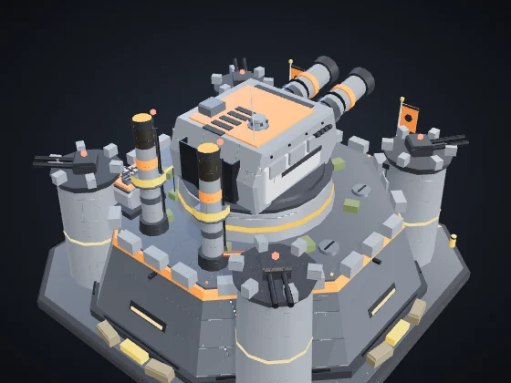  
**Bastião** — Vida 2.200 · Fortaleza da Fundição Orbital.

## Ascensão da Raça: Revolução Industrial

Produção 25% mais rápida e Reatores queimam 30% menos Plasma. Custo: 300 Minério + 200 Plasma + 150 Dados.

## Unidades

| | |
|:-:|:--|
| 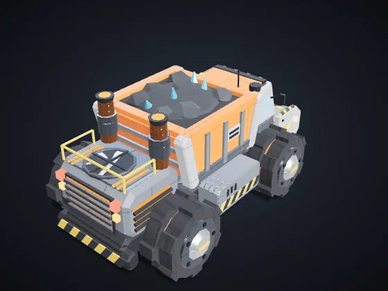 | **Coletor** (tecla C) — Civil · Era I · Produzida em: Núcleo de Domínio Custo: 60 Minério · Vida 90 · Velocidade 85 · Visão 110 · Carga 50 *Coleta automaticamente nós no seu território e entrega na Refinaria ou Núcleo mais próximo.* |
| 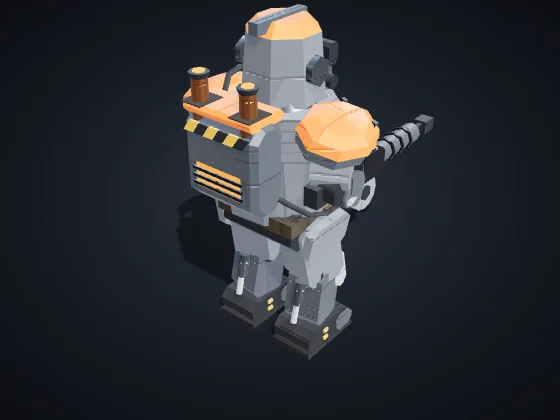 | **Infantaria Orbital** (tecla I) — Infantaria · Era I · Produzida em: Quartel Orbital Custo: 50 Minério · Vida 120 · Velocidade 90 · Visão 160 Ataque 12 a cada 0,8 s, alcance 110 *Forte vs Drones e Suporte. Fraca vs Veículos e Estruturas.* |
| 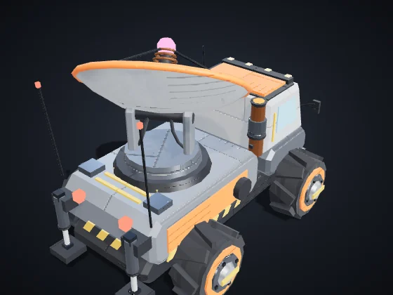 | **Suporte / Hack** (tecla S) — Suporte/Hack · Era II · Produzida em: Quartel Orbital Custo: 90 Minério + 20 Dados · Vida 100 · Velocidade 80 · Visão 200 Ataque 10 a cada 1,5 s, alcance 170 *Forte vs Veículos e Estruturas, e os atrasa. Fraco vs Infantaria e Drones.* |
| 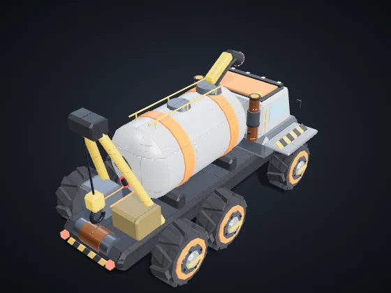 | **Rebocador** (tecla P) — Suporte/Hack · Era I · Produzida em: Quartel Orbital Custo: 120 Minério + 30 Plasma · Vida 260 · Velocidade 72 · Visão 180 · Carga 600 *Sifona Refinarias e Reatores inimigos por até 40 s. Erevane: camuflado e +20% no roubo. Vehnar: Rebocador, lento e resistente, carrega 2x.* |
| 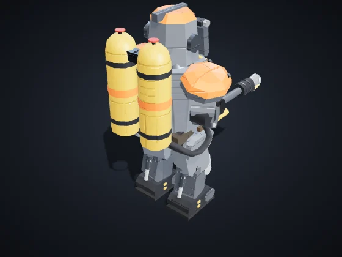 | **Soldador** (tecla O) — Infantaria · Era I · Produzida em: Quartel Orbital Custo: 90 Minério + 15 Plasma · Vida 170 · Velocidade 75 · Visão 150 Ataque 20 a cada 0,5 s, alcance 75, área 22 *Lança-chamas de curto alcance com dano em área. Devastador contra infantaria; fraco contra veículos.* |
| 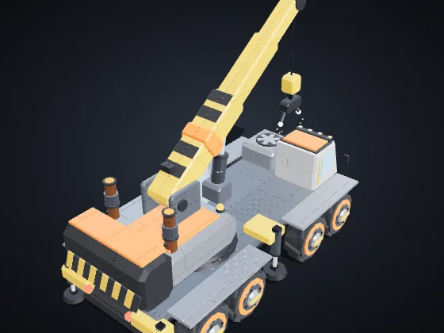 | **Guindaste Armado** (tecla U) — Suporte/Hack · Era II · Produzida em: Quartel Orbital Custo: 180 Minério + 40 Plasma · Vida 320 · Velocidade 60 · Visão 170 Repara 4 de vida/s em unidades e 9/s em estruturas a até 90 *Sem armas. Repara unidades e estruturas suas por perto, continuamente.* |
| 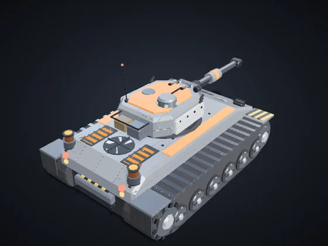 | **Veículo Pesado** (tecla V) — Veículos · Era II · Produzida em: Fábrica de Veículos Custo: 160 Minério + 40 Plasma · Vida 420 · Velocidade 65 · Visão 170 Ataque 40 a cada 1,4 s, alcance 150, área 24 *Forte vs Infantaria e Estruturas. Fraco vs Drones e Suporte.* |
| 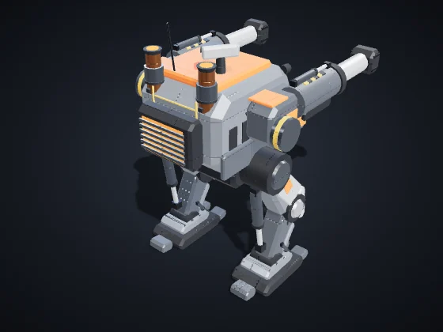 | **Prensa** (tecla R) — Veículos · Era III · Produzida em: Fábrica de Veículos Custo: 320 Minério + 80 Plasma · Vida 900 · Velocidade 50 · Visão 170 Ataque 70 a cada 2,2 s, alcance 140, área 34 *Mech bípede de cerco: canhões duplos com grande área. Lento e caro.* |
| 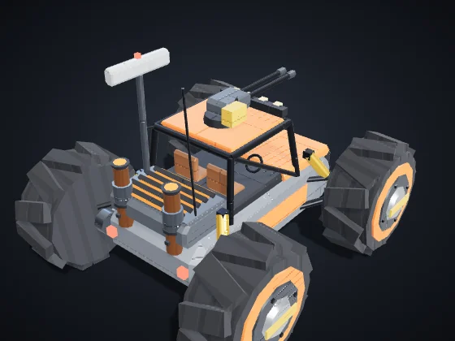 | **Tratorzão** (tecla T) — Veículos · Era II · Produzida em: Fábrica de Veículos Custo: 110 Minério + 20 Plasma · Vida 220 · Velocidade 135 · Visão 320 Ataque 18 a cada 0,9 s, alcance 120 *Veículo leve e rápido de reconhecimento, com sensores longos e metralhadora.* |
| 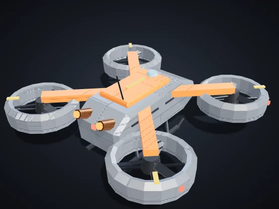 | **Drone Aéreo** (tecla D) — Drones · Era II · Produzida em: Hangar de Drones Custo: 120 Minério + 50 Plasma · Vida 160 · Velocidade 150 · Visão 220 Ataque 18 a cada 0,9 s, alcance 120 *Forte vs Veículos e Suporte. Fraco vs Infantaria e Estruturas. Sobrevoa a Fenda.* |

## Construções

| | |
|:-:|:--|
| 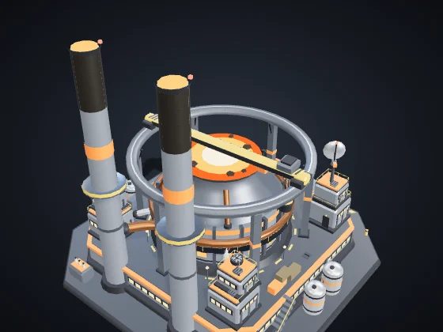 | **Núcleo de Domínio** — Era I Custo: — · Vida 8.000 · Energia +60 · Visão 420 Produz: Coletor *Centro da colônia. Produz coletores. Se cair, você é eliminado.* |
| 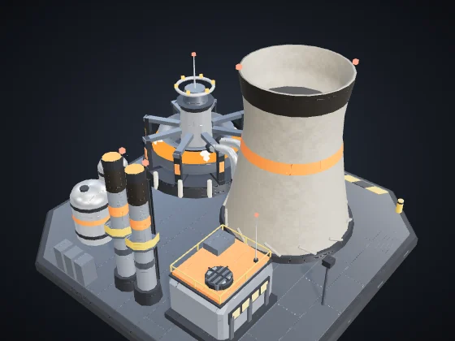 | **Reator** (B + R) — Era I Custo: 120 Minério · Vida 700 · Energia +35 · Visão 120 *+35 de energia queimando 0,3 Plasma/s. Vehnar: emite Fumaça visível a todos.* Módulo **Câmara de Fusão** (Era II, 120 Minério + 40 Plasma): +60% de energia neste Reator, sem queimar mais Plasma. |
| 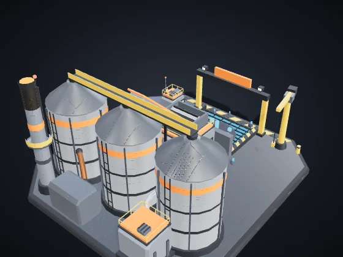 | **Refinaria** (B + F) — Era I Custo: 150 Minério · Vida 1.000 · Energia −6 · Visão 140 *Ponto de entrega perto dos nós. Alvo de Sifão.* |
| 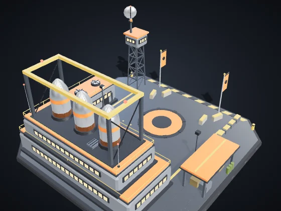 | **Quartel Orbital** (B + Q) — Era I Custo: 200 Minério · Vida 1.150 · Energia −8 · Visão 140 Produz: Infantaria Orbital, Suporte / Hack, Rebocador, Soldador, Guindaste Armado *Produz Infantaria, Suporte/Hack e Piratas.* Módulo **Academia** (Era II, 160 Minério + 60 Plasma + 30 Dados): A infantaria deste Quartel já sai Veterana (★): +10% de dano e −7% de dano recebido. |
| 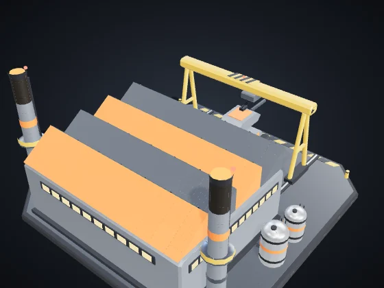 | **Fábrica de Veículos** (B + V) — Era II Custo: 300 Minério + 60 Plasma · Vida 1.300 · Energia −12 · Visão 140 Produz: Veículo Pesado, Prensa, Tratorzão *Produz Veículos Pesados.* |
| 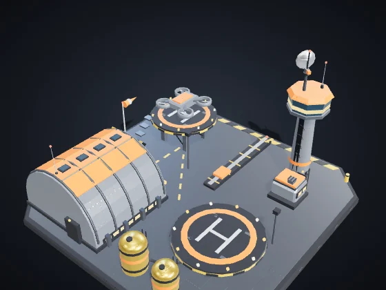 | **Hangar de Drones** (B + H) — Era II Custo: 280 Minério + 60 Plasma · Vida 1.150 · Energia −12 · Visão 160 Produz: Drone Aéreo *Produz Drones Aéreos.* |
| 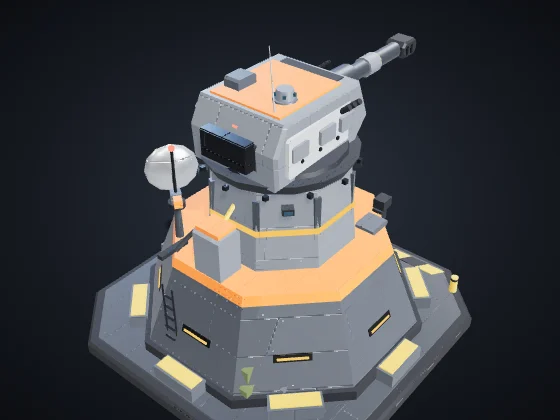 | **Torre de Defesa** (B + T) — Era I Custo: 180 Minério + 40 Plasma · Vida 1.100 · Energia −10 · Visão 260 Ataque 30 a cada 1 s, alcance 230, área 16 *Forte vs Infantaria e Drones. Detecta camuflagem em 140.* Módulo **Bateria Pesada** (Era III, 150 Minério + 60 Plasma): +40% de vida e +30% de dano nesta Torre. |
| 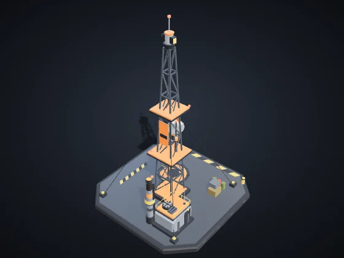 | **Nódulo de Avanço** (B + N) — Era I Custo: 120 Minério + 20 Plasma · Vida 650 · Energia −4 · Visão 260 *Reclama território em 320 e libera nós para coleta automática. Pode ser colocado até 650 de qualquer estrutura sua.* |
| 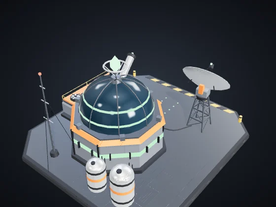 | **Laboratório** (B + L) — Era II Custo: 220 Minério + 60 Plasma + 40 Dados · Vida 900 · Energia −10 · Visão 140 *Pesquisas e superarma, pagas com Fragmentos de Dados.* |
| 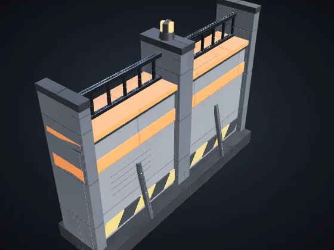 | **Muro** (B + M) — Era I Custo: 20 Minério · Vida 450 · Visão 50 *Barreira barata. Arraste para desenhar uma linha. Bloqueia unidades e absorve tiros.* |
| 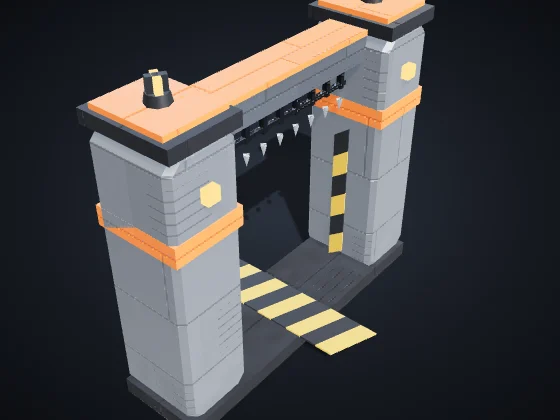 | **Portão** (B + G) — Era I Custo: 40 Minério · Vida 600 · Visão 60 *Trecho de muro que suas unidades atravessam. Inimigos precisam derrubá-lo.* |

---

Valores na dificuldade Normal, sem pesquisas nem veterania. Vida e dano das unidades: pontos do jogo; distância e velocidade: unidades do mapa (o mapa tem 3200 de lado). Gerado por `node tools/docs-gerar.cjs` a partir do código do jogo (números da simulação e textos dos dicionários). Imagens: `tools/galeria.cjs`, com os modelos do próprio jogo.
