<!-- Generated by node tools/docs-gerar.cjs from the game code (numbers from the simulation, texts from the dictionaries). Images: tools/galeria.cjs, with the game's own models. -->
# Vorag Brood

**Languages:** **English** · [Português (Brasil)](vorag.pt-BR.md) · [Español](vorag.es.md) · [All Races](README.md) · [Back to the README](../../README.md)

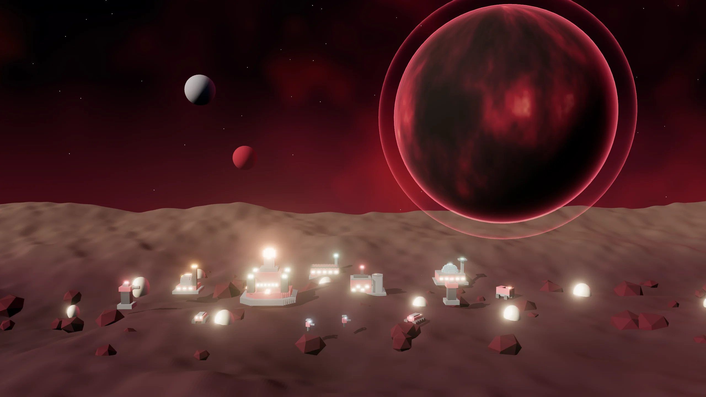

> A ravenous biological swarm. Cheap, fast and always hungry: Broodlings hatch in pairs and the Scavenger devours wrecks and Outposts.

## The leader and the story

**Leader:** Oru Voraz  
**Homeworld:** Velk (nests beneath the crust) · Ravenous swarm  
**Play style:** Cheap swarm · Broodlings in pairs · Hunger away from home · Devours wrecks

*“Oru Voraz. The hunger of Velk never ends.”*

 

## Race abilities

- **Broodlings in pairs:** every Broodling comes out in a pair (a trio with the Ascension).
- **Hunger:** outside your territory, Broodlings lose 0.6 health per second, down to 40% of their health.
- **Devour:** the Scavenger eats wrecks (40 cargo) and bites enemy Outposts (30 damage per bite).
- **Core Jumps:** 1 per match.

## Superweapon: Hatching

Eggs burst out at a visible point and release 8 Broodlings for 30 s. Costs 300 Data + 200 Plasma.

## Race Ascension: Endless Hunger

Broodlings hatch in threes and units regenerate out of combat (3 health/s). Cost: 300 Ore + 200 Plasma + 150 Data.

## Commander in the field: Devourer

A match option (Commanders in the field): the leader enters the map as an avatar with three abilities.

| | |
|:-:|:--|
| 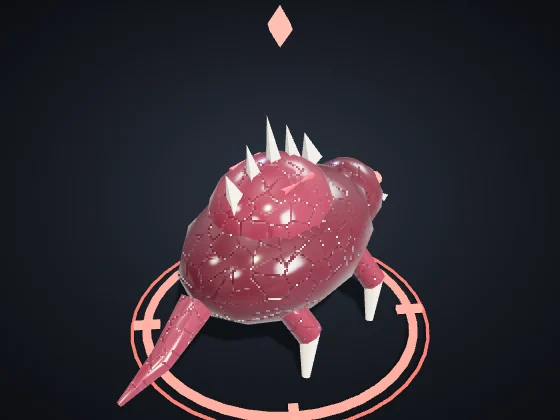 | **Devourer** — Vehicles · Leader: Oru Voraz Health 1,100 · Speed 98 · Sight 220 Attack 40 every 0.9 s, range 34 *Avatar of Oru Voraz: the beast that devours and calls the brood.* |

| Ability | Target | Cooldown | Effect |
|:--|:--|:-:|:--|
| **Devour** | one enemy (range 70) | 20 s | Swallows a weak enemy (up to 220 health) and heals; on strong ones, 220 damage. |
| **Brood** | around the avatar | 40 s | Four Broodlings hatch around for 25 s. |
| **Roar** | around the avatar | 30 s | Enemies around 40% slower for 4 s; allies +15% damage for 6 s. |

The level rises with the avatar's veterancy: each level adds +15% damage and healing, −5% cooldown and +10% health. When it falls, it returns at the Core after 40 s + 10 s per level, keeping its level.

## Units

| | |
|:-:|:--|
| 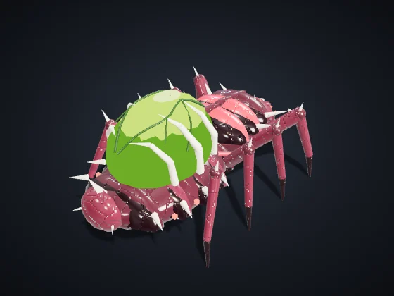 | **Sower** (key C) — Civilian · Era I · Built at: Dominion Core Cost: 60 Ore · Health 90 · Speed 85 · Sight 110 · Cargo 50 *Automatically harvests nodes in your territory and delivers to the nearest Refinery or Core.* |
| 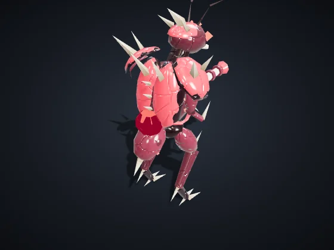 | **Orbital Infantry** (key I) — Infantry · Era I · Built at: Orbital Barracks Cost: 50 Ore · Health 120 · Speed 90 · Sight 160 Attack 12 every 0.8 s, range 110 *Strong vs Drones and Support. Weak vs Vehicles and Structures.* |
| 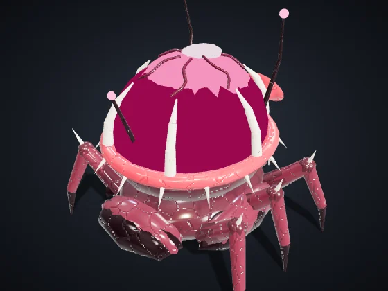 | **Support / Hack** (key S) — Support/Hack · Era II · Built at: Orbital Barracks Cost: 90 Ore + 20 Data · Health 100 · Speed 80 · Sight 200 Attack 10 every 1.5 s, range 170 *Strong vs Vehicles and Structures, and slows them. Weak vs Infantry and Drones.* |
| 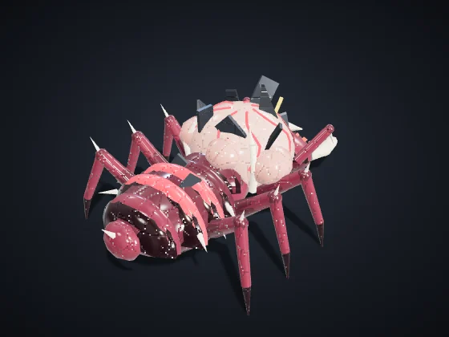 | **Scavenger** (key P) — Support/Hack · Era I · Built at: Orbital Barracks Cost: 120 Ore + 30 Plasma · Health 200 · Speed 95 · Sight 180 · Cargo 300 *Siphons enemy Refineries and Reactors for up to 40 s. Erevane: cloaked, +20% stolen. Vehnar: Hauler, slow and tough, carries 2x.* |
| 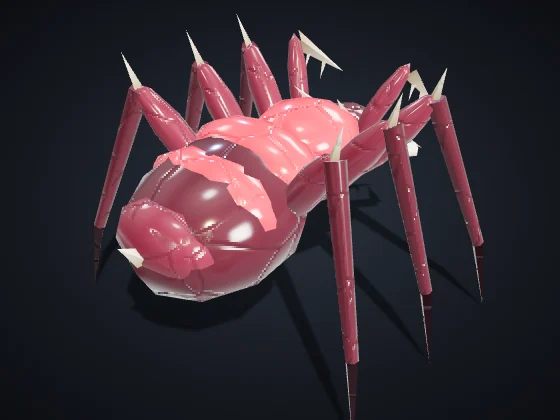 | **Broodling** (key K) — Infantry · Era I · Built at: Orbital Barracks Cost: 26 Ore + 14 Plasma · Health 72 · Speed 122 · Sight 150 Attack 10 every 0.5 s, range 26 *Melee swarm; hatches in pairs. Hunger: outside your territory it slowly loses health (down to 40%).* |
| 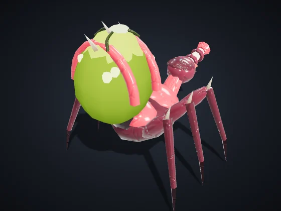 | **Spitter** (key U) — Infantry · Era I · Built at: Orbital Barracks Cost: 55 Ore + 35 Plasma · Health 95 · Speed 90 · Sight 170 Attack 16 every 1.1 s, range 130, splash 14 *Spits acid at medium range; corrodes vehicles and structures.* |
| 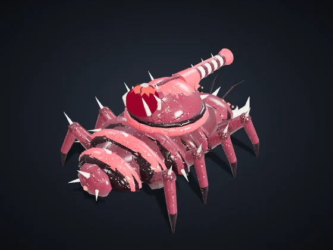 | **Heavy Vehicle** (key V) — Vehicles · Era II · Built at: Vehicle Factory Cost: 160 Ore + 40 Plasma · Health 420 · Speed 65 · Sight 170 Attack 40 every 1.4 s, range 150, splash 24 *Strong vs Infantry and Structures. Weak vs Drones and Support.* |
| 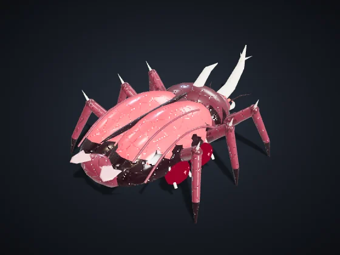 | **Scarab** (key E) — Vehicles · Era II · Built at: Vehicle Factory Cost: 70 Ore + 60 Plasma · Health 300 · Speed 120 · Sight 190 Attack 30 every 0.9 s, range 30 *Armored beast of burden: a fast charge that tramples infantry.* |
| 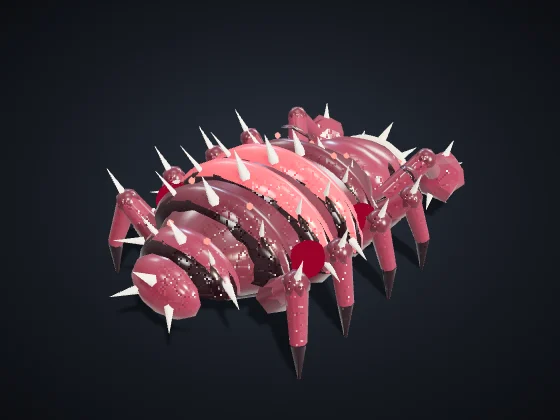 | **Brute** (key B) — Vehicles · Era III · Built at: Vehicle Factory Cost: 160 Ore + 130 Plasma · Health 1,000 · Speed 52 · Sight 170 Attack 55 every 1.7 s, range 120, splash 26 *Biological tank: thick carapace and an area strike.* |
| 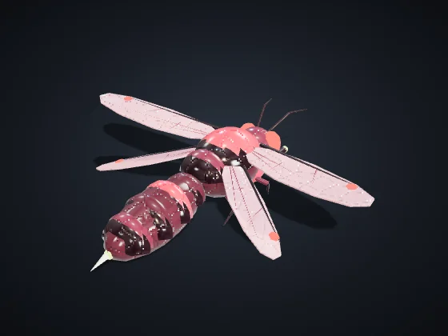 | **Aerial Drone** (key D) — Drones · Era II · Built at: Drone Hangar Cost: 120 Ore + 50 Plasma · Health 160 · Speed 150 · Sight 220 Attack 18 every 0.9 s, range 120 *Strong vs Vehicles and Support. Weak vs Infantry and Structures. Flies over the Rift.* |
| 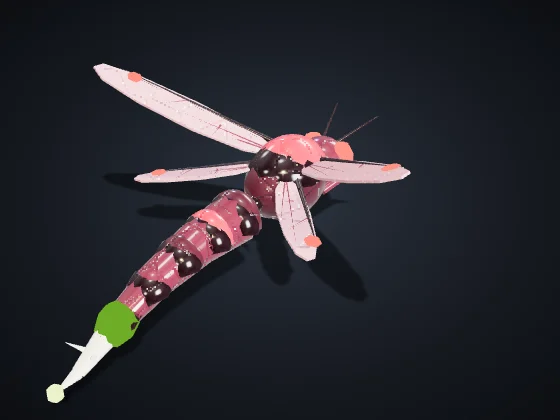 | **Stinger** (key F) — Drones · Era II · Built at: Drone Hangar Cost: 30 Ore + 50 Plasma · Health 80 · Speed 170 · Sight 210 Attack 7 every 0.45 s, range 85 *Cheap flyer with a stinger; in swarms, it stings vehicles and support.* |

## Buildings

| | |
|:-:|:--|
| 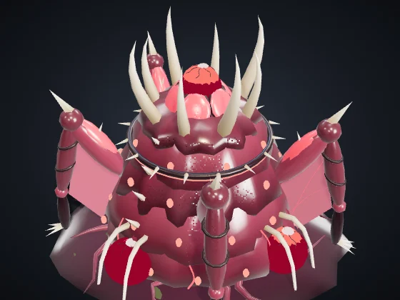 | **Dominion Core** — Era I Cost: — · Health 8,000 · Energy +60 · Sight 420 Produces: Sower *The heart of the colony. Produces harvesters. If it falls, you are eliminated.* |
| 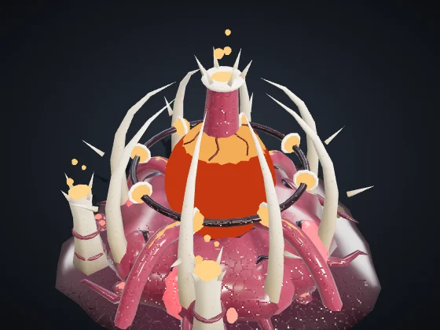 | **Reactor** (B + R) — Era I Cost: 120 Ore · Health 700 · Energy +35 · Sight 120 *+35 energy by burning 0.3 Plasma/s. Vehnar: gives off Smoke visible to everyone.* Module **Fusion Chamber** (Era II, 120 Ore + 40 Plasma): +60% energy from this Reactor, without burning more Plasma. |
| 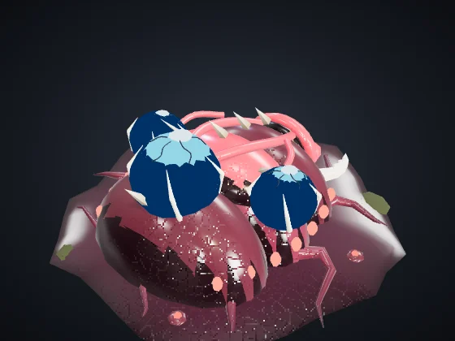 | **Refinery** (B + F) — Era I Cost: 150 Ore · Health 1,000 · Energy −6 · Sight 140 *Drop-off point near the nodes. A Siphon target.* Modules with a choice (Era II, 150 Ore + 50 Plasma): **Ore Press** — +0.5 Ore per second. · **Armored Vault** — +60% health and regenerates 4 health/s. |
| 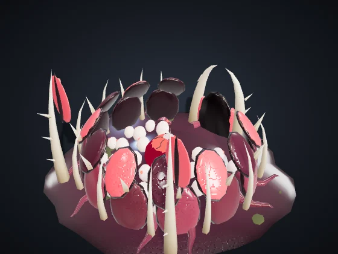 | **Orbital Barracks** (B + Q) — Era I Cost: 200 Ore · Health 1,150 · Energy −8 · Sight 140 Produces: Orbital Infantry, Support / Hack, Scavenger, Broodling, Spitter *Produces Infantry, Support/Hack and Pirates.* Module **Academy** (Era II, 160 Ore + 60 Plasma + 30 Data): Infantry from this Barracks comes out Veteran (★): +10% damage and −7% damage taken. |
| 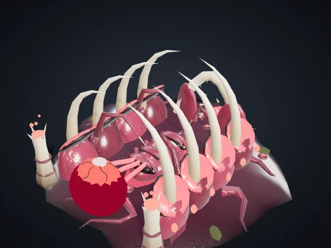 | **Vehicle Factory** (B + V) — Era II Cost: 300 Ore + 60 Plasma · Health 1,300 · Energy −12 · Sight 140 Produces: Heavy Vehicle, Scarab, Brute *Produces Heavy Vehicles.* Modules with a choice (Era II, 150 Ore + 50 Plasma): **Fast Line** — 20% faster production in this Factory. · **Reinforced Chassis** — Vehicles from here come out with +15% health. |
| 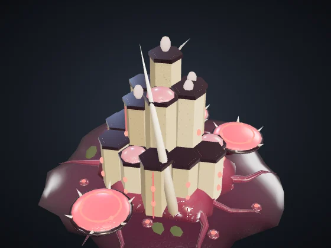 | **Drone Hangar** (B + H) — Era II Cost: 280 Ore + 60 Plasma · Health 1,150 · Energy −12 · Sight 160 Produces: Aerial Drone, Stinger *Produces Aerial Drones.* Modules with a choice (Era II, 150 Ore + 50 Plasma): **Afterburner** — Drones from here come out 12% faster. · **Repair Dock** — Repairs your flying units within 160 (5 health/s). |
| 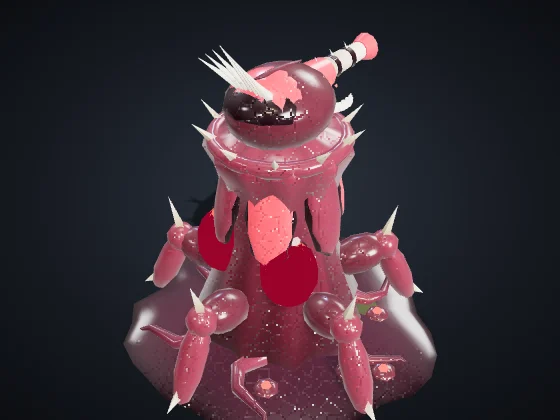 | **Defense Tower** (B + T) — Era I Cost: 180 Ore + 40 Plasma · Health 1,100 · Energy −10 · Sight 260 Attack 30 every 1 s, range 230, splash 16 *Strong vs Infantry and Drones. Detects cloaked units within 140.* Module **Heavy Battery** (Era III, 150 Ore + 60 Plasma): +40% health and +30% damage for this Tower. |
| 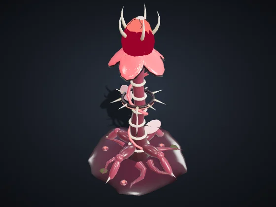 | **Forward Outpost** (B + N) — Era I Cost: 120 Ore + 20 Plasma · Health 650 · Energy −4 · Sight 260 *Claims territory within 320 and frees nodes for automatic harvesting. Can be placed up to 650 from any of your structures.* Modules with a choice (Era II, 150 Ore + 50 Plasma): **Forward Post** — +50% health and regenerates 3 health/s. · **Pulse Mine** — A 45-damage area pulse on enemies within 90, every 6 s. |
| 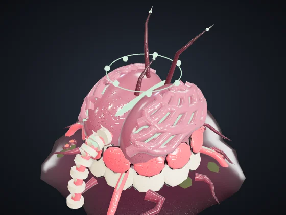 | **Laboratory** (B + L) — Era II Cost: 220 Ore + 60 Plasma + 40 Data · Health 900 · Energy −10 · Sight 140 *Research and the superweapon, paid with Data Shards.* Modules with a choice (Era II, 150 Ore + 50 Plasma): **Data Antenna** — +0.3 Data per second. · **Counterintelligence** — Detects cloaked enemy units within 260, like a Tower. |
| 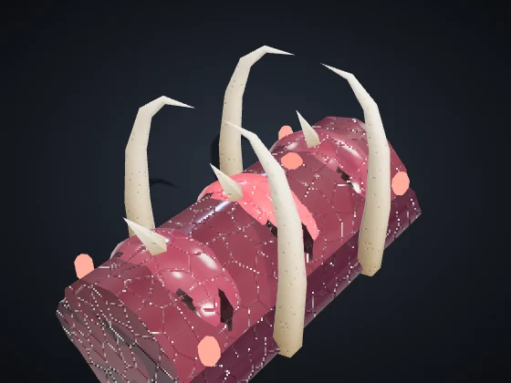 | **Wall** (B + M) — Era I Cost: 20 Ore · Health 450 · Sight 50 *Cheap barrier. Drag to draw a line. Blocks units and absorbs fire.* |
| 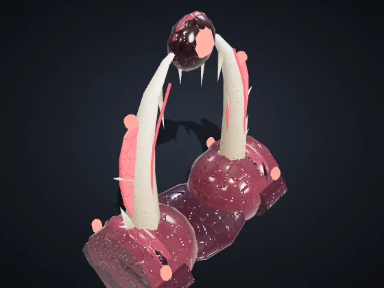 | **Gate** (B + G) — Era I Cost: 40 Ore · Health 600 · Sight 60 *A stretch of wall your units can pass through. Enemies have to knock it down.* |

## Unique buildings

Each Race has two, and each player can raise at most one of each (shortcuts B + J and B + K).

| | |
|:-:|:--|
| 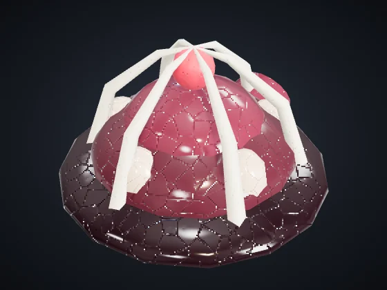 | **Incubation Chamber** (B + J) — Era II Cost: 200 Ore + 60 Plasma · Health 1,000 · Energy −6 · Sight 150 Produces: Broodling, Spitter *Hatches Broodlings and Spitters 25% faster than the Barracks.* |
| 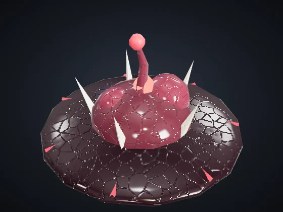 | **Territory Tumor** (B + K) — Era I Cost: 140 Ore + 30 Plasma · Health 700 · Energy −2 · Sight 220 *Claims territory within 240 and slows enemies inside it by 30%.* |

---

Values on Normal, with no research or veterancy. Health and damage are game points; distance and speed are map units (the map is 3200 across). Generated by `node tools/docs-gerar.cjs` from the game code (numbers from the simulation, texts from the dictionaries). Images: `tools/galeria.cjs`, with the game's own models.
