<!-- Gerado por node tools/docs-gerar.cjs a partir do código do jogo (números da simulação e textos dos dicionários). Imagens: tools/galeria.cjs, com os modelos do próprio jogo. -->
# Prole Vorag

**Idiomas:** [English](vorag.md) · **Português (Brasil)** · [Español](vorag.es.md) · [Todas as Raças](README.pt-BR.md) · [Voltar ao README](../../README.pt-BR.md)

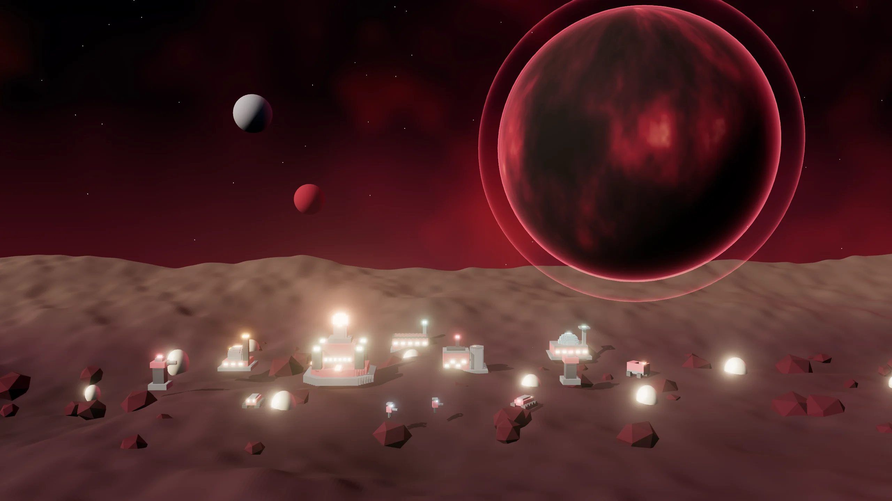

> Enxame biológico voraz. Barato, rápido e sempre com fome: Crias eclodem em pares e o Carniceiro devora carcaças e Nódulos.

## O líder e a história

**Líder:** Oru Voraz  
**Mundo natal:** Velk (ninhos sob a crosta) · Enxame voraz  
**Estilo de jogo:** Enxame barato · Crias em pares · Fome fora de casa · Devora carcaças

*“Oru Voraz. A fome de Velk não tem fim.”*

 

## Habilidades da Raça

- **Crias em pares:** cada Cria produzida sai em dupla (em trio com a Ascensão).
- **Fome:** fora do seu território, as Crias perdem 0,6 de vida por segundo, até ficar com 40% da vida.
- **Devorar:** o Carniceiro come carcaças (40 de carga) e morde Nódulos inimigos (30 de dano por mordida).
- **Saltos de Núcleo:** 1 por partida.

## Superarma: Eclosão

Ovos irrompem num ponto visível e liberam 8 Crias por 30 s. Custa 300 Dados + 200 Plasma.

## Ascensão da Raça: Fome Sem Fim

Crias eclodem em trios e unidades se regeneram fora de combate (3 de vida/s). Custo: 300 Minério + 200 Plasma + 150 Dados.

## Comandante em campo: Devorador

Opção da partida (Comandantes em campo): o líder entra no mapa com um avatar e três habilidades.

| | |
|:-:|:--|
| 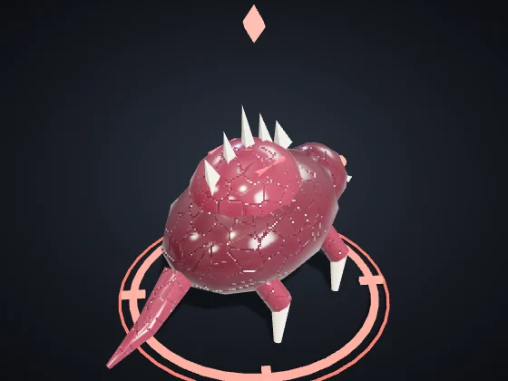 | **Devorador** — Veículos · Líder: Oru Voraz Vida 1.100 · Velocidade 98 · Visão 220 Ataque 40 a cada 0,9 s, alcance 34 *Avatar de Oru Voraz: a fera que devora e chama a ninhada.* |

| Habilidade | Alvo | Recarga | Efeito |
|:--|:--|:-:|:--|
| **Devorar** | um inimigo (alcance 70) | 20 s | Engole um inimigo fraco (até 220 de vida) e se cura; nos fortes, 220 de dano. |
| **Ninhada** | em volta do avatar | 40 s | Quatro Crias eclodem em volta por 25 s. |
| **Rugido** | em volta do avatar | 30 s | Inimigos em volta 40% mais lentos por 4 s; aliados +15% de dano por 6 s. |

O nível sobe com a veterania do avatar: a cada nível, +15% de dano e cura, −5% de recarga e +10% de vida. Quando cai, volta no Núcleo depois de 40 s + 10 s por nível, com o nível que tinha.

## Unidades

| | |
|:-:|:--|
| 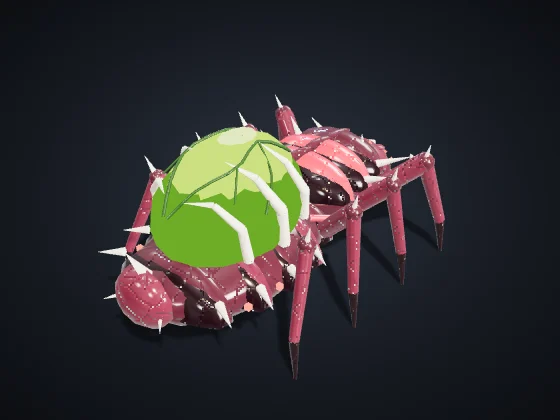 | **Semeador** (tecla C) — Civil · Era I · Produzida em: Núcleo de Domínio Custo: 60 Minério · Vida 90 · Velocidade 85 · Visão 110 · Carga 50 *Coleta automaticamente nós no seu território e entrega na Refinaria ou Núcleo mais próximo.* |
| 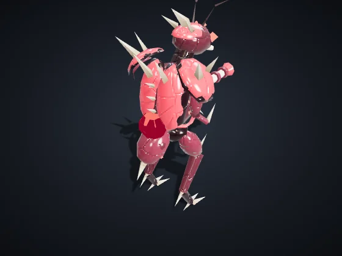 | **Infantaria Orbital** (tecla I) — Infantaria · Era I · Produzida em: Quartel Orbital Custo: 50 Minério · Vida 120 · Velocidade 90 · Visão 160 Ataque 12 a cada 0,8 s, alcance 110 *Forte vs Drones e Suporte. Fraca vs Veículos e Estruturas.* |
| 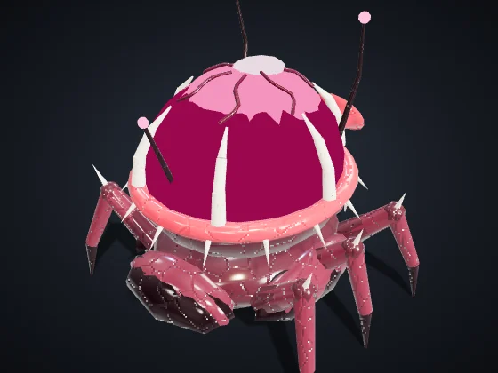 | **Suporte / Hack** (tecla S) — Suporte/Hack · Era II · Produzida em: Quartel Orbital Custo: 90 Minério + 20 Dados · Vida 100 · Velocidade 80 · Visão 200 Ataque 10 a cada 1,5 s, alcance 170 *Forte vs Veículos e Estruturas, e os atrasa. Fraco vs Infantaria e Drones.* |
| 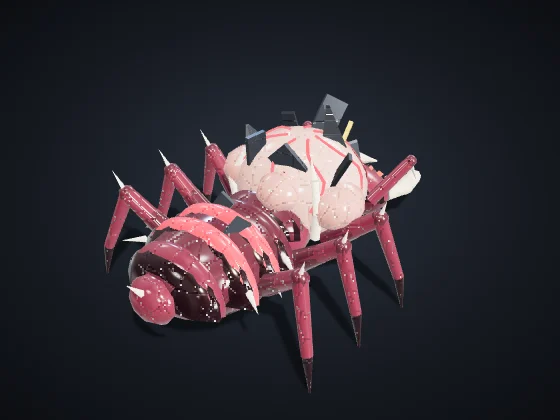 | **Carniceiro** (tecla P) — Suporte/Hack · Era I · Produzida em: Quartel Orbital Custo: 120 Minério + 30 Plasma · Vida 200 · Velocidade 95 · Visão 180 · Carga 300 *Sifona Refinarias e Reatores inimigos por até 40 s. Erevane: camuflado e +20% no roubo. Vehnar: Rebocador, lento e resistente, carrega 2x.* |
| 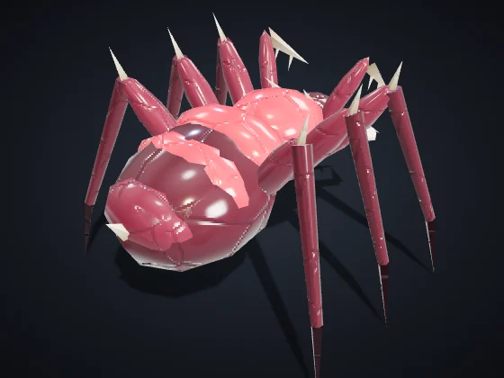 | **Cria** (tecla K) — Infantaria · Era I · Produzida em: Quartel Orbital Custo: 26 Minério + 14 Plasma · Vida 72 · Velocidade 122 · Visão 150 Ataque 10 a cada 0,5 s, alcance 26 *Enxame corpo a corpo; eclode em pares. Fome: fora do seu território perde vida devagar (até 40%).* |
| 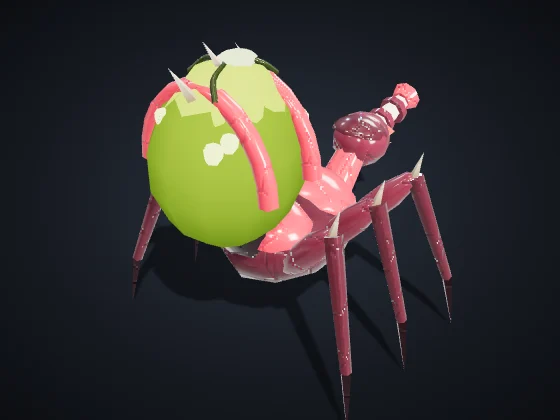 | **Cuspidor** (tecla U) — Infantaria · Era I · Produzida em: Quartel Orbital Custo: 55 Minério + 35 Plasma · Vida 95 · Velocidade 90 · Visão 170 Ataque 16 a cada 1,1 s, alcance 130, área 14 *Cospe ácido a média distância; corrói veículos e estruturas.* |
| 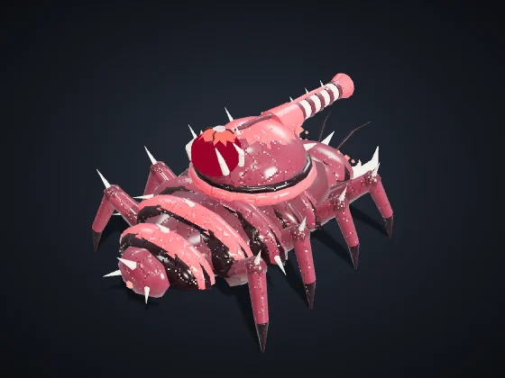 | **Veículo Pesado** (tecla V) — Veículos · Era II · Produzida em: Fábrica de Veículos Custo: 160 Minério + 40 Plasma · Vida 420 · Velocidade 65 · Visão 170 Ataque 40 a cada 1,4 s, alcance 150, área 24 *Forte vs Infantaria e Estruturas. Fraco vs Drones e Suporte.* |
| 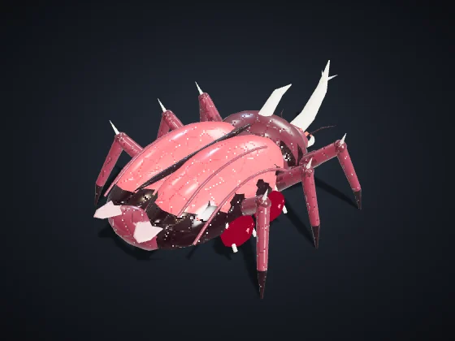 | **Escaravelho** (tecla E) — Veículos · Era II · Produzida em: Fábrica de Veículos Custo: 70 Minério + 60 Plasma · Vida 300 · Velocidade 120 · Visão 190 Ataque 30 a cada 0,9 s, alcance 30 *Besta de carga blindada: investida rápida que atropela infantaria.* |
| 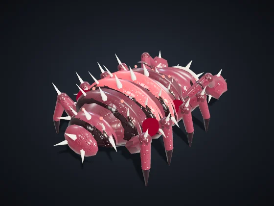 | **Brutamonte** (tecla B) — Veículos · Era III · Produzida em: Fábrica de Veículos Custo: 160 Minério + 130 Plasma · Vida 1.000 · Velocidade 52 · Visão 170 Ataque 55 a cada 1,7 s, alcance 120, área 26 *Tanque biológico: carapaça grossa e golpe de área.* |
| 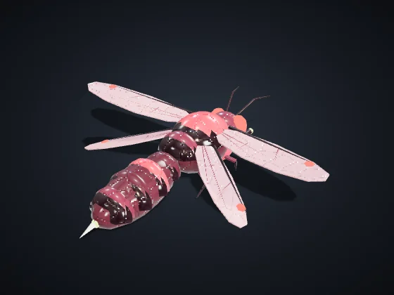 | **Drone Aéreo** (tecla D) — Drones · Era II · Produzida em: Hangar de Drones Custo: 120 Minério + 50 Plasma · Vida 160 · Velocidade 150 · Visão 220 Ataque 18 a cada 0,9 s, alcance 120 *Forte vs Veículos e Suporte. Fraco vs Infantaria e Estruturas. Sobrevoa a Fenda.* |
| 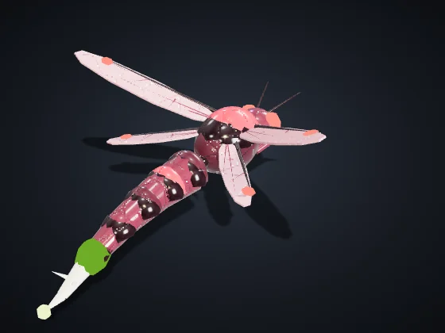 | **Ferroada** (tecla F) — Drones · Era II · Produzida em: Hangar de Drones Custo: 30 Minério + 50 Plasma · Vida 80 · Velocidade 170 · Visão 210 Ataque 7 a cada 0,45 s, alcance 85 *Voadora barata com ferrão; em enxame, pica veículos e suporte.* |

## Construções

| | |
|:-:|:--|
| 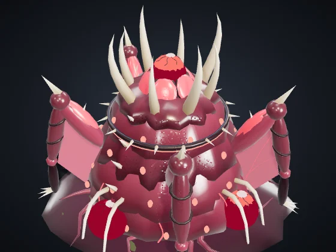 | **Núcleo de Domínio** — Era I Custo: — · Vida 8.000 · Energia +60 · Visão 420 Produz: Semeador *Centro da colônia. Produz coletores. Se cair, você é eliminado.* |
| 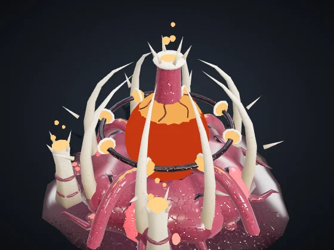 | **Reator** (B + R) — Era I Custo: 120 Minério · Vida 700 · Energia +35 · Visão 120 *+35 de energia queimando 0,3 Plasma/s. Vehnar: emite Fumaça visível a todos.* Módulo **Câmara de Fusão** (Era II, 120 Minério + 40 Plasma): +60% de energia neste Reator, sem queimar mais Plasma. |
| 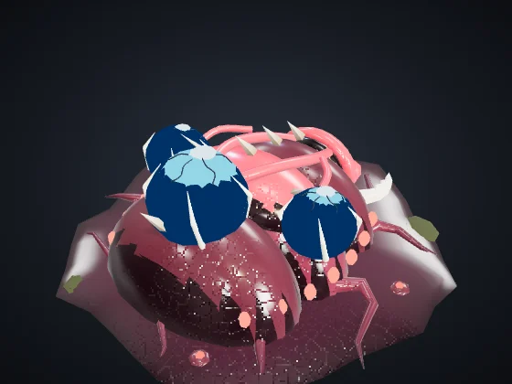 | **Refinaria** (B + F) — Era I Custo: 150 Minério · Vida 1.000 · Energia −6 · Visão 140 *Ponto de entrega perto dos nós. Alvo de Sifão.* Módulos com escolha (Era II, 150 Minério + 50 Plasma): **Prensa de Minério** — +0,5 Minério por segundo. · **Cofre Blindado** — +60% de vida e regenera 4 de vida/s. |
| 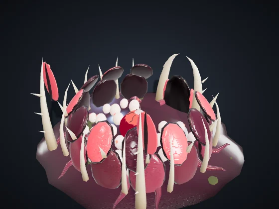 | **Quartel Orbital** (B + Q) — Era I Custo: 200 Minério · Vida 1.150 · Energia −8 · Visão 140 Produz: Infantaria Orbital, Suporte / Hack, Carniceiro, Cria, Cuspidor *Produz Infantaria, Suporte/Hack e Piratas.* Módulo **Academia** (Era II, 160 Minério + 60 Plasma + 30 Dados): A infantaria deste Quartel já sai Veterana (★): +10% de dano e −7% de dano recebido. |
| 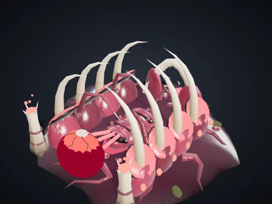 | **Fábrica de Veículos** (B + V) — Era II Custo: 300 Minério + 60 Plasma · Vida 1.300 · Energia −12 · Visão 140 Produz: Veículo Pesado, Escaravelho, Brutamonte *Produz Veículos Pesados.* Módulos com escolha (Era II, 150 Minério + 50 Plasma): **Linha Rápida** — Produção 20% mais rápida nesta Fábrica. · **Chassi Reforçado** — Os veículos daqui saem com +15% de vida. |
| 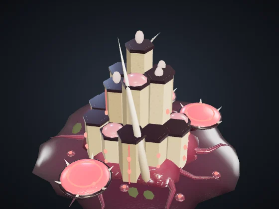 | **Hangar de Drones** (B + H) — Era II Custo: 280 Minério + 60 Plasma · Vida 1.150 · Energia −12 · Visão 160 Produz: Drone Aéreo, Ferroada *Produz Drones Aéreos.* Módulos com escolha (Era II, 150 Minério + 50 Plasma): **Pós-combustão** — Os drones daqui saem 12% mais rápidos. · **Doca de Reparo** — Repara as suas unidades voadoras a até 160 (5 de vida/s). |
| 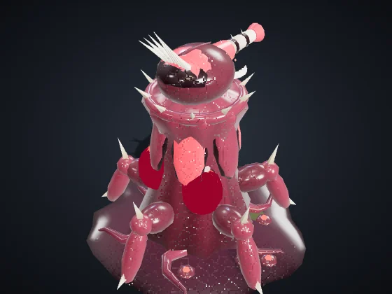 | **Torre de Defesa** (B + T) — Era I Custo: 180 Minério + 40 Plasma · Vida 1.100 · Energia −10 · Visão 260 Ataque 30 a cada 1 s, alcance 230, área 16 *Forte vs Infantaria e Drones. Detecta camuflagem em 140.* Módulo **Bateria Pesada** (Era III, 150 Minério + 60 Plasma): +40% de vida e +30% de dano nesta Torre. |
| 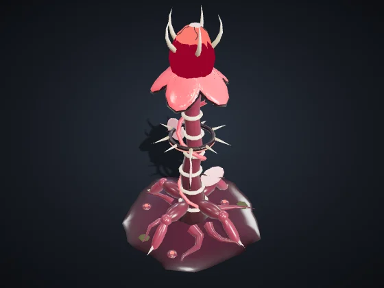 | **Nódulo de Avanço** (B + N) — Era I Custo: 120 Minério + 20 Plasma · Vida 650 · Energia −4 · Visão 260 *Reclama território em 320 e libera nós para coleta automática. Pode ser colocado até 650 de qualquer estrutura sua.* Módulos com escolha (Era II, 150 Minério + 50 Plasma): **Posto Avançado** — +50% de vida e regenera 3 de vida/s. · **Mina de Pulso** — Pulso de 45 de dano em área nos inimigos a até 90, a cada 6 s. |
| 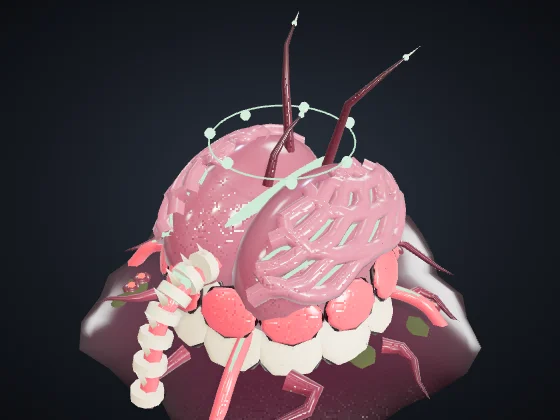 | **Laboratório** (B + L) — Era II Custo: 220 Minério + 60 Plasma + 40 Dados · Vida 900 · Energia −10 · Visão 140 *Pesquisas e superarma, pagas com Fragmentos de Dados.* Módulos com escolha (Era II, 150 Minério + 50 Plasma): **Antena de Dados** — +0,3 Dados por segundo. · **Contraespionagem** — Detecta as unidades camufladas inimigas a até 260, como uma Torre. |
| 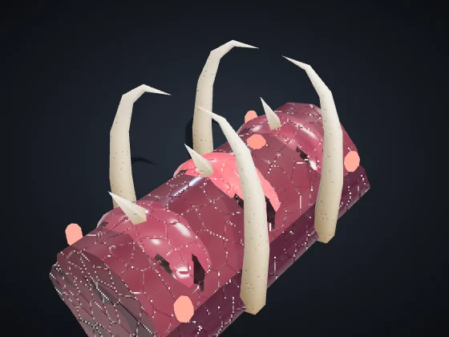 | **Muro** (B + M) — Era I Custo: 20 Minério · Vida 450 · Visão 50 *Barreira barata. Arraste para desenhar uma linha. Bloqueia unidades e absorve tiros.* |
| 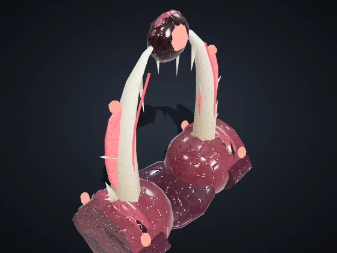 | **Portão** (B + G) — Era I Custo: 40 Minério · Vida 600 · Visão 60 *Trecho de muro que suas unidades atravessam. Inimigos precisam derrubá-lo.* |

## Construções únicas

Cada Raça tem duas, e cada jogador ergue no máximo uma de cada (atalhos B + J e B + K).

| | |
|:-:|:--|
| 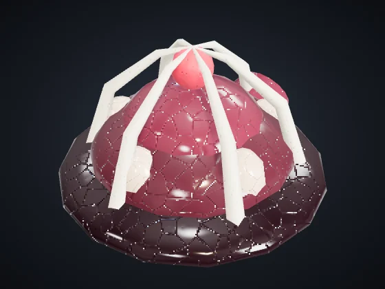 | **Câmara de Incubação** (B + J) — Era II Custo: 200 Minério + 60 Plasma · Vida 1.000 · Energia −6 · Visão 150 Produz: Cria, Cuspidor *Choca Crias e Cuspidores 25% mais rápido que o Quartel.* |
| 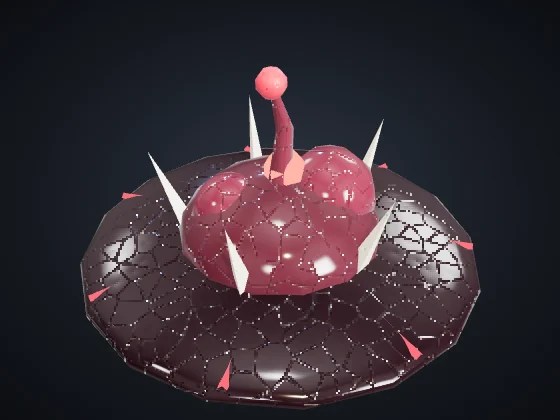 | **Tumor de Território** (B + K) — Era I Custo: 140 Minério + 30 Plasma · Vida 700 · Energia −2 · Visão 220 *Reclama território em 240 e desacelera em 30% os inimigos dentro dele.* |

---

Valores na dificuldade Normal, sem pesquisas nem veterania. Vida e dano das unidades: pontos do jogo; distância e velocidade: unidades do mapa (o mapa tem 3200 de lado). Gerado por `node tools/docs-gerar.cjs` a partir do código do jogo (números da simulação e textos dos dicionários). Imagens: `tools/galeria.cjs`, com os modelos do próprio jogo.
